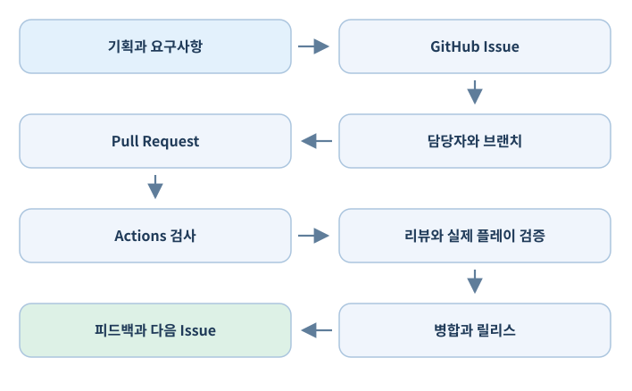
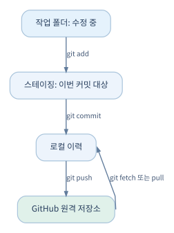
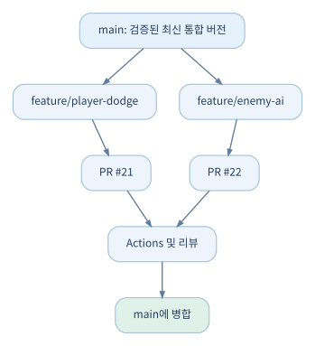
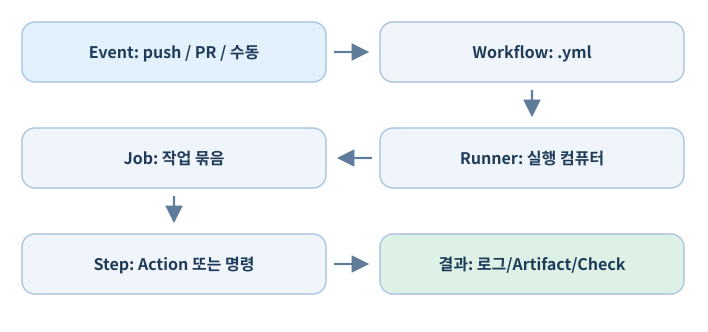

# Unity 개발자를 위한 GitHub 실무 교과서 — 통합 Markdown판

> MkDocs 원고 12개 기본 장·3개 보강 장과 부록을 하나의 파일로 모은 읽기·인쇄용 파일.


---

# Unity 개발자를 위한 GitHub 실무 교과서

> GitHub를 파일 업로드 공간으로만 쓰지 않고, **Unity 게임의 요구사항·설계·구현·협업·품질 검증·빌드·출시**를 연결하는 도구로 활용하기 위한 실무 교재.

이 책은 Git, GitHub Desktop, GitHub의 웹 기능, Unity Editor를 명확히 구분하는 데서 시작한다. 개념의 뜻뿐 아니라 **어디를 눌러 무엇을 작성하고, 어떤 명령을 실행하고, 무엇으로 성공을 판정하는지**를 설명한다. 목표 독자는 GitHub가 낯설지만 Unity로 게임을 만들고 소규모 팀 개발에 적용하려는 개발자다.

## 책의 관점과 범위

- **도구는 목적이 아니다.** 목적은 게임 개발에서 요구사항을 잃지 않고, 변경을 추적하고, 팀원이 각자 해야 할 일을 알며, 결과물을 검증하는 소프트웨어공학 활동을 지속하는 것이다.
- **Unity 프로젝트를 기준으로 한다.** `.meta`, GUID, 씬·프리팹, 대용량 에셋, 패키지, 빌드 라이선스 같은 게임 엔진 고유 문제를 별도로 다룬다.
- **소규모 팀에 맞춘다.** 팀장은 계획·일정·결정을 관리하고, 팀원은 자신에게 배정된 Issue를 중심으로 작업하며, 자동화는 반복적인 검증을 지원한다. 팀장에게 모든 결정을 몰아넣는 것은 지양한다.
- **GitHub 기능과 별도 설치 도구를 구분한다.** Projects·Issues·Actions는 GitHub에서 제공하는 실제 웹 기능이다. Git·GitHub Desktop·Git LFS·Unity는 설치하거나 로컬 환경에서 사용하는 도구이다.
- **완벽한 자동화는 전제하지 않는다.** 코드가 빌드된다고 게임이 재미있다는 뜻은 아니다. 플레이 경험과 시청각 완성도는 사람의 평가가 필요하다.

## 용어 한눈에 보기

| 이름 | 분류 | 하는 일 | 설치 여부 |
|---|---|---|---|
| Git | 버전 관리 프로그램 | 로컬 변경 이력과 브랜치 관리 | 필요 |
| GitHub | 웹 기반 협업 서비스 | 원격 Git 저장소·작업·자동화 제공 | 웹 이용 |
| GitHub Desktop | 데스크톱 GUI 프로그램 | Commit, Push, Pull 등 Git 작업 | 선택 설치 |
| Git LFS | Git 확장 프로그램 | 대용량 에셋 별도 저장 및 참조 | 필요할 때 설치 |
| GitHub Repository | GitHub 내 저장소 | 코드·문서와 변경 이력 보관 | 웹 기능 |
| GitHub Issues | GitHub 내 기능 | 작업·버그·요구사항 기록 | 웹 기능 |
| GitHub Projects | GitHub 내 기능 | 이슈·PR을 표·보드·로드맵으로 관리 | 웹 기능 |
| GitHub Actions | GitHub 내 기능 | 테스트·빌드·배포 자동화 정의·실행 | 웹 기능 |
| Unity Editor | 설치형 게임 개발 도구 | 게임과 에셋 제작 | 필요 |

## 예시 프로젝트

책 전체에서 `Aster Arena`라는 가상의 3D 싱글플레이 액션 게임을 사용한다. 개발팀은 3명이며 플레이어 이동·회피·공격, 적 AI, 간단한 전투 장면을 포함한다. 예시 저장소 경로는 `OWNER/aster-arena`로 적는다. **OWNER, URL, 토큰, Unity 에디터 경로 등은 독자가 자기 환경에 맞게 바꿔야 한다.**

작업의 기본 흐름은 다음과 같다.



!!! warning "이 책에 포함된 예시와 실제 제품 기능"
    GitHub 설정·요금·권한 정책, Unity의 설치 위치·라이선스와 패키지 버전은 바뀔 수 있다. 예시 명령어는 읽고 실습할 수 있도록 작성했지만 사용자 환경에서 실시간 실행 검증한 것은 아니다. 확정적인 제품 정책이나 제한 수치는 해당 장의 공식 문서에서 최신 상태를 재확인한다. 이 책의 정보 검토 기준일은 **2026년 10월 16일**이다.

## 이 책의 구성

- **A. Git과 GitHub 기초:** 로컬 이력·원격 저장소·보안·복구
- **B. Unity 프로젝트 관리:** 폴더·`.meta`·Git LFS·병합·UVCS 비교
- **C. 팀 협업:** Branch·PR·리뷰·저장소 규칙
- **D. 개발 작업 관리:** Issues·Projects·템플릿·마일스톤·진행 현황
- **E. 자동화:** Actions·Unity 테스트·자동 빌드·릴리스
- **F. 운영과 확장:** 문서·보안·GitHub API·Discord·AI 규칙

본문은 각 장에서 **개념 → 판단 기준 → 절차 → Unity 실습 → 흔한 실패 → 확인할 결과** 순서로 정리했다. 필요한 장을 바로 찾아 읽어도 되며, 처음 접한다면 앞 장의 선행 개념을 이해하고 넘어가면 된다.


## 확장판 추가 학습 안내 (2026-10-24)

기본 12장은 그대로 유지하면서 기존 설명 뒤에 실전 확장 절을 추가했다. 특히 GitHub 알림 관리, 논의와 공식 작업의 구분, 프로젝트 전체 상태 보고, 코드 검색과 의존성·보안 검사는 다음 장에서 별도로 설명한다.

- [07-A Notifications: 작업을 놓치지 않는 알림 체계](docs/part-d/07a-notifications.md)
- [07-B Discussions와 프로젝트 상태 업데이트](docs/part-d/07b-discussions-status.md)
- [11-A Code Search·Blame·Dependabot·보안 검사](docs/part-f/11a-code-search-security.md)

복사 가능한 실습 파일은 프로젝트 최상위의 `examples/` 폴더에 있다. 원고를 읽는 데 예제 설치가 필요하지 않으며, 실습할 때만 본인의 Unity 또는 GitHub 테스트 저장소에 복사한다.

기존 장을 익힌 다음에는 [Unity × GitHub 종합 실습](docs/appendix/integrated-lab.md)으로 작업의 연결 흐름을 검증할 수 있다.


---

# 01. Git의 기본 원리

## 1.1 Git은 무엇을 관리하는가?

Git은 파일의 변화를 **커밋(commit)**이라는 단위로 기록하는 분산 버전 관리 프로그램이다. GitHub 계정이 없어도 로컬에서 Git을 쓸 수 있다. 반대로 GitHub 웹 페이지에 저장소가 있다는 사실만으로 로컬 컴퓨터가 자동으로 동기화되지는 않는다. `git push`나 Desktop의 **Push origin**처럼 변경을 보내는 동작이 필요하다.

UVCS에서 체크인한 경험이 있다면 ‘변경 집합을 기록한다’는 감각은 비슷하다. 다만 Git은 **로컬 저장소에 먼저 커밋**하고, 그 이력을 원격 저장소로 `push`하는 작업이 분리된다.



- **Working Directory**: 지금 편집하는 파일이 있는 작업 폴더. Unity Editor가 `Assets`를 수정하는 영역이다.
- **Staging Area/Index**: 다음 커밋에 포함할 변경을 선택해 놓는 영역. `git add`는 업로드가 아니라 이 준비 작업이다.
- **Local Repository**: `.git` 폴더에 기록된 커밋 이력. 인터넷 없이도 커밋 가능하다.
- **Remote Repository**: GitHub 같은 서버에 놓인 저장소. `origin`은 보통 기본 원격 저장소의 별칭이다.
- **Commit**: 특정 시점의 파일 상태와 부모 커밋, 작성자 등의 정보를 갖는 불변에 가까운 이력 객체.
- **HEAD**: 현재 체크아웃해 작업하는 커밋·브랜치를 가리키는 참조.

!!! note "커밋은 백업과 같지 않다"
    로컬 커밋만 있으면 디스크 손실 시 함께 사라질 수 있다. 원격 푸시와 저장소 별도 백업을 조합해야 한다. `git push`만으로도 모든 종류의 손실·삭제를 예방하는 것은 아니다.

## 1.2 시작 준비와 사용자 설정

Windows에서 [Git 공식 배포](https://git-scm.com/downloads)를 설치하고 PowerShell, Git Bash 또는 VS Code 터미널을 열어 확인한다.

```bash
git --version
git config --global user.name "Your Display Name"
git config --global user.email "you@example.com"
git config --global --list
```

`user.name`과 `user.email`은 커밋 작성자 정보다. GitHub 웹 인증과 다르다. 이메일 공개가 부담되면 GitHub의 `noreply` 주소를 사용할 수 있다. 팀 전체에서 개별 사용자 계정을 사용하는 것이 추적성 면에서 좋다.

### 처음 실습: 작은 C# 파일 이력 만들기

```bash
mkdir git-practice
cd git-practice
git init
echo "public class Health {}" > Health.cs
git status
git add Health.cs
git commit -m "Add health component skeleton"
git log --oneline --decorate -5
```

Git 기본 브랜치 이름은 환경 설정에 따라 다를 수 있다. 통일이 필요하면 `git branch -M main`으로 이름을 바꾼다. `git status`는 작업 전후에 자주 보는 습관을 들이자.

## 1.3 핵심 명령과 정확한 의미

| 명령 | 의미 | Unity 예 |
|---|---|---|
| `git status` | 수정·추가·충돌·스테이징 확인 | `.meta` 누락 검사 |
| `git diff` | 아직 스테이징하지 않은 변경 비교 | C# 코드 수정 검토 |
| `git diff --staged` | 커밋 예정 변경 비교 | 예상치 못한 씬 포함 여부 검사 |
| `git add Assets/Scripts/Player.cs` | 특정 경로를 스테이징 | 기능과 무관한 장면 수정 제외 |
| `git commit -m "..."` | 로컬 변경 집합 기록 | 구현 단위 이력 생성 |
| `git log --oneline --graph --all` | 이력 확인 | 브랜치가 어디서 갈라졌는지 이해 |
| `git clone URL` | 원격 저장소 복제 | 새 팀원 초기 설정 |
| `git fetch origin` | 원격 이력만 가져옴 | 병합 전 변경 확인 |
| `git pull` | 가져온 내용을 현재 작업에 통합 | 다른 팀원의 최신 코드 반영 |
| `git push -u origin main` | 로컬 브랜치를 원격에 게시 | 첫 업로드 |
| `git switch -c feature/dodge` | 새 브랜치 생성·전환 | 회피 기능 분리 |
| `git merge feature/dodge` | 다른 브랜치 이력을 통합 | 기능 통합 |

`fetch`는 비교적 안전한 조회 중심 작업이며, `pull`은 통합까지 수행한다. 로컬에 커밋되지 않은 수정이 있을 때는 먼저 `status`를 확인하고, 의도적으로 커밋하거나 임시 보관한 뒤 가져오자.

## 1.4 브랜치와 병합의 사고방식

브랜치는 무거운 복제 폴더가 아니라 특정 커밋을 가리키는 가벼운 포인터다. `main`에서 기능 브랜치를 만들면 두 브랜치가 같은 출발점을 공유하다 각자 커밋이 생기면서 갈라진다.

```bash
git switch main
git switch -c feature/player-dodge
# PlayerDodge.cs를 수정한 뒤
git add Assets/Scripts/PlayerDodge.cs
git commit -m "Implement dodge state transitions"
git switch main
git merge feature/player-dodge
```

실제 팀 작업에서는 `main`에 직접 `merge`하기보다는 GitHub Pull Request를 통해 리뷰한 후 병합하는 방식을 권장한다(05장).

### 충돌이 발생하면

두 브랜치에서 같은 텍스트의 동일한 부분을 바꾸면 Git이 자동으로 선택하지 못할 수 있다. `git status`로 충돌 파일을 확인한 뒤, 텍스트의 `<<<<<<<`, `=======`, `>>>>>>>` 표시를 읽고 의도한 최종 내용으로 정리한 다음 `git add`하여 병합을 완료한다. **Unity 씬·프리팹 파일은 텍스트처럼 보이더라도 구조화된 직렬화 데이터이므로 표시만 지우는 식의 해결은 위험하다.** 04장에서 별도로 다룬다.

## 1.5 실수 복구: 파일·커밋·브랜치

| 상황 | 우선 사용할 방법 | 주의 |
|---|---|---|
| 파일 수정만 취소 | `git restore -- 파일경로` | 저장되지 않은 수정이 사라짐 |
| 스테이징만 취소 | `git restore --staged -- 파일경로` | 작업 파일 내용은 유지 |
| 안전한 되돌림 이력 | `git revert 커밋해시` | 이전 변경을 취소하는 새 커밋 생성 |
| 임시 작업 보관 | `git stash push -u -m "메시지"` | 적용 후 충돌 발생 가능 |
| 임시 작업 복원 | `git stash list`, `git stash pop` | `pop`은 성공 시 stash 제거 |
| 과거 이력 탐색 | `git reflog` | 로컬 기록의 보존에는 기간 제한 존재 |

`git reset --hard`, `git clean -fd`, `push --force`는 데이터 손실이나 팀원의 이력 훼손을 일으킬 수 있다. 단순히 '되돌리기'라는 설명만 보고 실행하지 말고, **어느 영역(작업 폴더·스테이징·커밋·원격)이 바뀌는지** 이해한 뒤 사용하자. 공유된 `main`의 잘못된 변경은 대체로 `revert`가 낫다.

## 1.6 GitHub Desktop과 터미널을 병행하는 법

GitHub Desktop의 `Changes → Commit to ... → Push origin`은 각각 변경 선택, 로컬 커밋, 원격 업로드에 해당한다. `Fetch origin`은 원격 이력을 확인하고 `Pull origin`은 변경을 로컬에 가져오는 역할을 한다. Desktop은 입문에 편하지만 세밀한 복구, LFS 조사, CI 관련 작업에는 CLI가 유용하다.

터미널과 Desktop은 같은 `.git` 저장소를 조작하므로 **서로 독립된 변경 이력이 생기는 것이 아니다**. 어느 화면에서 작업하든 현재 브랜치와 미커밋 변경을 확인하자.

## 1.7 작은 실습: 변경과 복구

1. `Health.cs`에 `MaxHealth` 필드를 추가하고 `git diff`를 살펴본다.
2. `git add`와 `git commit`으로 기능 이력을 기록한다.
3. 다른 브랜치에서 값을 바꿔 커밋한다.
4. `main`에서 통합하고 두 이력을 `git log --graph --oneline --all`로 확인한다.
5. 안전한 실습용 파일을 한 번 수정하고 `git restore`로 되돌려 본다.
6. 커밋한 변경을 `git revert`로 되돌려 **새 커밋이 생기는 것**을 확인한다.

**확인할 결과:** 어떤 변경이 로컬에만 있고 어떤 변경이 원격으로 전송되었는지, 실수를 되돌릴 때 데이터가 어디서 사라지는지 설명할 수 있어야 한다.

**공식 자료:** [Git Book](https://git-scm.com/book/en/v2), [Git 참조](https://git-scm.com/docs), [GitHub 시작하기](https://docs.github.com/en/get-started)


---

# 02. GitHub 기본 사용법

## 2.1 GitHub와 저장소의 관계

GitHub는 **Git 저장소를 호스팅**하면서 Issues, Projects, Pull Requests, Actions, Releases, 보안 기능 등 개발 협업 서비스를 제공한다. GitHub에 로그인하는 것은 Git을 설치하는 것과 다르고, GitHub Desktop은 이 서비스를 로컬에서 편하게 다루는 선택형 GUI 앱이다.

저장소 주소 예: `https://github.com/OWNER/aster-arena`. `OWNER`는 개인 계정이나 조직(Organization)이다. 브라우저에서 보이는 `Code`, `Issues`, `Pull requests`, `Actions`, `Projects` 등의 탭은 저장소 설정과 권한에 따라 표시 위치가 달라질 수 있다. 특히 Projects는 개인/조직 소유 프로젝트로 별도 존재하며 여러 저장소의 Issue와 PR을 모을 수 있다.

## 2.2 계정과 인증

GitHub 계정을 만든 후 2단계 인증을 활성화한다. 로컬 Git에서 HTTPS로 원격 저장소에 연결할 때 일반 계정 비밀번호를 직접 사용하는 방식과 GitHub 웹 로그인은 다르다. GitHub Desktop·Git Credential Manager 같은 인증 관리자 또는 SSH Key를 사용할 수 있다.

- **HTTPS**: `https://github.com/OWNER/REPO.git` 주소 사용. 인증 관리자가 토큰을 안전하게 관리할 수 있다.
- **SSH**: `git@github.com:OWNER/REPO.git` 주소 사용. 개인키는 사용자 기기에 보관하고 공개키를 GitHub 계정에 등록한다.
- **PAT(Fine-grained Personal Access Token)**: 특정 저장소/권한/기간을 제한한 토큰. 자동화에 불필요하게 광범위한 권한을 주지 않는다.
- **GitHub App**: 앱이 설치된 조직·저장소 범위에서 API를 접근하도록 하는 인증 모델. 고급 자동화에서 중요하다.

!!! danger "기밀 정보"
    PAT, SSH 개인키, Unity 라이선스 비밀 정보, Discord Webhook URL을 코드·Issue·스크린샷·Actions 로그에 노출하지 않는다. 유출된 비밀은 삭제 커밋만으로 해결되지 않으므로 즉시 폐기·재발급해야 한다.

## 2.3 저장소 생성과 공개 범위

웹사이트 우측 상단 `+ → New repository`에서 이름, 설명, 공개 여부를 선택한다. **Public**은 누구나 소스에 접근할 수 있고, **Private**은 권한 있는 사용자 중심으로 접근이 제한된다. 협업에 필요한 기능과 Pages 게시 가능성은 계정·조직 요금제 및 설정을 확인한다.

새 Unity 프로젝트를 올릴 때 초기화 옵션을 잘 선택해야 한다. 로컬에 이미 커밋이 있다면 GitHub에서 README를 추가한 빈 저장소를 동시에 만들지 않는 편이 첫 푸시 시 불필요한 이력 충돌을 줄인다. 초보자는 GitHub Desktop의 `File → Add local repository` 또는 `Create a repository`, 이어 `Publish repository` 흐름을 쓰면 편리하다.

```bash
# 이미 로컬 Git 저장소가 있는 경우의 예시
git branch -M main
git remote add origin https://github.com/OWNER/aster-arena.git
git remote -v
git push -u origin main
```

이미 `origin`이 연결되어 있다면 `remote add`를 다시 호출하지 않는다. `git remote -v`로 확인하고 필요한 경우 `git remote set-url origin URL`을 사용한다.

## 2.4 개인 Repository와 Organization

개인 저장소는 개인이 소유한다. Organization은 여러 저장소, 팀, 권한을 조직 단위로 관리하기 위한 공간이다. 소규모 팀도 프로젝트 소유권을 특정 팀원의 개인 계정에 묶지 않으려면 조직 저장소를 고려할 수 있다.

| 항목 | 개인 저장소 | 조직 저장소 |
|---|---|---|
| 소유권 | 개인 계정 중심 | 조직 중심 |
| 협업 | Collaborator 초대 | 조직 Team과 역할 설정 |
| 팀원 교체 | 소유자 의존 위험 확인 | 역할 및 권한 재배분 용이 |
| 관리 부담 | 상대적으로 작음 | 조직 설정 관리 필요 |

조직/저장소의 역할은 단순한 읽기 권한에서 관리 권한까지 다양하다. 최소 권한을 부여하고, 외부 협업자가 더 이상 참여하지 않을 때 접근을 회수하자.

## 2.5 기본 파일의 의미

- `README.md`: 프로젝트의 목적, 설치 환경, 실행 방법, 기여 절차를 안내한다. 기본 화면에 노출되므로 신규 팀원이 읽는 첫 문서다.
- `.gitignore`: 추적하지 않을 새 파일의 패턴을 정의한다. 이미 Git이 추적하는 파일을 나중에 적어도 **자동으로 추적 해제되지 않는다**.
- `.gitattributes`: 파일 속성, 줄바꿈 및 LFS 추적·병합 규칙을 정의한다.
- `LICENSE`: 외부 사용자가 소스 코드를 사용할 수 있는 법적 권한에 영향을 준다. 공개 저장소라는 사실만으로 자유롭게 재사용할 수 있다는 뜻은 아니다.
- `CONTRIBUTING.md`: 브랜치, PR, 테스트, 스타일, 커뮤니케이션 규칙.
- `.github/`: Issue·PR 템플릿, 워크플로, 기여 정책 등 GitHub 관련 설정을 보관한다.

## 2.6 웹에서 확인해야 할 화면

1. `Code`: 파일, 기본 브랜치, 최근 커밋, Clone 주소.
2. `Commits`: 변경 이력과 작성자, 특정 변경 비교.
3. `Branches`: 진행 중인 작업 분기와 통합 상태.
4. `Issues`: 할 일, 버그, 요구사항. 활성화하지 않았다면 저장소 설정 확인.
5. `Pull requests`: 제안된 코드 변경과 리뷰.
6. `Actions`: CI와 자동화 실행 결과.
7. `Settings`: 권한, 보호 정책, 웹 페이지 배포 및 프로젝트 관리 설정.
8. `Insights`: 저장소 활동 정보. Projects의 Insights와 구분.

## 2.7 로컬에서 Clone한 뒤 검증

```bash
git clone https://github.com/OWNER/aster-arena.git
cd aster-arena
git remote -v
git status
git branch -a
```

빈 저장소라면 실제 프로젝트 폴더와 구조가 다를 수 있다. Unity 프로젝트를 Clone하는 경우 `Assets`, `Packages`, `ProjectSettings`가 **저장소 루트**에 제대로 위치하는지 확인한다. `AsterArena/AsterArena/Assets`처럼 중첩된 구조를 의도치 않게 만드는 실수가 흔하다.

## 2.8 입문자가 자주 하는 실수

- 웹사이트의 `Upload files`로 큰 Unity 프로젝트를 여러 번 수동 업로드한다 → 버전 관리와 에셋 복원이 어려워진다.
- GitHub Desktop에서 Commit만 하고 Push하지 않는다 → 동료가 변경을 볼 수 없다.
- `git pull`을 무작정 반복한다 → 미커밋 변경이나 충돌의 원인을 놓친다.
- Public 저장소에 유료 에셋이나 라이선스 제한 파일을 넣는다 → 저작권·라이선스 문제가 생길 수 있다.
- 프로젝트 소유자 한 명만 모든 관리 권한을 가진다 → 팀원 교체와 장기 유지보수에 위험하다.

## 2.9 실습: 두 위치에서 같은 저장소 사용

1. 개인 Private 저장소를 생성한다.
2. 프로젝트 폴더에서 Git 이력을 만들고 원격 주소를 연결한다.
3. README를 커밋하고 푸시한다.
4. 다른 폴더로 Clone한다.
5. 두 번째 폴더에서 README를 수정해 푸시한다.
6. 첫 번째 폴더에서 Fetch/Pull을 하여 변화를 확인한다.
7. `git log --oneline`으로 커밋의 이동을 설명한다.

**확인할 결과:** 계정/프로그램/저장소의 차이를 말할 수 있고, 팀원 초대·인증·Clone·Push·Pull을 실제로 완료한다.

**공식 자료:** [GitHub 계정 시작하기](https://docs.github.com/en/get-started), [저장소 관리](https://docs.github.com/en/repositories), [GitHub Desktop](https://docs.github.com/en/desktop)

---

## 2.9 확장: Unity 팀을 위한 저장소 설정 점검

프로젝트가 개인 계정 저장소에 있는지, Organization 저장소에 있는지에 따라 권한과 관리자 책임이 달라진다. 개인 프로젝트를 실제 팀의 공동 작업으로 키우려면 다음 순서로 확인한다.

1. 저장소 `Settings`에서 **Public/Private** 상태를 확인한다.
2. `Collaborators` 또는 Organization의 `People/Teams`에서 누가 접근하는지 확인한다.
3. 팀원의 역할별로 필요한 최소 권한을 부여한다. `Read`는 확인 중심, `Write`는 코드 작업, `Maintain/Admin`은 더 큰 관리 권한을 포함하므로 무작정 모두에게 관리자 권한을 주지 않는다.
4. 저장소 기본 브랜치를 `main` 등 명확한 이름으로 합의한다.
5. Issues, Discussions, Projects 등 필요한 기능이 켜져 있는지 확인한다.
6. 프로젝트에서 공개하면 안 되는 소스와 에셋의 라이선스를 확인한다.
7. 복구 담당자, 백업 위치, 팀장이 졸업하거나 프로젝트에서 빠질 때의 소유권 이전 절차를 정한다.

**개인 저장소와 Organization의 차이**: 개인 저장소는 시작이 빠르지만, 계정 소유자에게 설정이 집중되기 쉽다. Organization은 팀 구성원·저장소 권한을 보다 체계적으로 관리할 수 있지만 초기 운영 부담이 생긴다. 어느 쪽이든 프로젝트의 장기적인 소유권과 접근 권한을 먼저 합의하자.

### GitHub Desktop을 사용하는 팀원과 CLI를 사용하는 팀원이 섞인 경우

명령줄이나 GUI의 선택은 서로 달라도 된다. 다만 저장소의 **공통 규칙은 같아야 한다**.

- 동일한 기본 브랜치와 브랜치 이름 정책을 사용한다.
- `.gitignore` 및 `.gitattributes` 규칙은 Repository에서 공유한다.
- `commit → push → PR → review → merge`가 실제로 같은 변경 결과를 만든다.
- 충돌 해결 후 Unity에서 프로젝트를 열어 확인한다.

**학습 확인:** 저장소를 팀원에게 전달하면서 '어떤 계정 권한이 필요한지', '코드는 어디에서 받을 수 있는지', '작업은 어느 화면에서 확인하는지'를 구두 설명 없이 문서로 전달할 수 있다.

**공식 자료:** [저장소 권한](https://docs.github.com/en/repositories/managing-your-repositorys-settings-and-features/customizing-your-repository/managing-repository-settings) · [Organization](https://docs.github.com/en/organizations)


---

# 03. Unity 프로젝트를 GitHub에 업로드하기

## 3.1 Unity 프로젝트는 일반 소스 저장소와 무엇이 다른가?

Unity는 C# 코드뿐 아니라 씬, 프리팹, 머티리얼, 텍스처, 애니메이션, 오디오, 패키지 설정, 임포트 정보 등 다양한 자산을 참조한다. 파일의 **이름과 경로**뿐 아니라 `.meta` 안의 **GUID**를 사용해 참조를 유지한다. 따라서 스크립트 몇 개만 올려서는 프로젝트를 완전히 복원할 수 없다. Unity 저장소의 성공 기준은 **다른 컴퓨터 또는 깨끗한 폴더에서 Clone한 뒤 동일한 에디터 버전으로 열고 게임을 실행할 수 있는가**다.

### 핵심 프로젝트 폴더

| 경로 | 역할 | 일반적 Git 처리 |
|---|---|---|
| `Assets/` | 코드·씬·프리팹·리소스와 `.meta` | 추적 |
| `Packages/manifest.json` | 패키지 직접 의존성 | 추적 |
| `Packages/packages-lock.json` | 패키지 해결·고정 정보 | 대체로 추적 |
| `Packages/` 로컬 패키지 | 저장소에 포함하는 로컬 패키지 | 패키지 설계에 따라 추적 |
| `ProjectSettings/` | 프로젝트 전역 설정·에디터 버전 | 추적 |
| `UserSettings/` | 개인별 에디터 설정 | 대개 제외 |
| `Library/` | Unity 임포트 캐시·생성 정보 | 제외 |
| `Temp/`, `Obj/`, `Logs/` | 임시·중간 산출물 | 제외 |
| `Build/`, `Builds/` | 게임 빌드 산출물 | 통상 별도 보관 |

Unity 버전에 따라 `ProjectSettings` 설정 메뉴와 자동 생성 폴더의 세부 구조가 달라질 수 있다. 프로젝트에서 실제 발생하는 파일을 확인하고 공식 `Unity.gitignore`를 기초로 수정한다.

## 3.2 `.meta` 파일과 GUID

`Assets/Art/Sword.fbx`가 있으면 Unity는 보통 `Sword.fbx.meta` 파일을 만든다. `.meta`에는 GUID 및 임포트 관련 메타데이터가 들어 있다. 프리팹이 이 에셋을 참조할 때 GUID가 중요하므로 원본만 Git에 올리고 `.meta`를 빠뜨리면 참조가 깨질 수 있다.

**안전한 규칙**

1. `Assets` 안의 에셋을 이동·이름 변경할 때는 가능한 한 Unity Editor의 Project 창에서 처리한다.
2. 파일 시스템에서 직접 이동하는 경우 해당 `.meta` 파일도 함께 이동되는지 확인한다.
3. `.meta`는 전부 무시하는 규칙(`*.meta`)을 만들지 않는다.
4. 파일을 삭제할 때 고아 `.meta`가 남지 않았는지 확인한다.
5. GUID가 갑자기 바뀌거나 같은 GUID가 중복되면 참조 문제를 우선 조사한다.

C# 스크립트에도 `.meta`가 붙는다. 이름만 같게 새 파일을 만들었다고 기존 Unity 참조가 자동 보존되는 것은 아니다.

## 3.3 에디터 및 직렬화 설정

Unity Editor의 `Edit → Project Settings → Editor`에서 관련 항목을 확인한다. 버전에 따라 UI 표기가 달라질 수 있으므로 설치된 Unity의 매뉴얼을 함께 본다.

- **Visible Meta Files**: `.meta` 파일을 외부 버전 관리에 적절한 형태로 노출한다. 현대 Unity 버전에서 일부 선택 항목이 이전 버전과 다르게 보일 수 있다.
- **Asset Serialization / Force Text**: 가능한 씬·프리팹·에셋을 텍스트 기반으로 저장해 변경 비교·병합 가능성을 높인다. 모든 에셋이 텍스트로 바뀌는 것은 아니다.
- **Unity 에디터 버전**: `ProjectSettings/ProjectVersion.txt`에 기록된다. 팀원은 일치하는 버전을 Unity Hub로 설치한다.
- **스크립팅 환경**: API 호환성 수준, Define Symbols, 플랫폼별 설정의 차이가 빌드 실패 원인이 될 수 있다.

## 3.4 `.gitignore`를 설정하는 방법

[GitHub의 Unity.gitignore](https://github.com/github/gitignore/blob/main/Unity.gitignore)를 기반으로 저장소 루트에 `.gitignore`를 만든다. 아래는 **설명용 최소 예시**로, 실제로는 최신 공식 템플릿을 적용해야 한다.

```gitignore
[Ll]ibrary/
[Tt]emp/
[Oo]bj/
[Ll]ogs/
[Uu]ser[Ss]ettings/
[Bb]uild/
[Bb]uilds/
.vs/
.idea/
*.csproj
*.sln
```

위 예시에는 패키지와 플랫폼별 예외가 모두 포함되어 있지 않다. 또 `.sln` 및 `.csproj`를 팀이 의도적으로 보관하는 경우엔 제외 규칙을 조정한다. `.gitignore`는 신규 **미추적 파일**에 적용되므로 이미 `Library`를 커밋해 버렸다면 다음처럼 추적을 해제해야 할 수 있다.

```bash
# 원본 파일을 로컬 디스크에서 삭제하지 않고 Git 추적에서 제외
git rm -r --cached Library
git add .gitignore
git commit -m "Stop tracking generated Unity cache"
```

`git rm --cached`의 대상 범위를 잘못 지정하면 의도치 않은 파일이 다음 커밋에서 저장소에서 삭제될 수 있다. 항상 `git status`와 `git diff --staged --stat`을 확인한다.

## 3.5 Unity 프로젝트 최초 업로드: 새 프로젝트

1. Unity Hub에서 정확한 에디터 버전을 선택하고 `AsterArena` 프로젝트를 만든다.
2. 프로젝트를 한 번 실행하고 씬 저장·컴파일이 정상인지 확인한다.
3. Unity Editor를 닫는다. 첫 설정 시 불필요한 파일 변동을 줄이기 위함이다.
4. 프로젝트 루트에 `.gitignore`, `.gitattributes`(필요시), `README.md`를 만든다.
5. Git 초기화 후 상태를 확인한다.

```bash
cd "C:/Work/AsterArena"
git init
git branch -M main
git status
git add Assets Packages ProjectSettings .gitignore README.md
git status
git diff --staged --stat
git commit -m "Initialize Unity project"
```

프로젝트에 따라 루트의 추가 필수 파일이 있다면 포함한다. `git add .`를 사용할 수도 있지만, **최초 커밋 때는 반드시 스테이징 파일 목록을 검토**하는 것이 좋다.

6. GitHub에서 `aster-arena` 비공개 빈 저장소를 생성한다.
7. 원격 저장소를 연결해 Push한다.

```bash
git remote add origin https://github.com/OWNER/aster-arena.git
git push -u origin main
```

8. GitHub 웹에서 `Assets/`, `Packages/`, `ProjectSettings/`가 올바르게 보이는지 확인한다.

## 3.6 기존 Unity 프로젝트를 옮길 때

기존에 UVCS로 관리하던 프로젝트를 Git으로 옮기고 싶다면 원본과 별도 작업 사본을 만들고 **관리 도구 전환을 테스트**한다. 두 시스템을 동일한 작업 폴더에 동시에 연결해 두면 메타데이터 충돌·혼란이 발생할 수 있으므로 계획 없이 섞어 운영하지 않는다.

- 기존 UVCS의 태그·브랜치·변경 이력을 얼마나 보존해야 하는지 정한다.
- Unity 버전과 외부 패키지·원본 에셋의 상태를 기록한다.
- 새 Git 저장소로 가져온 뒤 복제 테스트를 수행한다.
- 기존 UVCS는 전환 승인 전까지 읽기 전용 백업처럼 보존한다.
- 전환 날짜, 최종 UVCS 변경 번호, 최초 Git 커밋을 문서에 기록한다.

두 저장소 사이에 단순 파일 복사만 했다고 과거 변경 이력이 변환되는 것은 아니다. 이력 보존이 중요하면 별도 마이그레이션 계획이 필요하다.

## 3.7 깨끗한 폴더에서 복원 테스트

```bash
cd "C:/Work"
git clone https://github.com/OWNER/aster-arena.git AsterArena-Clone
```

Unity Hub에서 `Add project from disk` 등 해당 버전의 UI를 통해 `AsterArena-Clone`을 열고, 다음을 확인한다.

- Unity Hub가 요구하는 에디터 버전이 설치되어 있는가?
- Package Manager 오류 없이 패키지가 설치되는가?
- 콘솔에서 컴파일 오류가 발생하지 않는가?
- 주요 씬에 Missing Script, Missing Material이 생기지 않는가?
- 플레이어 이동·카메라·기본 UI가 정상 동작하는가?
- 실제 Player 빌드가 가능한가?

**복원 테스트는 원래 개발자의 `Library/` 캐시에 의존하지 않는다는 증거**다. 이 절차를 통과하지 못하면 GitHub에 파일을 올렸어도 협업 준비가 끝났다고 보기 어렵다.

## 3.8 Unity와 Git의 실무 주의점

- Unity Editor에서 파일을 편집하는 도중 다른 브랜치로 전환하지 않는 편이 안전하다. 브랜치 전환 전 저장·종료·상태 확인을 권장한다.
- 패키지 설치 후 `manifest.json`과 lockfile 변화를 확인한다.
- 코드를 삭제하거나 이름을 바꾼 뒤 C# 참조와 씬 연결이 깨지지 않는지 확인한다.
- 영문·대소문자 파일명 충돌은 운영체제별 차이로 문제를 일으킬 수 있다.
- 빌드 산출물을 소스 저장소에 반복 커밋하면 이력이 비대해지므로 Artifact/Releases 등 별도 경로를 사용한다.
- 유료 에셋은 라이선스 허용 범위를 확인한다. Private 저장소라도 팀원 간 공유가 계약 위반일 수 있다.

## 3.9 실습과 확인 기준

기본 3D Unity 프로젝트에 C# 스크립트, 씬, 프리팹, 텍스처를 각각 추가하고 커밋한다. 저장소에 `.meta`가 함께 존재하는지 확인한 후 완전히 다른 폴더에 복제해 실행한다. 임시로 `Library/`를 삭제해도 Unity가 다시 생성하는지 확인한다(원본 백업을 확보하고 테스트 사본에서 수행).

**확인할 결과:** GitHub 저장소만으로 프로젝트 복원이 가능하고 어떤 폴더가 소스이며 무엇이 생성 캐시인지 판단한다.

**공식 자료:** [Unity 외부 버전 관리](https://docs.unity3d.com/Manual/ExternalVersionControlSystemSupport.html), [Unity.gitignore](https://github.com/github/gitignore/blob/main/Unity.gitignore), [Unity 프로젝트 구조](https://docs.unity3d.com/Manual/ProjectView.html)


---

# 04. Unity 에셋 관리와 Git LFS, 충돌, UVCS 비교

## 4.1 게임 에셋은 왜 특별한가?

C# 코드는 줄 단위로 비교·병합하기 쉽다. 하지만 FBX, PSD, Blender 원본, 오디오, 많은 텍스처는 바이너리라서 두 사람이 같은 파일을 다르게 수정한 경우 자동 병합하기 어렵다. 용량도 커서 모든 버전을 일반 Git 객체로 저장하면 복제 속도와 저장소 크기에 부담이 생긴다.

Git LFS(Large File Storage)는 Git 저장소에 작은 **포인터 파일**을 기록하고 실제 큰 파일은 LFS 스토리지에 보관한다. LFS가 있다고 해서 바이너리 병합이 가능해지는 것은 아니다. **용량 처리와 동시 편집 충돌 방지는 서로 다른 문제**다.

## 4.2 Git LFS 도입 판단

| 에셋 | 일반적인 후보 | 검토 이유 |
|---|---|---|
| `.blend`, `.psd`, `.fbx` | LFS 추천 후보 | 크고 바이너리·차분 효율 낮음 |
| `.wav`, 대용량 `.mp4` | LFS 추천 후보 | 미디어가 저장소를 급격히 키울 수 있음 |
| `.png`, `.tga` | 크기·변경 빈도에 따라 | 무조건 LFS로 지정할 필요는 없음 |
| `.unity`, `.prefab` | 보통 텍스트 Git | UnityYAMLMerge 활용 가능성 |
| `.cs`, `.asmdef`, `.json` | 일반 Git | 텍스트 비교·리뷰에 적합 |
| `Library/` | 추적 제외 | 재생성 가능한 캐시 |

LFS를 선택하면 **스토리지와 대역폭 사용량**을 지속적으로 관리해야 한다. 소규모 팀도 빌드 서버가 반복적으로 전체 대형 에셋을 내려받으면 비용이 발생할 수 있다. GitHub LFS 요금·한도는 [공식 안내](https://docs.github.com/en/repositories/working-with-files/managing-large-files/about-git-large-file-storage)에서 확인한다.

## 4.3 설치와 추적 설정

Git LFS는 Git과 별도로 설치해야 하는 도구다. [git-lfs.com](https://git-lfs.com/)에서 설치한 뒤:

```bash
git lfs version
git lfs install
git lfs track "*.fbx"
git lfs track "*.psd"
git lfs track "*.blend"
git lfs track "*.wav"
cat .gitattributes
```

Windows PowerShell에서는 `cat`이 파일 내용을 보여주는 별칭으로 동작한다. `git lfs track`을 실행하면 `.gitattributes` 규칙이 추가된다.

```gitattributes
*.fbx filter=lfs diff=lfs merge=lfs -text
*.psd filter=lfs diff=lfs merge=lfs -text
*.blend filter=lfs diff=lfs merge=lfs -text
*.wav filter=lfs diff=lfs merge=lfs -text
```

이후 `.gitattributes` 자체도 반드시 버전 관리한다.

```bash
git add .gitattributes Assets/Art
 git status
 git lfs ls-files
```

위 명령에서 들여쓰기된 `git` 앞의 공백은 의미가 없지만 복사 시 제거해도 된다. `git lfs ls-files`는 현재 LFS 관리 대상으로 커밋된 파일을 확인하는 데 쓰인다. 추적 규칙을 만든 뒤 새로 추가한 파일에 적용되는 것을 확인한다.

**기존 Git 이력에 이미 들어간 바이너리**를 LFS로 바꾸는 것은 단순 `track`만으로 완료되지 않는다. 이력 재작성·기존 팀원 클론·Force Push 위험이 얽힐 수 있으므로 `git lfs migrate` 같은 작업은 별도 백업·합의 후 실습한다.

## 4.4 LFS 포인터와 Clone 검증

GitHub 웹에서 일부 LFS 파일은 내용이 아닌 포인터나 요약으로 보인다. 포인터에는 파일의 식별자와 크기가 들어 있고, 실제 파일은 LFS가 다운로드한다.

```bash
git lfs ls-files
git lfs fetch
git lfs checkout
```

대부분은 적절히 설치한 환경에서 `git clone`/`git pull`로 파일을 함께 받는다. Clone한 Unity 프로젝트에서 텍스처·모델이 깨지면 해당 파일이 실제 바이너리인지, LFS 포인터만 있는 상태인지 확인한다. `GIT_LFS_SKIP_SMUDGE` 설정 등으로 자동 다운로드가 생략된 경우도 있다.

## 4.5 파일 잠금의 의미와 한계

`git lfs lock`은 **한 번에 한 사람이 편집하도록 협의**하는 보조 수단이다.

```bash
git lfs lock Assets/Art/Boss.blend
git lfs locks
git lfs unlock Assets/Art/Boss.blend
```

잠금이 제대로 작동하려면 사용 중인 Git 호스팅·클라이언트 지원과 조직의 운영 정책을 확인해야 한다. 모든 파일에 자동으로 강제되거나 오프라인 작업까지 완전 차단하는 것은 아니며, 잠금만으로 팀의 협업 갈등이 사라지지 않는다. 같은 씬을 반복해서 편집해야 한다면 씬 분리·프리팹 모듈화가 더 근본적인 해결책일 수 있다.

## 4.6 Unity 씬·프리팹의 텍스트 병합

Unity의 씬과 프리팹은 Force Text 설정에서 YAML 형식으로 직렬화될 수 있다. 텍스트이므로 Git이 변경을 비교할 수는 있지만, Unity 객체 ID와 참조가 복잡해 문법만 맞춰 병합하면 논리적인 오류가 생길 수 있다. Unity가 제공하는 **UnityYAMLMerge/Smart Merge**는 이 데이터를 인식하는 병합 도구다.

> 예시: 같은 씬에서 A가 조명을 이동하고 B가 적 오브젝트를 삭제했다면, Git이 충돌을 해결하더라도 참조가 끊긴 오브젝트가 없는지 Unity에서 반드시 확인한다.

### UnityYAMLMerge를 Git에 연결하는 개념

Unity Editor 설치 폴더에 있는 실제 UnityYAMLMerge 경로를 찾는다. 버전/OS에 따라 경로가 달라지므로 하드코딩된 오래된 경로를 사용하지 않는다.

```ini
# 예시: 사용자별 .gitconfig 설정의 일부
[merge]
    tool = unityyamlmerge
[mergetool "unityyamlmerge"]
    trustExitCode = false
    cmd = 'PATH_TO_UNITYYAMLMERGE' merge -p "$BASE" "$REMOTE" "$LOCAL" "$MERGED"
```

`PATH_TO_UNITYYAMLMERGE`는 **실제 실행 파일 경로로 교체**하고 사용하는 셸/플랫폼의 경로 따옴표를 맞춘다. 위 예시는 Unity 문서에서 소개하는 외부 병합 도구 연결 개념으로, 그 자체가 모든 Git 충돌을 자동 해결하는 완성 설정은 아니다. `git mergetool`과 파일 속성 등을 팀 환경에서 테스트해야 한다.

### 충돌 처리 절차

1. 먼저 충돌 파일과 `git status`를 캡처·기록한다.
2. 변경 당사자와 **양쪽 수정 의도**를 확인한다.
3. 대상이 C# 텍스트인지, Unity YAML인지, 바이너리인지 분류한다.
4. YAML은 적절한 도구로 병합하고, 바이너리는 보통 한 버전을 선택해 별도 수작업으로 재적용한다.
5. Unity에서 씬을 열어 Missing 참조·컴포넌트·실제 동작을 검증한다.
6. 결정 사항을 PR에 기록하고 다시 테스트한다.

## 4.7 충돌을 줄이는 Unity 설계

- 큰 씬 하나에 모든 시스템을 놓기보다 `Bootstrap`, `UI`, `Level`, `Gameplay` 등 역할을 분리한다.
- 재사용 가능한 장면 요소를 Prefab으로 구성해 담당 영역을 분리한다.
- 한 장면을 동시에 변경해야 하는 작업은 Discord/Issue에서 사전 협의한다.
- 프로그램 코드와 수치 데이터를 적절히 나누어 단순 밸런스 수정이 큰 씬 변경으로 이어지지 않게 한다.
- 동일 에셋의 잠금·소유권·수정 우선순위를 정한다.
- 실험용 변경은 별도 브랜치나 복사본에서 진행하고, 정식 파일을 덮어쓰지 않는다.

## 4.8 UVCS(Unity Version Control)와 Git 비교

| 비교 기준 | UVCS | Git + GitHub |
|---|---|---|
| 익숙한 핵심 조작 | Checkin, Workspace | Commit, Push, Pull |
| 이력 구조 | 중앙 서비스/워크스페이스 중심 사용 흐름 | 로컬 커밋 이력과 원격 동기화 구분 |
| 게임 에셋 협업 | 잠금·아티스트 중심 작업 흐름이 강점 | LFS·잠금·씬 분리 등의 운영 설계 필요 |
| 코드 협업 | UVCS의 브랜치·리뷰 수단 | GitHub PR·Rulesets·Checks |
| 자동화와 연계 | 별도 도구·연동 구성 | GitHub Actions 통합 편의성 |
| 팀의 학습 비용 | 기존 UVCS 경험이 있으면 낮음 | Git·LFS·PR 학습 필요 |

둘은 모두 실제 버전 관리 시스템이고 어느 쪽이 무조건 우수하다고 단정할 수 없다. **GitHub Actions를 쓰고 싶다**는 이유만으로 UVCS를 즉시 폐기할 필요는 없다. 다만 GitHub 중심으로 협업하려면 중복 커밋·수동 동기화 부담을 줄이도록 **주 저장소를 하나 정하는 방향**을 검토해야 한다.

### UVCS에서 GitHub로 전환하려면

1. 전환 목적(협업·빌드·라이선스 비용·파일 잠금)을 기록한다.
2. 대표 프로젝트로 Git LFS 저장소를 시험한다.
3. 에셋 충돌·대용량 파일·복제 시간·팀원 숙련도를 측정한다.
4. 외부 에셋 라이선스와 저장 공간 비용을 검토한다.
5. 전환 시점과 원본 백업, 이력 보존, 복귀 방법을 정한다.
6. 시험 결과를 근거로 최종 결정한다.

## 4.9 실습과 확인 기준

FBX·PSD 같은 대용량 에셋 후보 파일을 LFS로 관리하는 작은 시험 저장소를 만든다. 다른 폴더에서 Clone하고 실제 원본 데이터가 다운로드되는지 확인한다. 이어 **복사해 둔 Unity 테스트 프로젝트**에서 같은 Prefab의 서로 다른 속성을 두 브랜치에서 바꾼 뒤 의도적으로 충돌을 만들어 해결하고, Unity에서 정상 표시되는지 확인한다.

**확인할 결과:** Git LFS의 목적과 한계를 구별하고, 게임 에셋 충돌을 자동으로 해결할 수 있는 경우와 사람의 조정이 필요한 경우를 판단할 수 있다.

**공식 자료:** [Git LFS 소개](https://docs.github.com/en/repositories/working-with-files/managing-large-files/about-git-large-file-storage), [Git LFS 설정](https://docs.github.com/en/repositories/working-with-files/managing-large-files/configuring-git-large-file-storage), [Unity Smart Merge](https://docs.unity3d.com/Manual/SmartMerge.html)

---

## 4.9 확장: Unity 파일 충돌의 해결 순서

`.unity`, `.prefab`, `.asset`, `.meta`의 변경은 텍스트로 보이더라도 Unity 에셋 참조·GUID와 밀접하게 관련된다. Git에서 병합 성공으로 표시되더라도 Unity에서 정상적으로 열리지 않으면 **실질적인 통합 성공이 아니다**.

충돌이 나면 다음처럼 접근한다.

1. `git status`로 충돌 파일을 확인한다.
2. 해당 파일의 소유자 또는 작업자를 찾고 변경 의도를 확인한다.
3. 수정 파일을 백업하거나 안전한 브랜치를 확보한다.
4. 텍스트/YAML 파일이라면 충돌 구간을 비교한다. UnityYAMLMerge를 이미 구성했다면 설정과 결과를 검증한다.
5. 바이너리 파일은 텍스트 방식으로 임의 병합하려 하지 않는다. 한 버전을 선택하고 변경을 재적용하거나, 에셋 잠금·작업 조율로 해결한다.
6. 충돌 표시가 제거되었다고 끝내지 말고 Unity에서 해당 씬과 Prefab 참조를 확인한다.
7. 플레이 모드 및 필요한 빌드를 실행한다.
8. 재발이 반복되면 폴더 분할, 씬 분리, Prefab 작업 단위, 잠금 정책을 재설계한다.

**중요:** `git checkout --ours`나 `--theirs`로 충돌 파일을 선택하면 **다른 쪽 변경 사항을 버릴 수 있다**. 명령을 외워서 사용하는 대신 변경 범위와 의도를 먼저 확인하자.

## 4.10 Git LFS가 만능은 아닌 이유

Git LFS는 큰 파일을 저장하고 전송하는 방식을 바꾸는 도구야. **두 사람이 동시에 같은 바이너리 파일을 수정했을 때 내용을 자동으로 병합해 주는 도구는 아니다.** 잠금 기능을 검토할 수 있지만 팀원이 잠금 규칙을 실제로 지켜야 한다.

LFS 도입 전에 다음을 판단한다.

- 저장소가 커지는 원인이 어디에 있는가? PSD/FBX/대형 텍스처인가, 아니면 잘못 포함된 `Library` 캐시인가?
- LFS로 추적할 파일 종류를 `.gitattributes`에 일관되게 기록할 수 있는가?
- GitHub의 저장 공간 및 전송량이 팀 예산에 맞는가?
- 기존 Git 이력을 재작성해야 하는 경우 팀원에게 충분히 공지할 수 있는가?

실습으로 단일 FBX 파일의 변경과 충돌을 비교해 보면 '대용량 관리'와 '동시 편집 관리'가 별개의 문제라는 것을 알 수 있다.

## 4.11 UVCS에서 GitHub 전환을 검증하는 실험

기존 UVCS에서 바로 모든 프로젝트를 옮길 필요는 없다. 별도 테스트 Unity 프로젝트를 만들고 다음을 검증하자.

- 동일한 씬과 프리팹을 두 명이 수정했을 때 Git이 얼마나 쉽게 충돌을 처리하는가?
- UVCS에서 익숙했던 체크인·브랜치·그래프 확인이 GitHub Desktop 또는 Git UI에서 가능한가?
- 팀원 모두가 Git LFS를 설정하고 새 PC에서 프로젝트를 복원할 수 있는가?
- GitHub PR과 Actions의 장점이 추가 학습 비용을 상쇄할 수 있는가?

실험을 마친 뒤 하나의 프로젝트에서는 **Git/ GitHub 또는 UVCS 중 주 버전 관리 시스템을 분명하게 정하는 것**을 추천한다. 양쪽에서 각각 코드 수정을 허용하면 이력 불일치와 수동 동기화 부담이 발생할 수 있다.


---

# 05. 브랜치, Pull Request, 코드 리뷰

## 5.1 협업의 핵심: 작업을 분리하고 안전하게 합치기

세 명이 같은 Unity 프로젝트를 개발하면 누구나 `main`의 파일을 직접 수정할 수 있는 구조가 간단해 보인다. 하지만 서로 다른 팀원이 같은 전투 시스템을 수정하거나, 한쪽의 에셋이 아직 준비되지 않은 상태에서 다른 기능을 병합하면 실행할 수 없는 게임이 되기 쉽다. **기능 브랜치에서 작업하고, Pull Request로 변경과 검증 결과를 확인한 뒤 병합**하는 흐름을 추천한다.



`main`이 언제나 완전히 출시 가능한 버전이어야 한다는 뜻은 아니다. 소규모 팀에서는 **현재 개발 기준으로 재현 가능한 실행·빌드 상태를 유지**하는 목표부터 세우는 것이 현실적이다.

## 5.2 실무 브랜치 정책

| 종류 | 이름 예 | 용도 |
|---|---|---|
| 기본 | `main` | 통합되고 검증된 소스 |
| 기능 | `feature/player-dodge` | 새로운 게임플레이 기능 |
| 수정 | `fix/save-load-null` | 재현된 버그 수정 |
| 실험 | `experiment/new-camera` | 실패 가능성이 큰 설계 탐색 |
| 릴리스 | `release/0.2.0` | 필요한 경우 출시 후보 안정화 |

브랜치를 장기간 유지하면 Unity 씬/패키지 변경이 누적되어 병합 비용이 커진다. **작고 짧은 변경**으로 나누고 통합 빈도를 높이는 편이 안정적이다. 단, 매일 무조건 병합할 필요는 없으며 동작하지 않는 중간 결과는 Draft PR로 공유할 수 있다.

### 브랜치 만드는 절차

```bash
git switch main
git pull --ff-only origin main
git switch -c feature/player-dodge
# Unity에서 작업한 다음
git status
git add Assets/Scripts/Player/PlayerDodge.cs Assets/Scripts/Player/PlayerDodge.cs.meta
git commit -m "Implement player dodge"
git push -u origin feature/player-dodge
```

`git pull --ff-only`는 현재 브랜치가 Fast-forward만 가능한 경우에 업데이트한다. 브랜치 상태에 따라 실패할 수 있으며, 그때는 의도를 확인하고 별도로 병합·리베이스 방법을 선택한다.

## 5.3 Pull Request는 단순한 병합 버튼이 아니다

PR은 '이 변경을 통합해 달라'는 요청이며, 변경 의도·코드 차이·관련 Issue·테스트 결과·리뷰 대화를 한곳에 연결하는 기록이다.

**PR 구성 요소**

- **Base**: 변경을 병합할 대상 브랜치 (`main` 등).
- **Compare/Head**: 변경을 제출하는 브랜치.
- **Title/Description**: 무엇을, 왜 바꿨는지.
- **Files changed**: 코드/파일 차이 비교.
- **Reviewers**: 변경을 검토할 사람.
- **Checks**: Actions 등 자동 검사 결과.
- **Merge**: 승인된 변경을 기본 브랜치에 통합.

PR 설명 예시:

```markdown
## 목적
플레이어의 회피 입력을 이동 상태 시스템에 통합한다.

## 관련 작업
Closes #42

## 변경 사항
- Dodge 상태 및 재사용 대기시간 추가
- 이동/공격 전환 조건 수정
- 기본 효과음 이벤트 연결

## 테스트
- [x] Edit Mode 테스트 통과
- [x] Play Mode 수동 확인
- [ ] 게임패드 조작 추가 확인 필요

## 영향 범위
PlayerMovement, PlayerStateMachine, CombatInput
```

GitHub에서 PR 본문의 `Closes #42` 같은 키워드를 사용하면 지정된 조건의 기본 브랜치 병합 시 관련 Issue가 자동 종료될 수 있다. **자동 종료 조건과 실제 게임 검증 조건은 구분**한다. 플레이테스트가 끝나기 전에는 `Refs #42`처럼 단순 참조만 연결하는 운영도 가능하다.

## 5.4 Draft PR과 작은 변경의 장점

코드가 아직 미완성이라면 **Draft Pull Request**로 올려 팀에 작업 의도와 예상 의존성을 공유한다. 완성 후 `Ready for review`로 변경한다. PR 하나에 수십 개 씬과 모든 전투 시스템이 섞이면 리뷰가 어려우므로 기능의 경계를 작게 잡는다.

### 리뷰어가 실제로 확인할 것

1. **요구사항**: 연결된 Issue의 완료 조건이 충족되었는가?
2. **설계**: 기존 아키텍처·데이터 흐름·상태 소유권을 지키는가?
3. **중복**: 이미 있는 시스템과 기능이 중복되지 않는가?
4. **안정성**: 예외/널 참조, 저장·불러오기, 씬 전환에 문제가 없는가?
5. **성능**: Update에서 과도한 할당, 반복 탐색, 불필요한 Instantiate를 만들지 않는가?
6. **에셋**: `.meta`, Prefab 참조, 프로젝트 설정, 라이선스에 예상치 못한 변경이 없는가?
7. **검증**: 자동 검사와 실제 플레이 확인이 분리되어 기록되었는가?
8. **유지보수**: 설정 데이터·문서·테스트가 필요한 부분을 누락하지 않았는가?

AI가 작성한 PR도 동일한 기준으로 검토한다. 'AI가 생성했다'는 사실은 코드 정확성이나 프로젝트 일관성을 보증하지 않는다.

## 5.5 병합 전략

| 방식 | 동작 | 소규모 팀에서의 선택 |
|---|---|---|
| Merge Commit | 분기 이력을 보존해 병합 커밋 생성 | 기능별 이력 추적에 유리 |
| Squash Merge | PR의 여러 커밋을 하나로 통합 | 자잘한 실험 커밋을 정리하기 편함 |
| Rebase Merge | 커밋을 재적용해 직선형 이력 구성 | 이력 관리 이해가 필요 |

어느 전략이 절대적으로 맞는 것은 아니다. 작은 팀이라면 **Squash Merge 또는 일반 Merge 중 하나를 합의해서 일관되게 사용**하는 것만으로도 충분하다. 팀원들이 공유 브랜치의 이력을 무작정 재작성하지 않도록 주의한다.

## 5.6 Rulesets와 브랜치 보호

GitHub는 저장소 규칙을 통해 `main`에 직접 푸시하거나 검사 실패 상태의 병합을 제한할 수 있다. 관련 기능의 적용 범위는 저장소 공개 여부·조직·요금제에 따라 다르므로 실제 설정 페이지에서 지원 여부를 확인해야 한다.

처음 도입한다면 최소 정책으로 시작하자.

- 기본 브랜치에 PR을 통해 병합한다.
- 코드 책임자가 작성하지 않은 핵심 시스템 변경에는 다른 사람의 리뷰를 권장한다.
- 최소 테스트가 있을 때 Actions 검사 결과를 확인한다.
- 관리자가 긴급 수정할 수 있는 예외 절차를 문서화한다.

### CODEOWNERS

`.github/CODEOWNERS` 등에 다음처럼 파일 패턴별 코드 소유자를 지정할 수 있다.

```text
/Assets/Scripts/Combat/   @YOUR_ORG/combat-team
/Assets/Scripts/Save/     @your-username
/ProjectSettings/         @your-username
```

예시는 실제 GitHub 사용자·팀으로 교체해야 한다. CODEOWNERS가 있다고 해서 모든 PR이 자동으로 승인 대기 상태가 되거나, 저장소 규칙 없이 승인 강제가 구현되는 것은 아니다.

## 5.7 Unity PR에서 특히 위험한 변경

- `ProjectSettings/`가 이유 없이 다수 변경됨.
- 씬이나 프리팹에서 수백 개 항목이 수정되었는데 작성자가 이유를 설명하지 못함.
- Unity 버전 업그레이드와 게임 기능 변경이 하나의 PR로 섞임.
- `.meta`가 삭제·재생성되어 GUID가 바뀜.
- 임시 테스트 에셋·에디터 캐시가 커밋됨.
- 패키지를 추가했는데 라이선스와 버전 정책을 확인하지 않음.
- 테스트가 통과해도 Unity Editor에서 장면을 실행하면 오류 발생.

이런 경우에는 리뷰에서 '무엇을 위해 바뀌었는지' 확인하고 무관한 변경을 분리한다.

## 5.8 팀 실습

세 작업을 Issues로 만든다: #10 이동 개선, #11 회피, #12 적 탐지. 각자 분기 브랜치를 만들고 PR을 제출한다. PR 설명에 관련 Issue와 테스트를 기록하고, 서로 리뷰한 뒤 `main`에 병합한다. 마지막으로 Unity에서 통합 빌드를 실행한다.

**확인할 결과:** PR 기록만 읽어도 변경 목적·검증 결과·최종 병합 여부를 추적할 수 있고, `main`에 안전하게 통합할 수 있다.

**공식 자료:** [Pull Requests](https://docs.github.com/en/pull-requests), [Rulesets](https://docs.github.com/en/repositories/configuring-branches-and-merges-in-your-repository/managing-rulesets), [CODEOWNERS](https://docs.github.com/en/repositories/managing-your-repositorys-settings-and-features/customizing-your-repository/about-code-owners)

---

## 5.9 확장 실습: 팀원 두 명의 작업을 안전하게 통합하기

이 절은 이미 알아본 브랜치·PR 개념을 **실제로 완료 가능한 절차**로 연결한다. 다른 사람의 계정이 없으면 개인 저장소에서 역할을 바꿔 진행해도 되지만, 실제 리뷰 알림·권한 테스트는 동료와 함께해야 확인할 수 있다.

**사전 조건**: 테스트 Unity 저장소를 GitHub에 올리고 `main`의 실행 가능 여부를 확인했다. `git status`는 깨끗하고, Unity 에디터는 같은 프로젝트를 동시에 두 프로세스에서 열지 않는다.

```bash
# 현재 상태 확인
git status
git switch main
git pull --ff-only origin main

# 새 기능 브랜치
git switch -c feature/31-player-dodge

# Unity에서 파일을 수정한 뒤
git status
git diff --stat
git add Assets/Game/Gameplay/Player
git commit -m "feat: add player dodge prototype"
git push -u origin feature/31-player-dodge
```

1. 저장소의 `Pull requests → New pull request`를 연다.
2. Base를 `main`, Compare를 `feature/31-player-dodge`로 선택한다.
3. 제목에는 사용자 눈높이의 결과를, 설명에는 '무엇을 바꿨는가, 무엇을 검증했는가, 어떤 위험이 있는가'를 작성한다.
4. 관련 Issue 링크를 넣는다. `Closes #31` 같은 종료 키워드는 **PR 병합 시 자동 종료되어도 좋은 Issue에만** 사용한다. 플레이 QA까지 끝나야 닫는 Issue라면 자동 종료를 사용하지 않는다.
5. Reviewer를 지정하고 변경된 파일을 확인한다.
6. 피드백이 오면 같은 브랜치에서 수정 후 `push`한다. PR은 보통 새 커밋을 자동 반영한다.
7. 승인과 자동 검사 상태를 확인한 뒤 팀의 병합 규칙에 따라 병합한다.
8. 마지막으로 `main`을 갱신하고 Unity에서 실제로 열리는지 확인한다.

**실패 사례: 에셋이 PR Diff에서 읽히지 않음.** 코드와 달리 FBX·PSD 같은 바이너리 파일의 내부 변경은 GitHub가 의미 있게 보여주기 어렵다. 미리보기 이미지, 에셋 리스트, Unity 임포트 확인 결과를 PR에 첨부하고, 동시에 하나의 바이너리 파일을 수정하는 일을 최소화한다.

## 5.10 Rulesets 실제 설정 순서

1. 저장소 `Settings → Rules → Rulesets`로 들어간다. 권한/요금제/조직 정책에 따라 보이는 메뉴가 다를 수 있다.
2. 새 **Branch ruleset**을 만든다. 이름은 `protect-main`처럼 의미 있게 작성한다.
3. Target branch로 기본 브랜치 `main`을 지정한다.
4. 처음에는 `Require a pull request before merging` 정도만 검토한다. 필요하면 승인 수와 기타 옵션을 설정한다.
5. 안정적인 자동 검사 Workflow가 있다면 `Require status checks to pass`를 검토한다. 아직 실행된 적 없는 체크 이름을 임의로 필수 조건으로 정하면 병합이 막힐 수 있다.
6. 시행 모드가 `Active`인 경우 즉시 영향을 미친다. 테스트 브랜치로 실제로 작동하는지 확인한다.
7. 팀원에게 우회 권한이 있는지, 긴급 수정 절차는 무엇인지 문서화한다.

**중요:** 개인 Free 계정의 비공개 저장소 등에서는 특정 Ruleset 및 리뷰 필수 기능이 제한될 수 있다. UI가 보이지 않는다면 팀의 실수를 원인으로 가정하지 말고 [Rulesets 공식 문서](https://docs.github.com/en/repositories/configuring-branches-and-merges-in-your-repository/managing-rulesets/about-rulesets)와 계정 플랜을 확인한다.

## 5.11 리뷰할 때의 우선순위

모든 PR에서 모든 코드를 정밀하게 검사할 필요는 없다. 게임 프로젝트에서 위험이 큰 변경부터 깊게 본다.

| 위험도 | 변경 유형 | 우선적으로 확인할 것 |
|---|---|---|
| 매우 높음 | 세이브 구조·게임 진행 상태·외부 인증 | 데이터 손상·호환성·복구 경로 |
| 높음 | 공통 시스템 API·입력·전투 규칙 | 기존 사용처, 테스트·플레이 동작 |
| 중간 | 신규 적·무기·UI 기능 | 기존 규칙 재사용 여부와 장면 통합 |
| 낮음 | 독립 에셋·문구·경미한 서식 | 참조 깨짐과 기본 동작 |

AI가 만든 코드는 코드량보다 **변경 의도와 검증 증거**로 평가한다. 리뷰어는 '무엇을 삭제/추가했는가'뿐 아니라 '왜 기존 클래스를 그대로 활용하지 않았는가'를 질문해야 한다.

### PR에서 기본적으로 확인할 다섯 질문

- 요구사항 Issue의 완료 기준을 충족했는가?
- 기존 로직이 중복되거나 핵심 책임이 두 곳으로 갈라지지 않았는가?
- 관련 Unity 씬/Prefab/Meta 참조에 문제가 없는가?
- 코드 검사와 실제 게임 검증을 **구분**해서 기록했는가?
- 되돌리기 어려운 변경이라면 백업·마이그레이션·복구 계획이 있는가?

**확인할 결과:** `main`에 코드를 합치는 방법뿐 아니라 '어떤 변경은 자동화로 검사할 수 있고 어떤 변경은 실제 플레이해야 하는지'를 설명할 수 있다.


---

# 06. GitHub Issues: 요구사항·작업·버그 관리

## 6.1 Issue가 소프트웨어공학에서 중요한 이유

Issue는 '할 일'을 적어두는 메모를 넘어 **요구사항과 결과물 사이의 연결 고리**다. 기획의 '회피가 재밌어야 한다'를 개발자가 실행할 수 있는 작업으로 나누고, 담당자·완료 기준·코드 변경·테스트 결과까지 추적하는 데 사용한다.

게임 개발에서는 보통 다음 유형이 반복된다.

| 분류 | 예 | 검증 결과 |
|---|---|---|
| 기능(Feature) | 공격 콤보 | 조건·시연·테스트 |
| 버그(Bug) | 회피 중 카메라 떨림 | 재현→수정→재현 방지 |
| 작업(Task) | 적 모델 임포트 | 규격 충족·참조 정상 |
| 조사(Research/Spike) | AI FSM/BT 비교 | 비교 결과·결정 기록 |
| 기획(Design) | 보스 공격 패턴 | 기획 문서·플레이테스트 |
| QA | 세이브 회귀 검사 | 빌드 번호·체크 결과 |

GitHub의 **Issue Types**는 Organization 수준에서 기능·버그·작업 유형 등을 분류하는 지원 기능이며, Labels는 저장소 단위로 다양하게 붙일 수 있다. 기능 지원 여부와 편집 권한을 구분한다.

## 6.2 Issue 작성의 최소 기준

아무리 좋은 Projects 보드를 만들어도 작업이 `전투 시스템 구현`이라는 제목 한 줄뿐이라면 팀원은 무엇을 해야 할지 모른다. 소규모 팀에 다음 항목을 권장한다.

1. **목적**: 왜 필요한가? 어떤 플레이 경험·문제를 다루는가?
2. **범위**: 이번 작업에 포함/제외하는 것은 무엇인가?
3. **입력·결과**: 어떤 조건에서 무엇이 일어나야 하는가?
4. **담당자**: 누가 작업을 이끌고 질문을 받을 수 있는가?
5. **선행 조건**: 어떤 코드·아트·기획 결정이 먼저 필요한가?
6. **완료 기준**: 무엇을 보여주면 완료로 판단하는가?
7. **검증**: 자동 테스트·수동 플레이 중 무엇을 확인하는가?

### 기능 Issue 예시

```markdown
# [Gameplay] 플레이어 회피 입력 및 상태 전환

## 목적
적의 공격 타이밍을 읽고 회피하는 전투 경험을 만든다.

## 범위
- 입력을 받으면 현재 이동 방향으로 회피
- 회피 동안 공격 불가
- 무적 구간은 설정 데이터로 조정
- 이번 작업에서는 카메라 이펙트 제외

## 선행 조건
#17 플레이어 상태 시스템 완성

## 완료 조건
- [ ] 기본 이동/대기에서 회피 가능
- [ ] 금지 상태에서는 회피 불가
- [ ] 연타 시 상태가 꼬이지 않음
- [ ] 실제 플레이 장면에서 동작 시연
- [ ] 관련 테스트와 변경 사항 PR 연결
```

기획 값은 확정된 수치가 아니라 **테스트를 통해 변경될 수 있는 가정**일 수 있다. 그렇다면 수치 조정의 책임자와 평가 방법을 명시하자.

## 6.3 Issue 생성 화면과 주요 항목

1. 해당 Repository의 `Issues` 탭을 연다.
2. `New issue` 또는 준비된 템플릿을 선택한다.
3. 제목과 본문을 작성한다.
4. `Assignees`에 담당자를 지정한다.
5. `Labels`, `Milestone`, `Projects`를 연결한다.
6. 관련 문서와 선행 Issue 링크를 추가한다.
7. 생성 후 댓글·상태·체크리스트를 갱신한다.

**Assignee**는 한 명 이상 지정할 수 있으나 한 작업의 주 책임을 명확히 하려면 팀 내부에서 대표 담당자를 정하는 것이 좋다. **Labels**는 복수의 분류로 필터링하기에 적합하고, **Milestone**은 특정 목표 시점에 완료할 Issue 묶음을 나타내는 데 쓸 수 있다.

## 6.4 상위 Issue와 Sub-issues

기능이 크면 부모 Issue와 하위 Issue를 활용한다.

```text
Epic: 전투 시스템
├─ 플레이어 공격 입력
├─ 피해 계산
├─ 회피 상태
├─ 적 공격 패턴
└─ 전투 피드백
```

GitHub의 Sub-issues는 단순 체크박스 텍스트와 달리 정식 Issue 관계로 구성되어 Project에서 계층 구조를 살펴볼 수 있다. 하위 Issue가 많아졌다고 해서 무조건 좋은 분해는 아니다. **한 작업을 누가 어떤 결과로 종료할지 판단 가능한 크기**까지 나누자.

## 6.5 의존성(Blocking/Blocked by)

회피 기능은 플레이어 상태 시스템이 먼저 필요하고, 전투 UI는 피해 이벤트 구조가 정해진 뒤 연결할 수 있다. 이런 관계를 `Relationships`의 의존성으로 명시하면 **막힌 작업**을 구분하는 데 도움이 된다.

- `A blocked by B`: B가 끝나기 전에는 A를 진행하기 어렵다.
- `A blocking C`: A가 C의 진행을 막고 있다.

모든 작은 의존성을 입력하면 오히려 관리 비용이 커지므로, 일정이나 담당자의 다음 행동에 실질적인 영향을 주는 관계만 기록하자.

## 6.6 Issue Forms로 기록 품질 일정하게 만들기

YAML 기반 Issue Forms는 새 Issue 작성 화면에서 필수 입력, 드롭다운, 입력창을 제공한다. 다음은 `.github/ISSUE_TEMPLATE/bug_report.yml`의 **동작 가능한 기본 예시**다.

```yaml
name: Bug report
description: 게임 기능 오류를 보고합니다.
title: "[Bug] "
labels: ["bug"]
body:
  - type: textarea
    id: summary
    attributes:
      label: 문제 요약
      description: 기대한 동작과 실제 결과를 적습니다.
    validations:
      required: true
  - type: textarea
    id: reproduction
    attributes:
      label: 재현 절차
      placeholder: "1. 게임을 실행한다.\n2. ..."
    validations:
      required: true
  - type: input
    id: build
    attributes:
      label: 빌드 버전
      placeholder: "0.2.1 (commit SHA 또는 태그)"
    validations:
      required: true
  - type: dropdown
    id: severity
    attributes:
      label: 심각도
      options:
        - Blocker
        - Critical
        - Major
        - Minor
    validations:
      required: true
```

**주의:** `labels: ["bug"]`가 지정되어 있다면 저장소에 해당 레이블을 미리 만들어 두는 편이 안전하다. 입력 폼은 정보를 강제할 수 있지만, 진단에 필요한 실제 로그·영상·파일이 제출되는지는 별도의 팀 규칙과 검토가 필요하다.

## 6.7 버그 보고의 품질

버그 Issue에는 적어도 **환경, 빌드, 기대 결과, 실제 결과, 재현 단계, 재현 빈도**를 기록한다. 가능하면 Console 로그, Player 로그, 영상, 세이브 파일을 첨부한다. 플레이어 개인정보나 비밀 정보가 섞이지 않았는지 확인해야 한다.

예시:

- **제목:** `[Bug][Critical] 보스 처치 직후 회피 시 결과 화면 미표시`
- **버전:** `v0.4.12`, Commit SHA 링크
- **환경:** Windows 11 / 게임패드 사용
- **재현:** 보스 처치 직후 회피 입력 → 결과 UI 누락
- **기대:** 보스 종료 연출 후 결과 화면 표시
- **검증:** 수정 후 같은 세이브와 새 게임 모두 검사

**심각도(Severity)**는 영향의 크기, **우선순위(Priority)**는 언제 고칠지에 대한 의사결정이다. 작은 시각 버그도 출시 영상에 직접 노출된다면 우선순위가 높을 수 있다.

## 6.8 GitHub Issue와 PR을 연결하는 방법

`Fixes #123`, `Closes #123` 같은 닫기 키워드는 기본 브랜치에 반영될 때 자동 종료 조건에 활용된다. 게임 QA가 코드 병합 뒤에 남아 있다면 미리 Issue를 닫아버리지 않도록 정책을 정하자.

**권장 분리 예시**

- 개발 Issue: 코드 수정·리뷰·자동 테스트·통합 완료 시 닫는다.
- QA Issue: 테스트 빌드와 플레이 시나리오 검증 후 닫는다.
- 또는 하나의 Issue에 명확한 상태 필드와 검증 완료 기준을 정의하고, PR은 `Refs #번호`로 연결한다.

어느 운영이든 **게임 플레이 검증 없이 GitHub 상태만 Done이 되는 착시**를 막는 것이 중요하다.

## 6.9 소규모 팀의 Issue 운영 규칙

- 생성 권한은 누구나 가질 수 있지만 우선순위와 마일스톤 변경 책임자는 정한다.
- 팀장이 모든 Issue 본문을 일일이 쓰지 않는다. 담당자가 초안을 작성하고 중요한 부분만 검토하도록 위임한다.
- 팀원에게 모호한 작업이 전달되면 Issue 댓글로 요구사항을 보완한다.
- 일주일 이상 멈춘 작업은 **무책임으로 단정하지 않고**, 차단 원인·의존성·작업 크기를 먼저 확인한다.
- 긴 논의의 결과만 Issue 본문 또는 결정 문서에 요약한다. Discord 메시지만 단독 근거로 남기지 않는다.

## 6.10 실습과 확인 기준

부모 Issue `전투 프로토타입`을 만들고, `이동`, `회피`, `공격`, `적 AI`, `전투 UI`, `테스트`의 하위 Issue를 작성한다. 회피 작업이 이동 상태 시스템에 의존하도록 연결하고, 담당자·완료 기준·마일스톤을 설정한다. 버그 템플릿을 통해 재현 가능한 오류 한 건을 보고한다.

**확인할 결과:** 어느 팀원도 구두 설명만 듣고 일을 시작하지 않아도 되며, Issue를 읽고 요구사항·검증 방법·관련 맥락을 찾을 수 있다.

**공식 자료:** [GitHub Issues](https://docs.github.com/en/issues/tracking-your-work-with-issues), [Sub-issues](https://docs.github.com/en/issues/tracking-your-work-with-issues/using-issues/adding-sub-issues), [의존성](https://docs.github.com/en/issues/tracking-your-work-with-issues/using-issues/creating-issue-dependencies), [Issue Forms](https://docs.github.com/en/repositories/managing-your-repositorys-settings-and-features/customizing-your-repository/configuring-issue-templates-for-your-repository)

---

## 6.11 확장 실습: 실제로 작성 가능한 Issue Forms

Issue Forms는 GitHub 저장소의 `.github/ISSUE_TEMPLATE/` 디렉터리에 YAML 파일로 만든다. 이 책에는 **복사 가능한 예제**를 `examples/github-config/.github/ISSUE_TEMPLATE/`에 함께 넣었다. GitHub가 제공하는 기본 양식 화면에서 시작해도 되고, 예제 파일을 테스트 저장소로 복사해도 된다.

### 예제: 기능 개발 요청 양식

```yaml
name: "기능 개발"
description: "새로운 게임 기능의 목적과 완료 기준을 등록합니다."
title: "[Feature] "
labels: ["feature"]
body:
  - type: textarea
    id: goal
    attributes:
      label: "플레이어 관점의 목표"
      description: "어떤 플레이 경험을 만들기 위한 기능인가요?"
    validations:
      required: true
  - type: textarea
    id: scope
    attributes:
      label: "작업 범위와 제외 범위"
      description: "이번 Issue에서 포함할 것과 하지 않을 것을 명확히 적습니다."
    validations:
      required: true
  - type: textarea
    id: done
    attributes:
      label: "완료 조건"
      value: |
        - [ ] 기능 동작 확인
        - [ ] 주요 예외 조건 확인
        - [ ] Unity 실제 빌드에서 확인
    validations:
      required: true
```

위 예제는 `feature`라는 Label이 저장소에 존재한다는 전제에 맞춰 작성되었다. 아직 라벨을 만들지 않았다면 생성하거나 `labels` 설정을 제거한다. `id`는 필드별로 고유해야 하고, YAML 들여쓰기는 공백으로 처리해야 한다. [공식 문법](https://docs.github.com/en/communities/using-templates-to-encourage-useful-issues-and-pull-requests/syntax-for-issue-forms) 참조.

**적용 절차**

1. `.github/ISSUE_TEMPLATE/feature.yml` 파일을 만든다.
2. 변경을 `main`에 반영한다. 팀 규칙에 따라 PR을 이용해도 된다.
3. 저장소 `Issues → New issue`를 연다.
4. `기능 개발` 양식을 선택한다.
5. 실제 입력 가능한지 확인하고 테스트 Issue를 만든다.
6. 필요 없는 필드가 있는지 팀원의 의견을 받아 수정한다.

### 규모가 커진 작업을 분할하는 판단 기준

처음에는 '전투 시스템 구현'처럼 크고 추상적인 작업이 필요할 수 있다. 하지만 실행 단계에서는 **1~3회의 작업 세션 안에 결과를 검증할 수 있는 하위 작업**을 기준으로 나눠보자. 개발자가 하루에 실제로 몇 시간 작업할 수 있는지에 따라 세션의 길이는 달라진다.

분할 시 다음 질문을 사용한다.

1. 이 작업은 하나의 **검증 가능한 행동**을 만들어 내는가?
2. 다른 시스템 담당자와 합의할 입력·출력은 무엇인가?
3. 다른 작업이 미완성이라도 임시 테스트나 Stub을 이용해 검증 가능한가?
4. 막혔을 때 이유를 한 문장으로 표현할 수 있는가?
5. 담당자가 진행 상황을 보여줄 수 있는 최소 단위는 무엇인가?

예를 들어 `전투 시스템` → `피해 계산 로직` → `체력 감소 테스트` → `피격 UI 연결` 같은 식으로 분리한다. 단, 단순히 체크 박스 개수를 늘리기 위해 과도하게 잘게 나눌 필요는 없다.

## 6.12 Issue · PR · QA의 상태 전이

**권장 기본 원칙**: 구현 Issue를 닫는 기준과 QA Issue를 닫는 기준은 다를 수 있다. 특히 팀이 `검증 완료`를 `Done`의 의미로 사용한다면 PR 병합 즉시 자동으로 닫히는 Issue와 충돌할 수 있다.

| 상황 | 바람직한 기록 |
|---|---|
| 구현은 시작했지만 요구사항이 불명확 | Issue에 질문, `Blocked` 표시 |
| 구현이 끝나 PR 생성 | Issue에 PR 연결, Projects `Review` |
| 자동 테스트 통과 | PR 검사 통과, 수동 QA는 별도 |
| 코드 병합 완료 | 구현 Issue 종료 가능, QA 별도 진행 |
| Unity 플레이 검증 실패 | 버그 Issue 등록 및 관련 PR/Issue 연결 |
| 플레이 검증까지 통과 | QA Issue 종료, 마일스톤 통과 근거 기록 |

### 자동 종료 키워드 주의

`Fixes #123`, `Closes #123` 같은 키워드가 기본 브랜치 병합과 결합하면 연결된 Issue가 자동 종료될 수 있다. 팀이 해당 Issue를 'QA까지 완료되어야 닫는 작업'으로 정의했다면 의도치 않은 종료가 발생할 수 있으므로 `Refs #123` 같은 단순 참조로만 연결하는 방법을 고려한다.

## 6.13 작업을 방치하지 않게 하는 질문 방식

지연된 Issue에는 '언제 끝나요?'라고만 물어보는 것보다 원인을 구체화하는 질문이 효과적이다.

- **요구사항 부족**: '최종 결과물의 모습이 무엇인지 함께 확인해야 하나요?'
- **기술적 장애**: '재현 절차·오류 로그·시도한 해결책을 남길 수 있나요?'
- **의존성**: '선행 작업이 무엇이고 누가 언제 처리해야 하나요?'
- **예상 작업량 초과**: '어느 부분까지 쪼개면 이번 주 안에 검증할 수 있나요?'
- **참여 가능 시간 변화**: '이번 주 실제 가용 시간에 맞게 범위를 줄여야 하나요?'

작업 관리의 목적은 개발자를 감시하는 것이 아니라 **상황을 조기에 가시화하고 필요한 지원과 결정을 제공하는 것**이다.

**추가 확인 과제:** 3명의 팀원이 기능·버그·조사 유형으로 최소 한 건씩 Issue를 작성하고, 서로 읽었을 때 추가 구두 설명 없이 작업을 시작할 수 있는지 시험해 보자.


---

# 07. GitHub Projects: 개발 현황과 진행 제어

## 7.1 Issues와 Projects의 차이

Issues는 저장소에 속하는 구체적인 작업/문제 기록이고, **Projects는 Issue와 PR 등을 모아 표·보드·로드맵 형태로 관리하는 계획 공간**이다. Project는 단일 저장소에만 묶이지 않을 수 있다. 따라서 게임 코드 저장소와 아트/문서 저장소가 별개여도 하나의 개발 계획에서 관련 작업을 볼 수 있다.

GitHub Projects는 일정 방식으로 고정된 도구가 아니다. 팀이 사용하는 프로세스에 맞춰 필드·보기·자동화를 **직접 설계**해야 한다. 'Projects를 켰다'는 사실이 곧 소프트웨어공학 계획이 만들어졌다는 뜻은 아니다.

## 7.2 팀장용과 팀원용 화면

개인 또는 조직 계정에서 Project를 생성해 적절한 저장소 Issue·PR을 추가한다. 팀원들은 같은 Project를 보되 **저장된 View**를 다르게 사용한다.

| View | 대상 | 구성 |
|---|---|---|
| `00 · 전체 현황` | 팀장 | Table, Status·Priority·Owner·Iteration |
| `01 · 내 작업` | 팀원 | `assignee:@me`로 필터, 중요순 정렬 |
| `02 · 이번 개발 주기` | 팀 전체 | `iteration:@current` 필터 |
| `03 · 리뷰 대기` | 개발자·리뷰어 | 검토 대상 PR/특정 상태 |
| `04 · 막힌 작업` | 팀장 | 차단 또는 명시된 Blocked 상태 |
| `05 · 마일스톤` | 팀장 | Roadmap 및 목표 날짜 |

**View 자체는 다른 데이터 사본이 아니다.** 동일한 Issue가 여러 View에 나타날 수 있으므로 중복 입력 부담을 줄일 수 있다.

## 7.3 Projects에서 알아야 할 구성 요소

1. **Items**: Issue, PR, Draft issue 등 Project에 포함된 항목.
2. **Fields**: Status, Priority, Estimate, Date, Iteration 등 메타데이터.
3. **Views**: Table(행), Board(칸반), Roadmap(시간축)으로 표시.
4. **Filters**: 필드·담당자·라벨·마일스톤 기준 조회.
5. **Workflows**: Issue 종료 시 Done 등 자동 상태 변경.
6. **Insights**: 사용자 지정 차트로 현재 업무의 상태와 추세 확인.

### 구체적인 필드 설계

| 필드 | 예 | 이유 |
|---|---|---|
| `Status` | Backlog / Ready / In Progress / Review / QA / Done | 진행 단계 구분 |
| `Priority` | P0 / P1 / P2 / P3 | 실제 처리 순서 |
| `Iteration` | 이번 주기 | 반복 개발 계획 |
| `Target date` | 2026-11-06 | 완료 목표 시점 |
| `Effort` | 1 / 2 / 3 / 5 | 상대적 규모 가늠 |
| `Workstream` | Code / Design / Art / QA | 직무별 보기 |
| `Stage` | Prototype / Slice / Alpha / Beta | 게임 생명주기 |

필드가 많으면 팀원이 데이터를 입력하지 않게 된다. 시작 시에는 `Status`, `Priority`, `Iteration`, `Workstream` 정도로 제한하고, 실제 도움이 되는 필드만 추가하자. `Assignee`, `Labels`, `Milestone`은 원본 Issue의 속성과 연계해서 쓰는 경우가 많다.

## 7.4 Table, Board, Roadmap의 차이

**Table**은 담당자·예상 작업량·상태를 한 번에 비교하기 좋다. 팀장에게 유리하다. **Board**는 상태별로 카드를 이동하면서 현재 해야 할 일을 파악하기 좋다. **Roadmap**은 날짜와 단계 간의 선후 관계를 개략적으로 보는 데 쓴다. 날짜가 기록되었다고 일정이 자동으로 정확해지는 것은 아니므로, 작업량·차단 관계를 함께 보자.

### Board 예시

```text
Backlog        Ready           In Progress       Review           QA              Done
보스 2페이즈   적 탐지 AI      회피 애니메이션    피해 계산 PR     회피 게임패드    기본 이동
업적 시스템    사운드 연결     전투 UI           적 공격 로직    보스 타격감     카메라 추적
```

팀원은 자신의 필터를 적용해 지금 무엇을 해야 할지만 보면 된다. 하지만 현재 작업이 막혔을 때는 **그 이유를 기록**해야 한다. 상태 필드만 추가해도 이유가 남지 않으면 팀장이 다시 메시지로 확인해야 한다.

## 7.5 필터 예시

GitHub Projects의 필터는 프로젝트 필드와 Issue/PR 메타데이터를 조합한다. 아래는 저장된 View에 쓸 수 있는 예시다.

```text
assignee:@me
assignee:@me status:"In progress"
iteration:@current
label:bug status:todo
no:assignee
no:priority
```

필터 값은 Project에 실제 등록된 **필드 이름과 옵션 이름**을 따라야 한다. 예를 들어 우리 프로젝트에 `In Progress` 옵션이 있다면 해당 표현을 사용해야 한다. 여러 필터 조합은 보통 AND로 작동하며 같은 필드의 여러 값은 특정 구문에서 OR로 해석될 수 있으므로 공식 문서와 화면 미리보기를 확인한다.

## 7.6 Milestone과 Iteration의 역할

- **Milestone**: `Prototype 완료`, `Vertical Slice 승인`, `Alpha` 등 검증 기준이 명확한 결과물 목표.
- **Iteration**: 1~2주 같은 반복 개발 주기. 이번 기간에 수행할 작업을 묶는다.
- **Target Date**: 특정 작업·단계의 예상 날짜. 불확실성에 따라 갱신한다.

게임 개발에서 **시간이 지났다는 사실만으로 다음 단계로 넘어가지는 않는다**. '회피 테스트를 통과했는가', '외부 플레이어가 기본 전투를 이해하는가' 등 마일스톤 통과 기준을 프로젝트 정의 문서에 따로 기록해야 한다.

## 7.7 자동화: 기본 제공 워크플로 먼저 사용

GitHub Projects에는 새 항목에 기본 Status를 부여하거나, Issue 종료·PR 병합 시 Done으로 변경하고, 특정 조건의 항목을 자동으로 추가/보관하는 **기본 자동화**가 있다.

1. Project를 열고 메뉴의 `Workflows` 항목을 찾는다.
2. 필요한 기본 워크플로를 선택한다.
3. 적용 이벤트·상태 값을 확인한다.
4. 작은 테스트 Issue로 실제 동작을 검증한다.
5. 자동 Done이 QA 완료의 의미와 충돌하는지 확인한다.

!!! warning "코드 병합과 게임 플레이 검증을 혼동하지 말자"
    PR이 병합되었다는 이유만으로 게임플레이 검증 단계까지 Done이 되면 팀에게 잘못된 신호를 준다. 코드 개발 Issue와 QA Issue를 분리하거나, 상태 워크플로를 프로젝트 의미에 맞게 조정하자.

## 7.8 팀장 1명이 운영할 때의 책임 분리

팀장이 **전체 작업을 계획하고 우선순위를 결정**하는 방향은 현실적이다. 하지만 모든 내용을 팀장이 작성하고 모든 결과를 승인하는 구조는 병목이 될 수 있다.

- 팀장: 마일스톤, 우선순위, 프로젝트 필드, 중요한 의존성, 위험 조정.
- 각 담당자: Issue의 구체적인 구현 방법·현재 상태·차단 사유 갱신.
- 기술 책임자: 아키텍처 영향이 큰 PR과 테스트 정책 검토.
- QA 담당(겸임 가능): 실제 빌드의 검증 결과 기록.

팀장 화면에는 `Unassigned`, `Blocked`, `Review`, `QA`를 우선 노출한다. 팀원 화면에는 `assignee:@me`와 현재 Iteration을 우선 노출한다. '업무가 안 된다'는 문제가 보이면 가장 먼저 **작업의 구체성/선행 작업/실제 가용 시간**을 확인한다.

## 7.9 Insights와 계획의 한계

Insights는 특정 필드별 개수·상태 분포 등을 시각화할 수 있다. 그러나 닫힌 Issue 수가 많다고 실제 게임 완성도가 높은 것은 아니다. '작업을 매우 작게 나누면 완료 개수가 늘어나는' 착시가 생긴다. 지표는 **마일스톤의 실제 빌드, 플레이테스트, 치명적 버그 수, 재작업 발생 이유**와 함께 봐야 한다.

## 7.10 Projects 템플릿과 재사용

Project 복사·템플릿은 보기·필드·일부 워크플로 구조를 재사용하는 데 유용하다. 다만 **게임 개발 단계별 모든 Issue와 자동화 파일이 프로젝트 복사만으로 완벽히 생성되는 것은 아니다**. 필요한 경우 Repository Template, Issue Templates, Actions, API를 조합해야 한다(12장).

## 7.11 실습과 확인 기준

Aster Arena Project를 만들고 상태·우선순위·Iteration 필드를 설정한다. 06장에서 작성한 Issue를 추가하고 `전체 현황`, `내 작업`, `이번 주기`, `QA` 보기로 저장한다. 테스트 Issue를 닫아 상태가 자동 변경되는지 확인한다. 자동 완료가 게임 검증 완료로 오해되지 않도록 운영 규칙을 문서화한다.

**확인할 결과:** 팀장이 모든 사람에게 반복해서 메시지를 보내지 않고도 중요한 문제를 찾고, 팀원은 Project에서 자신의 다음 행동을 파악한다.

**공식 자료:** [GitHub Projects](https://docs.github.com/en/issues/planning-and-tracking-with-projects), [Projects 필터](https://docs.github.com/en/issues/planning-and-tracking-with-projects/customizing-views-in-your-project/filtering-projects), [기본 자동화](https://docs.github.com/en/issues/planning-and-tracking-with-projects/automating-your-project/using-the-built-in-automations), [Best Practices](https://docs.github.com/en/issues/planning-and-tracking-with-projects/learning-about-projects/best-practices-for-projects)

---

## 7.12 확장 실습: 팀장과 팀원의 화면을 실제로 만들기

이 절은 개인 계정이나 Organization에서 새 Projects를 만든 뒤 하나의 게임 프로젝트를 구성하는 예시다. GitHub UI는 자주 바뀌므로 정확한 버튼 위치가 다르다면 [Projects Quickstart](https://docs.github.com/en/issues/planning-and-tracking-with-projects/learning-about-projects/quickstart-for-projects)의 최신 순서를 확인한다.

1. GitHub의 `Projects`에서 `New project`를 선택한다.
2. 기본 Table 또는 Board 형태로 프로젝트를 만든다. 이름은 `Aster Arena · Development`로 한다.
3. 프로젝트에 게임 코드 저장소의 Issue 5건을 추가한다.
4. `Status`를 `Backlog / Ready / In Progress / Review / QA / Done`으로 맞춘다. 기본 Status 옵션은 편집 가능하다.
5. `Priority`라는 Single select 필드를 추가해 `P0 / P1 / P2 / P3`을 만든다.
6. `Iteration` 필드를 추가한다. 반복 개발 주기는 가용 시간에 맞게 1~2주로 설정한다.
7. `View`를 복제·편집해서 `00 전체`, `01 내 작업`, `02 이번 주기`, `03 리뷰·QA`를 구성한다.
8. 팀원의 `내 작업` View에는 `assignee:@me`를 적용한다. 새로 배정한 Issue가 실제로 나타나는지 확인한다.
9. 팀장은 미배정·차단 항목을 별도 필터로 확인한다. 차단 이유는 Issue의 댓글이나 Dependency 관계에 남긴다.

**주의:** Projects의 필드 `Status`와 저장소 Issue의 열린/닫힌 상태는 별도의 개념이다. Issue가 열려 있어도 Project에 `Done`으로 표시하는 등의 불일치가 가능하다. 자동화 규칙이 어떤 항목의 어느 상태를 바꾸는지 반드시 테스트한다.

## 7.13 Auto-add와 기본 워크플로 상세

GitHub Projects의 기본 워크플로는 별도의 Actions YAML을 작성하지 않아도 설정할 수 있다.

### 새로운 Issue 자동 추가

1. Project 오른쪽 상단 메뉴에서 `Workflows`를 연다.
2. `Auto-add to project`를 선택한다.
3. 저장소를 지정하고 Issue 필터(예: `is:issue label:game-task`)를 입력한다.
4. `Save and turn on workflow`로 활성화한다.
5. 조건에 맞는 **새로운 테스트 Issue**를 만든다.
6. Project에 자동 등록되었는지 확인한다.

Auto-add는 기본적으로 새로 생성하거나 업데이트되는 항목을 감지한다. **설정하기 이전부터 존재하던 모든 Issue가 소급해서 자동 추가되는 것은 아니다.** 기존 항목은 수동으로 추가하거나 별도 절차를 적용한다. 플랜에 따른 워크플로 개수 제한도 있다. [공식 자동 추가 문서](https://docs.github.com/en/issues/planning-and-tracking-with-projects/automating-your-project/adding-items-automatically)

### 새 항목 상태 자동 지정

1. 같은 Workflows 메뉴에서 `Item added to project`를 선택한다.
2. 이벤트 유형과 초기 Status(`Ready` 또는 `Todo`)를 설정한다.
3. 활성화하고 새 Issue를 추가해 본다.
4. 테스트 결과가 예상과 다르면 필드 옵션 이름·사용 범위·기존 자동화를 확인한다.

### 병합과 완료 자동화의 함정

GitHub 기본 워크플로는 PR 병합 또는 Issue 종료를 감지해 상태를 Done으로 바꿀 수 있다. 이 기능을 켰을 때 **QA가 끝나지 않은 작업이 완료로 표시되는 문제**가 생긴다면 단계를 분리해야 한다.

- 구현 Issue를 병합 시 종료하고, QA는 별도 Issue로 관리.
- 하나의 Issue를 유지한다면 자동 완료 규칙을 조정하고 `QA` 상태에서 사람의 검증을 요구.

팀 규모가 작다면 첫 번째 방식이 이해하기 쉬울 수 있지만, 어떤 방식을 택하든 팀이 **Done의 의미**를 공통으로 알고 있어야 한다.

## 7.14 Insights와 진행 상황 해석

Projects의 Insights는 필드별 항목 분포나 추세를 살펴볼 때 유용하다. 하지만 게임 완성도는 '닫힌 Issue 수'와 같지 않다.

실습으로 `Insights → New chart`에서 Status별 작업 수를 살펴보고, 그 결과를 실제 Unity 통합 빌드와 비교해 보자. 예를 들어 Done이 80%라도 전투와 UI가 통합되지 않았다면 마일스톤은 아직 통과하지 못했을 수 있다.

차트 외에 반드시 확인할 정보:

- 이번 마일스톤의 **실제 실행 가능한 빌드**가 있는가?
- `Blocked` 항목이 누구의 결정을 기다리는가?
- 기능이 추가되는 속도보다 버그와 통합 문제가 빨리 늘고 있지 않은가?
- 팀원의 가용 시간 변화가 계획에 반영되었는가?

### 팀장을 위한 매주 5분 점검

1. `no:assignee` 또는 실제 프로젝트에 맞는 미배정 필터로 담당자가 없는 작업 확인.
2. 이번 Iteration에서 완료되지 않은 작업의 차단 사유 확인.
3. Review·QA 항목이 지나치게 쌓였는지 확인.
4. 프로젝트 상태 업데이트에 이번 주 빌드·위험·다음 결정을 기록(07-B장).
5. 다음 작업을 무조건 늘리기보다 지금 진행 중인 작업을 먼저 마무리하도록 우선순위 재조정.

**공식 자료:** [Projects 시작하기](https://docs.github.com/en/issues/planning-and-tracking-with-projects/learning-about-projects/quickstart-for-projects) · [기본 자동화](https://docs.github.com/en/issues/planning-and-tracking-with-projects/automating-your-project/using-the-built-in-automations) · [프로젝트 상태 업데이트](https://docs.github.com/en/issues/planning-and-tracking-with-projects/sharing-project-updates)


---

# 07-A. GitHub Notifications: 작업을 놓치지 않는 알림 체계

> **이 장의 위치**: 06장 Issues와 07장 Projects를 배운 뒤 읽는다. 기능은 별도의 설치 프로그램이 아닌 GitHub 웹사이트의 알림 서비스이며, GitHub Mobile이나 이메일을 함께 이용할 수 있다.

## A.1 알림과 작업 목록은 다르다

소규모 게임 개발팀에서 '공지에 읽었다고 답했는데 실제 작업은 진행하지 않았다'는 문제는 **알림을 확인하는 행위**와 **작업을 완수하는 행위**를 혼동할 때 심해진다. GitHub Notifications는 메시지를 놓치지 않도록 돕지만, 프로젝트의 해야 할 일 목록은 GitHub Projects와 Issues에 남겨야 한다.

| 구성 요소 | 무슨 역할인가 | 팀원의 행동 |
|---|---|---|
| GitHub Notifications | 내가 확인해야 할 변경·대화 알림 | 읽기, 답변, 추적 여부 결정 |
| GitHub Issues | 담당 업무·버그·결정 기록 | 작업 조건 확인, 결과 제출 |
| GitHub Projects | 지금 해야 할 일과 진행 단계 | 우선순위 선택, 상태 갱신 |
| Discord | 빠른 질문·회의·즉시 협의 | 논의하고 최종 결정을 Issue에 반영 |

**운영 규칙 예시**: 작업 할당이나 기술 결정은 반드시 Issue를 통해 남긴다. Discord는 링크를 전달할 수 있지만, Discord 메시지만으로 새 과업을 공식 배정하지 않는다.

## A.2 알림이 발생하는 대표적인 상황

- 내가 어떤 Issue 또는 PR의 담당자(Assignee)로 지정됨.
- 누군가 댓글에서 `@사용자명`으로 나를 언급함.
- 내가 참여하거나 구독한 대화에 새 댓글이 달림.
- 내가 리뷰어로 요청됨.
- 저장소나 특정 대화를 **Watch / Subscribe** 하여 새로운 활동을 추적함.

모든 상황에서 동일한 알림을 받는 것은 아니다. 저장소 Watch 설정, 계정 알림 설정, 조직 정책, 메일 설정에 따라 달라질 수 있다. **담당자로 지정했다고 반드시 이메일을 읽거나 작업을 이해했다는 뜻은 아니다.**

## A.3 웹사이트에서 확인하는 방법

1. GitHub 로그인 후 오른쪽 위의 종(bell) 아이콘 또는 `https://github.com/notifications`로 이동한다.
2. Inbox에서 읽지 않은 알림을 확인한다.
3. 개별 항목을 열어 **어떤 저장소의 어떤 Issue/PR**에 관한 알림인지 확인한다.
4. 지금 처리할 알림은 링크된 Issue에서 답변하거나 작업 상태를 갱신한다.
5. 나중에 처리할 것은 Saved 등 사용 가능한 보관 기능을 활용하고, 처리한 알림은 Done으로 정리한다.
6. `Settings → Notifications`에서 웹·이메일·모바일 알림 수단을 조정한다.

알림 UI는 수시로 변경될 수 있다. 화면에서 항목 이름이 달라졌다면 [Notifications 공식 문서](https://docs.github.com/en/subscriptions-and-notifications/concepts/about-notifications)를 기준으로 확인하자.

## A.4 너무 많은 알림을 줄이는 방법

**무작정 전체 저장소를 Watch하지 않는다.** 중요한 저장소는 Custom Watch 설정으로 필요한 이벤트를 선택하고, 자주 발생하는 자동 알림이 업무를 가리지 않도록 한다.

GitHub Inbox에서는 `repo:`, `reason:`, `org:` 등의 조건을 사용하는 사용자 정의 필터가 지원된다. 예를 들어 특정 프로젝트의 알림만 따로 모아 팀장의 확인 부담을 줄일 수 있다. 다만 **Inbox 필터는 GitHub Issues의 검색 문법과 완전히 같지 않다**. 지원 검색어와 제한은 공식 문서에서 확인해야 한다.

| 필터링 필요 | 실무 적용 |
|---|---|
| 내가 언급된 것 먼저 | 직접 답변이 필요한 질문을 우선 확인 |
| 프로젝트 저장소 관련만 | 다른 개인 저장소 알림과 분리 |
| 리뷰 요청 관련 | 코드 통합이 멈추지 않도록 확인 |
| 저장한 알림 | 즉시 처리하지 못한 중요한 논의 재방문 |

**주의:** 알림의 `Read`/`Done`은 **개발 작업 완료가 아니다**. Issue의 상태를 바꾸는 행위와 구분한다.

## A.5 소규모 팀의 알림 규칙

1. 새 작업은 Issue에 등록하고 담당자를 지정한다.
2. 특정 팀원의 판단이 필요하면 해당 Issue의 댓글에서 명확한 질문과 함께 `@mention`한다.
3. 긴급한 장애나 당일 회의 일정은 Discord에서 빠르게 알려도 좋지만, 해결 내용은 Issue에 기록한다.
4. 담당자가 막혔다면 '안 되는 중'이라고만 쓰지 말고 **재현 과정·이미 시도한 방법·필요한 도움**을 남긴다.
5. 팀장은 정기적으로 알림 개수보다 **미배정 작업과 막힌 작업**을 확인한다.

## A.6 실습: 담당자와 리뷰어 알림

**실습 준비**: 가능하면 두 개의 실습 계정 또는 동료 1명, 테스트 저장소 1개를 준비한다. 개인 계정을 추가로 만드는 것 자체는 필수 조건이 아니다.

1. A가 `#31 회피 애니메이션 구현` Issue를 만들고 B를 Assignee로 지정한다.
2. B가 알림을 확인한 뒤 '선행 애니메이션이 필요합니다'라고 댓글로 문의한다.
3. A가 해당 댓글에서 B를 언급해 질문에 답한다.
4. B가 PR을 생성하고 A에게 리뷰를 요청한다.
5. A는 리뷰 알림을 확인한다. PR 통과와 별개로 기능이 Unity에서 검증되었는지 판단한다.
6. 두 사람은 Projects의 상태가 담당자/리뷰어의 알림 처리만으로 변경되지 않는다는 점을 확인한다.

**완료 기준**: 팀원이 '내가 확인해야 할 알림'과 '내가 완료해야 할 작업'을 각각 어디에서 찾는지 설명할 수 있다.

**문제 해결**: 알림이 오지 않는다면 Watch/Subscribe 상태, 계정별 Notifications 설정, 조직·저장소 접근 권한, 이메일 수신 설정을 순서대로 확인한다. GitHub 설정만으로 외부 메신저의 읽음 여부나 참석 의사를 알 수는 없다.

**공식 자료**: [GitHub 알림 개요](https://docs.github.com/en/subscriptions-and-notifications/concepts/about-notifications) · [Inbox 필터](https://docs.github.com/en/subscriptions-and-notifications/reference/inbox-filters) · [알림 관리](https://docs.github.com/en/subscriptions-and-notifications)


---

# 07-B. Discussions와 Projects Status Updates: 논의와 보고의 분리

GitHub를 사용할 때 '모든 대화를 Issue로 만들면 되지 않을까?'라고 생각하기 쉽다. 그러나 아직 작업으로 확정되지 않은 논의, 이미 책임과 완료 조건이 정해진 작업, 프로젝트 전체의 현황 보고는 목적이 다르다.

## B.1 어떤 정보는 어디에 두는가?

| 목적 | 추천 위치 | 비고 |
|---|---|---|
| '전투 방식 A와 B 중 무엇을 택할까?' | Discord 회의 + 필요 시 Discussions | 선택지가 열려 있는 논의 |
| '회피 입력 시 무적 구간 구현' | Issue | 담당자와 검증 기준이 존재 |
| '이번 개발 주기의 전체 진척과 위험' | Projects Status Update | 일정, 위험, 중요한 성과 공유 |
| 'AI 코드에서 중복 로직 발견' | Issue 또는 PR 리뷰 | 구체적인 수정·검토 대상 |
| '게임 엔진 버전 선택 이유' | ADR(Repository 문서) | 시간이 지나도 남아야 할 결정 근거 |

여기서 **단일 원본(Source of Truth)**을 지켜야 한다. 같은 의사결정 결과를 Discord·Notion·Issues·Discussions 네 곳에서 각각 별도로 관리하면 서로 다른 버전이 생긴다.

## B.2 GitHub Discussions란?

Discussions는 저장소나 조직에서 질문·아이디어·토론 등을 다루는 기능이다. 저장소 설정에 따라 Discussions를 활성화할 수 있다. 카테고리의 성격을 `General`, `Ideas`, `Q&A`, `Announcements`, `Polls` 등으로 구분해서 운영할 수 있다.

**생성 절차 예시**

1. 저장소 `Settings → General → Features`에서 Discussions 사용 여부를 확인한다.
2. 저장소의 `Discussions` 탭에서 카테고리를 살펴본다.
3. 필요하면 `Ideas`와 `Questions` 정도로 최소한의 카테고리를 구성한다.
4. 논의에 배경, 대안, 결정해야 할 질문, 종료 조건을 명확히 작성한다.
5. 결론이 난 뒤 구현이 필요하면 **새 Issue를 만들고 Discussion에서 링크**한다.
6. 최종 결정이 중요한 설계 원칙에 관한 것이면 ADR에 이유를 남긴다.

!!! tip "Discussions를 반드시 도입할 필요는 없다"
    팀원들이 이미 Discord에 익숙하고 개발 기록은 Issues로 충분하다면 Discussions는 생략해도 좋다. 두 공간을 동시에 운영해서 오히려 논의가 분산된다면 이득이 없다.

### 토론 예시

**제목**: `기본 공격은 콤보형인가, 단발 집중형인가?`

- 결정할 질문: 첫 프로토타입에서 어떤 공격 조작을 사용할 것인가?
- 후보: 단발 공격 / 3연타 콤보
- 평가 기준: 구현량, 조작감 검증 가능성, 팀의 애니메이션 제작 능력
- 관련 자료: 짧은 플레이 영상, 현재 기획 요약
- 결정권자 및 기한: 전투 담당자와 게임 디렉터가 다음 리뷰 전에 결정
- 결정 후 행동: 구현 Issue로 전환, 진행할 수 없는 안건은 이유와 함께 종료

## B.3 Projects Status Updates는 작업 Status와 다르다

Projects의 **개별 작업 `Status` 필드**는 각 Issue가 `In Progress`, `Review`, `Done` 어디에 있는지를 표시한다. 반면 **Project Status Update**는 프로젝트 자체가 `On track`, `At risk` 등 어떤 상태인지를 설명하는 **고수준 보고**다.

GitHub 공식 문서에서 Projects의 상태 업데이트는 프로젝트의 시작 날짜·목표 날짜·현재 상태·Markdown 메시지 등을 포함할 수 있으며, 프로젝트 패널에서 과거 기록을 확인할 수 있다고 설명한다.

**상태 업데이트 작성 절차**

1. Projects를 연다.
2. 프로젝트의 오른쪽 상단에서 사이드 패널을 연다.
3. `Status updates` 옆의 `Add update`를 선택한다.
4. 전체 상태와 필요한 날짜 정보를 정한다.
5. 이번 주 완료된 실제 결과물, 가장 큰 위험, 다음 결정 내용을 짧게 작성한다.
6. 저장하고 팀원에게 프로젝트 링크를 공유한다.

프로젝트에 쓰기 권한이 있으면 업데이트할 수 있고, 읽기 권한으로도 보거나 구독할 수 있다. 프로젝트 템플릿 상태에서는 제한이 있을 수 있다. [공식 상태 업데이트 문서](https://docs.github.com/en/issues/planning-and-tracking-with-projects/sharing-project-updates)를 참조한다.

### 3분 안에 읽히는 보고 예시

```markdown
상태: At risk
기간: 이번 주

완료된 결과물:
- Windows 개발 빌드 0.3.4
- 이동 / 회피 / 피격 연결 검증

주요 위험:
- 적 AI 담당 작업이 플레이어 감지 규칙을 기다리는 중

필요한 결정:
- 이번 주 보스 추가를 보류하고 일반 적 1종 통합을 우선할지 결정

다음 확인 시점:
- 금요일 통합 플레이 리뷰
```

이 방식은 모든 팀원이 매번 길게 개발 보고서를 다시 쓰는 것보다 부담이 적다. 다만 상태 업데이트가 **Issue별 실제 검증**을 대체하지는 않는다.

## B.4 실제 회의에서 어떻게 연결하나?

회의 전에 팀장이 미완료 Issue·차단 항목·최근 빌드를 확인한다. 회의 중에는 **하나의 Project 화면을 공유**하고 새로 생긴 논의와 결정할 항목만 다룬다. 회의 이후에는 결정이 반영된 Issue를 생성/수정한다.

1. 회의 시작 5분: 이번 주 실제 빌드를 실행하고 공동 목표 재확인.
2. 10분: `Blocked`와 `Review` 작업부터 확인.
3. 10분: 필요한 설계·우선순위 결정.
4. 5분: 담당자, 다음 행동, 검증 기준 확인.
5. 회의 종료 후: 프로젝트 상태 업데이트를 남기고 관련 Issue 링크 첨부.

### 꼭 피해야 할 것

- 회의 전에 준비하지 않은 팀원에게 즉석에서 장시간 자료 조사를 요구하기.
- 토론이 끝났는데 담당자와 완료 조건이 없는 상태로 회의를 종료하기.
- 프로젝트 상태를 단순히 완료 Issue 개수로만 `On track` 판정하기.
- Discord 메시지를 공식 결론이라고 가정하면서 GitHub에는 전혀 남기지 않기.

## B.5 실습

토론 주제 하나를 정해서 Discussion 또는 Discord에서 후보를 비교하고, 결과가 정해지면 구현 Issue 두 개를 등록한다. 그다음 프로젝트 전체 상태 업데이트를 한 건 작성한다. 팀원에게 **'무엇을 결정했는지', '내 할 일은 어디에 있는지', '프로젝트는 왜 위험 상태인지'** 설명해 보라고 한다.

**공식 자료**: [Discussions 개요](https://docs.github.com/en/discussions) · [Discussions 카테고리](https://docs.github.com/en/discussions/managing-discussions-for-your-community/managing-categories-for-discussions) · [Projects 상태 보고](https://docs.github.com/en/issues/planning-and-tracking-with-projects/sharing-project-updates)


---

# 08. GitHub Actions 기초: 자동화가 어떻게 작동하는가?

## 8.1 Actions는 별도 설치 프로그램이 아니다

GitHub Actions는 저장소에서 발생하는 이벤트에 반응해 정의된 작업을 실행하는 **GitHub 제공 자동화 서비스**다. 일반적으로 웹의 `Actions` 탭에서 실행 결과를 확인하고 저장소의 `.github/workflows/*.yml` 파일로 실행 조건과 단계를 정의한다. 이 YAML 파일은 프로그램 설치 파일이 아니라 **자동화 작업을 기술하는 설정 파일**이다.



- **Event**: `push`, `pull_request`, `workflow_dispatch`, `schedule` 등 실행 트리거.
- **Workflow**: YAML 파일 한 개가 정의하는 자동화 흐름.
- **Job**: Runner에서 실행되는 작업 묶음. 여러 Job은 병렬 실행 또는 의존성 연결이 가능하다.
- **Step**: Job 안에서 실행되는 명령 또는 재사용 Action.
- **Action**: `actions/checkout`처럼 특정 기능을 수행하도록 포장된 재사용 단계.
- **Runner**: 실제 명령이 실행되는 컴퓨터. GitHub-hosted 또는 Self-hosted로 구분한다.
- **Artifact**: 빌드 파일·테스트 보고서 등 실행 결과로 저장하는 파일 묶음.
- **Cache**: 재실행 시 속도를 높이기 위해 재사용하는 임시 데이터.

## 8.2 첫 실행: 수동 Hello Workflow

저장소에 다음 파일을 작성한다: `.github/workflows/hello.yml`.

```yaml
name: First Workflow

on:
  workflow_dispatch:

permissions:
  contents: read

jobs:
  hello:
    runs-on: ubuntu-latest
    steps:
      - name: Print message
        run: echo "Hello from GitHub Actions"
```

`on: workflow_dispatch`이므로 **수동 실행**하도록 설정한 예시다. 파일을 기본 브랜치에 커밋·푸시한 뒤 GitHub 웹의 `Actions → First Workflow → Run workflow`에서 실행한다. 계정·저장소 설정에 따라 워크플로 목록이 나타나기까지 약간의 시간이 필요할 수 있다. 실행 항목을 열면 Job별 Step 로그를 볼 수 있다.

!!! note "YAML 문법"
    YAML에서는 들여쓰기 수준이 데이터 구조다. `on`, `jobs`는 최상위 키이고, `steps`는 특정 Job 아래에 있다. 탭 대신 공백을 사용한다. 또한 로컬 YAML 파서는 `on`을 불리언으로 잘못 해석하는 구버전 YAML 1.1 규칙을 적용할 수 있다. GitHub Actions의 파싱 규칙과 같은 기준인지 확인해야 한다.

## 8.3 자주 사용하는 이벤트

```yaml
on:
  push:
    branches: [main]
  pull_request:
    branches: [main]
  workflow_dispatch:
```

위 예시는 `main`으로 푸시되거나 `main`을 대상으로 PR이 생성/업데이트되거나 수동 실행될 때 실행한다. 실제 환경에서는 **중복 실행과 빌드 비용**이 생길 수 있으므로 필요한 이벤트만 선택한다.

`paths` 필터를 사용하면 특정 파일이 변경될 때만 실행할 수 있다. 다만 PR 병합을 요구하는 **필수 Check**를 경로 필터로 생략하면 검사가 대기 상태로 남는 등 정책 충돌이 발생할 수 있으므로 관련 문서를 확인한다.

## 8.4 Job, Step, 실행 순서

```yaml
name: Two jobs example
on:
  workflow_dispatch:
permissions:
  contents: read
jobs:
  inspect:
    runs-on: ubuntu-latest
    steps:
      - uses: actions/checkout@v4
      - run: git status --short
  report:
    needs: inspect
    runs-on: ubuntu-latest
    steps:
      - run: echo "Inspection finished"
```

`needs: inspect`는 선행 Job의 성공 이후 다음 Job을 실행하도록 연결한다. 각 GitHub-hosted Job은 별도 실행 환경에서 시작하므로 Job 간에 파일이 **자동 공유되지 않는다**. 필요한 결과 파일은 Artifact를 사용하거나 출력값을 전달한다.

## 8.5 `uses`와 `run`

- `uses`: 재사용 Action 호출. 예: `actions/checkout@v4`로 저장소 파일을 Runner에 가져온다.
- `run`: Runner의 셸에서 명령 실행. 예: `dotnet test`나 `python scripts/check.py`.

외부에서 제공하는 Action을 사용하면 **그 Action의 코드가 Runner에서 실행**될 수 있다. 신뢰 가능한 게시자·버전·요구 권한을 확인하고, 실제 운영에서는 가능한 경우 **전체 커밋 SHA 고정**도 검토한다. 교재의 `@v4` 표기는 이해를 위한 간단한 예시이며 보안이 중요한 저장소에서는 더 엄격한 고정 정책을 권장한다.

## 8.6 환경 변수, Secrets, 권한

```yaml
permissions:
  contents: read

jobs:
  example:
    runs-on: ubuntu-latest
    env:
      BUILD_CONFIGURATION: Development
    steps:
      - run: echo "$BUILD_CONFIGURATION"
```

워크플로에서 자격 증명이 필요하다면 Repository/Organization/Environment의 **Secrets**를 통해 전달하고, 필요 이상의 권한을 주지 않는다. `GITHUB_TOKEN`은 해당 워크플로에서 제공되는 토큰이며 설정된 권한으로 저장소 리소스에 접근할 수 있다. **Projects GraphQL 조작은 일반 저장소 `GITHUB_TOKEN`만으로 접근할 수 없는 경우가 있다**. 12장에서 권한이 제한된 GitHub App/PAT 방식을 별도로 설명한다.

중요한 보안 규칙:

1. `pull_request`와 `pull_request_target` 이벤트의 보안 의미를 혼동하지 않는다.
2. 신뢰하지 않는 PR 코드를 높은 권한의 토큰이나 비밀 값과 함께 실행하지 않는다.
3. 출력 로그에 토큰, 라이선스 문자열, 고객 데이터가 남지 않게 한다.
4. Workflow 권한을 최소화하고 외부 Action 업데이트를 검토한다.
5. Self-hosted Runner에 실행되는 코드는 로컬 컴퓨터에 영향을 줄 수 있다는 점을 기억한다.

## 8.7 실행 로그·Cache·Artifact

**Log**는 명령 실행 과정, 실패 원인, 테스트 출력 등을 확인하는 기본 정보다. **Artifact**는 사용자가 다운로드하는 테스트 보고서·게임 빌드·스크린샷 등을 보관한다. **Cache**는 반복 빌드 시간을 줄이는 용도이며 빌드 결과 보관소나 영구 백업으로 사용하지 않는다.

```yaml
# 어느 Job의 steps에 추가할 수 있는 예시
- name: Upload test report
  if: always()
  uses: actions/upload-artifact@v4
  with:
    name: test-report
    path: TestResults/
    if-no-files-found: warn
```

위 블록은 단독 워크플로가 아니라 **이미 존재하는 Job의 Step 일부**다. `if: always()`는 앞 단계가 실패해도 가능한 한 보고서를 수집하도록 시도하며, 실제로 파일이 생성되지 않았다면 로그에서 확인해야 한다. 업로드되는 로그·보고서에 개인정보나 기밀이 없도록 주의한다.

## 8.8 GitHub-hosted와 Self-hosted Runner

| 항목 | GitHub-hosted | Self-hosted |
|---|---|---|
| 환경 관리 | GitHub 제공 임시 환경 | 팀이 직접 설치·운영 |
| 설치된 소프트웨어 | 기본 도구 제공, Unity 등 추가 준비 | Unity 설치·캐시 유지 가능 |
| 비용 | 이용량·요금 정책 영향 | 하드웨어·전력·관리 비용 |
| 접근·보안 | 격리된 실행 환경, 정책 확인 | 내부망·로컬 머신 노출 위험 |
| 유지보수 | 상대적으로 적음 | OS·Runner·Unity 라이선스 관리 필요 |

Unity는 에디터 설치와 라이선스 활성화가 추가로 필요할 수 있어 초반에는 GitHub-hosted의 편의성과 실행 비용, Self-hosted의 로컬 환경 활용을 비교하자. 공개 저장소에서 출처를 알 수 없는 PR 코드를 Self-hosted Runner에서 실행하는 설계는 특히 조심해야 한다.

## 8.9 비용을 통제하는 습관

- 모든 커밋마다 전체 Unity 빌드를 돌리기보다 PR에는 가벼운 검사, 정해진 시점에 전체 빌드를 분리한다.
- 저장소가 Private인지 Public인지, Runner OS/규격에 따라 요금·무료 할당량이 달라질 수 있다.
- 실행 취소·동시 실행 제한(`concurrency`)을 이해한다.
- 큰 Artifact의 보관 기간과 다운로드 필요성을 검토한다.
- 캐시가 실제로 시간을 줄이는지 측정한다. Unity Library 캐시는 용량·키 설계가 중요하다.

## 8.10 실습과 확인 기준

1. 수동 Hello 워크플로를 추가한다.
2. 브라우저에서 실행해 성공 로그를 확인한다.
3. `exit 1`을 실행하도록 바꿔 **실패 표시**를 확인한다.
4. `push`와 `workflow_dispatch`의 차이를 실험한다.
5. Artifact 업로드를 시도해 보고 파일이 없을 때 어떤 경고가 뜨는지 살펴본다.
6. `permissions`가 필요한 이유를 설명한다.

**확인할 결과:** Workflow가 어떤 파일에 저장되고 언제·어느 머신에서 실행되며, 검사 결과와 산출물이 어디에 남는지 이해한다.

**공식 자료:** [GitHub Actions](https://docs.github.com/en/actions), [이벤트](https://docs.github.com/en/actions/reference/workflows-and-actions/events-that-trigger-workflows), [Workflow 문법](https://docs.github.com/en/actions/reference/workflows-and-actions/workflow-syntax), [보안](https://docs.github.com/en/actions/security-for-github-actions)

---

## 8.11 확장: Actions 워크플로의 실제 구조 읽기

Actions 사용법은 YAML 문법을 외우는 것보다 **왜 이 작업을 언제 누구의 권한으로 실행해야 하는지**를 이해하는 것이 중요하다.

```yaml
name: Repository checks

on:
  pull_request:
    branches: [main]
  workflow_dispatch:

permissions:
  contents: read

concurrency:
  group: checks-${{ github.workflow }}-${{ github.ref }}
  cancel-in-progress: true

jobs:
  check-docs:
    runs-on: ubuntu-latest
    timeout-minutes: 10
    steps:
      - name: Checkout
        uses: actions/checkout@v4
      - name: Print event metadata
        run: |
          echo "Event: $GITHUB_EVENT_NAME"
          echo "SHA: $GITHUB_SHA"
      - name: Verify README exists
        run: test -f README.md
```

이 코드는 실제 저장소에 적용할 수 있는 **작은 검사 예제**이며 Unity 게임을 빌드하지는 않는다. 코드를 적용하기 전 `actions/checkout`의 현재 지원 버전과 사용 정책을 최신 문서에서 확인해야 한다. 실제 프로젝트에서는 보안을 강화하기 위해 검토한 Action을 전체 커밋 SHA로 고정하는 방식도 고려한다.

- `on`: 언제 실행하는가?
- `permissions`: 자동화가 저장소에 접근할 수 있는 최소 권한은 무엇인가?
- `concurrency`: 같은 PR에 새 커밋을 올렸을 때 오래된 검사를 취소할 것인가?
- `timeout-minutes`: 예상치 못한 무한 대기와 비용을 어떻게 제한할 것인가?
- `uses`: 미리 만들어진 Action을 호출한다.
- `run`: Runner의 셸에서 명령을 실행한다.

### `permissions` 최소화

`GITHUB_TOKEN`은 워크플로에 자동으로 제공될 수 있으며, Job/Workflow 수준에서 필요한 권한만 지정하는 것이 좋다. 문서 검사라면 `contents: read`처럼 제한한다. Issue 댓글 작성, Projects 필드 변경, 릴리스 업로드처럼 쓰기 작업이 필요한 경우에는 **정확히 필요한 권한만 추가**한다.

특히 외부 PR의 코드를 다루면서 Secrets가 들어 있는 높은 권한의 작업과 결합하는 것은 위험하다. `pull_request_target` 이벤트를 이용해 신뢰할 수 없는 PR 코드를 체크아웃하고 실행하는 패턴은 피하자. [Actions 보안 가이드](https://docs.github.com/en/actions/security-for-github-actions)에서 권한과 이벤트의 차이를 확인한다.

## 8.12 Cache와 Artifact, 자동화 결과를 구분하기

| 개념 | 저장되는 것 | 실무 예 |
|---|---|---|
| Cache | 다음 실행에서 재사용할 파일 | 종속성 캐시, 안정적으로 키가 지정된 라이브러리 |
| Artifact | 실행 결과를 다운로드·보관하기 위한 파일 | 테스트 결과 XML, 빌드 ZIP, 로그 |
| Release Asset | 사용자에게 제공하는 버전별 자산 | `AsterArena-0.2.0-Windows.zip` |

Unity의 `Library` 전체를 무조건 캐싱하면 큰 용량과 빈번한 무효화 때문에 오히려 비효율적일 수 있다. 실제 빌드 시간, 다운로드 시간, 캐시 크기를 측정한 뒤 도입한다.

### 테스트 로그를 Artifact로 남기는 형태

```yaml
- name: Upload test results
  if: always()
  uses: actions/upload-artifact@v4
  with:
    name: unity-test-results
    path: test-results/
    if-no-files-found: warn
    retention-days: 7
```

위 예시는 **그 전에 `test-results/`에 파일이 생성되었을 때** 다운로드 가능한 형태로 올리는 Step이다. 테스트를 실제로 실행하는 Step은 별도로 필요하다. 실패한 테스트도 보고서를 남기려면 `if: always()` 같은 조건의 의미를 알아두면 좋다.

## 8.13 재사용 워크플로와 Matrix

하나의 프로젝트에서 동일한 검사 코드를 여러 워크플로에 복사하지 않도록 `workflow_call`을 사용하는 재사용 워크플로를 검토할 수 있다. `strategy.matrix`를 활용하면 운영체제·구성·플랫폼 별 Job을 만들 수 있다.

다만 Windows·Linux에서 Unity를 모두 빌드하도록 Matrix를 구성하기 전에 **실제로 해당 OS에서 엔진과 라이선스, 플랫폼 모듈을 준비할 수 있는지** 먼저 확인해야 한다. 특히 Unity의 플랫폼별 빌드 목표는 `-buildTarget` 등으로 명확히 지정해야 한다.

초기 3~5인 팀은 하나의 플랫폼, 하나의 안정적인 빌드 스크립트부터 시작하는 것이 좋아.

## 8.14 배포 승인과 Environments

GitHub Actions의 `Environments`는 배포 환경별 비밀값과 승인 규칙을 구성하는 데 사용할 수 있다. 예를 들어 `playtest`와 `production`을 구분해, 정식 릴리스는 담당자 검토 뒤 실행하도록 설계할 수 있다. 다만 보호 규칙 등의 이용 가능 범위는 플랜·저장소 설정에 따라 다르다.

게임 개발에서 중요한 구분:

- **빌드 성공**: 명령이 종료되고 필요한 산출물이 생성됨.
- **테스트 성공**: 설정된 자동 테스트가 통과함.
- **출시 승인**: 실제 플레이, 세이브 호환성, 성능, 법적·스토어 요구를 사람이 확인함.

세 가지는 서로 자동으로 따라오지 않는다.

## 8.15 대표 실패 원인과 조치

| 증상 | 우선 확인 |
|---|---|
| Workflow가 목록에 없음 | 파일이 기본 브랜치의 `.github/workflows/*.yml`에 있는가? YAML 문법은 맞는가? |
| 실행은 되는데 예상 Job이 없음 | `on`, `if`, 브랜치 필터, `paths` 조건 |
| `Resource not accessible by integration` | `GITHUB_TOKEN` 권한·이벤트 신뢰 수준 |
| Artifact가 없음 | 파일 경로, 파일 생성 시점, `if-no-files-found` |
| 매번 오래된 실행이 누적됨 | `concurrency` 설계, 과도한 트리거 |
| 사용량이 증가함 | 실행 빈도, OS별 Runner 비용, 캐시/Artifact 보관 정책 |

**실습:** 위 Repository checks 파일을 테스트 저장소에 넣고 PR을 만들고, `README.md` 이름을 잠시 변경하여 실패를 재현한 뒤 다시 원상복구한다. 실패한 실행의 Job·Step·로그 위치를 찾을 수 있으면 첫 단계 완료다.

**공식 자료:** [Workflow syntax](https://docs.github.com/en/actions/reference/workflows-and-actions/workflow-syntax) · [권한](https://docs.github.com/en/actions/security-for-github-actions/security-guides/automatic-token-authentication) · [Concurrency](https://docs.github.com/en/actions/how-tos/write-workflows/choose-when-workflows-run/control-workflow-concurrency) · [재사용 워크플로](https://docs.github.com/en/actions/how-tos/sharing-automations/reusing-workflows)


---

# 09. Unity 테스트 자동화와 CI

## 9.1 게임 QA와 자동 테스트의 역할

액션 게임에서 회피의 무적 판정이나 피해 계산이 규칙대로 동작하는지 검증하는 일과, 회피가 '기분 좋게 느껴지는지' 확인하는 일은 다르다. 전자는 자동 테스트에 적합할 수 있고 후자는 실제 플레이와 관찰이 필요하다.

| 영역 | 추천 검증 | 자동화 적합성 |
|---|---|---|
| 피해량·경험치 계산 | Unit Test | 높음 |
| 아이템 수량과 소비 규칙 | Unit Test | 높음 |
| 세이브 직렬화·역직렬화 | Integration Test | 높음 |
| 게임 상태 전환 | Edit/Play Mode Test | 중간~높음 |
| 물리 판정·애니메이션 타이밍 | Play Mode 또는 수동 | 중간 |
| 타격감·난이도·UI 직관성 | 실제 플레이테스트 | 낮음 |
| FPS·메모리·GC | 프로파일링·성능 측정 | 일부 자동화 가능 |

**CI(지속적 통합)**는 변경을 자주 통합하고 자동 검사를 수행해 회귀 문제를 조기에 발견하는 실천이다. GitHub Actions는 CI 실행 도구이지, 테스트 설계를 자동으로 완성해 주는 도구가 아니다.

## 9.2 Unity Test Framework와 Test Runner

Unity Package Manager에서 **Test Framework**의 설치·버전을 확인한다. `Window → General → Test Runner` 등 버전에 맞는 경로에서 Edit Mode 및 Play Mode 테스트를 선택·실행할 수 있다. 프로젝트마다 Package Manager의 정확한 패키지 버전을 기록한다.

- **Edit Mode Test**: Editor 환경의 테스트. 순수 규칙·유틸리티 로직에 적합.
- **Play Mode Test**: 게임 루프 및 프레임 기반 동작이 필요한 테스트에 사용. 실행 플랫폼/환경에 따라 결과가 달라질 수 있다.
- **NUnit**: Assert 등 테스트 작성에 사용하는 프레임워크.
- **Assembly Definition (`.asmdef`)**: 테스트 코드가 어느 어셈블리에 속하는지 분리·구성한다.

### 테스트 가능한 설계

데미지 로직이 `MonoBehaviour.Update`와 애니메이션·UI에 얽혀 있으면 단위 테스트가 어렵다. 계산 규칙을 별도의 C# 클래스로 추출하면 Editor에서 Unity 씬을 열지 않고도 검증할 수 있다.

```csharp
// Assets/Scripts/Combat/DamageCalculator.cs
public static class DamageCalculator
{
    public static int ApplyArmor(int damage, int armor)
    {
        if (damage < 0) damage = 0;
        if (armor < 0) armor = 0;
        return System.Math.Max(0, damage - armor);
    }
}
```

```csharp
// Assets/Tests/EditMode/DamageCalculatorTests.cs
using NUnit.Framework;

public class DamageCalculatorTests
{
    [Test]
    public void ArmorReducesDamage()
    {
        Assert.AreEqual(7, DamageCalculator.ApplyArmor(10, 3));
    }

    [Test]
    public void DamageNeverBecomesNegative()
    {
        Assert.AreEqual(0, DamageCalculator.ApplyArmor(1, 99));
    }
}
```

위 코드는 **프로젝트의 Assembly Definition 및 테스트 참조 설정을 마친 후** 사용할 수 있는 교육용 예시다. 이 테스트가 통과해도 Unity의 히트박스 판정·애니메이션 연동이 정상이라는 뜻은 아니다.

## 9.3 테스트 어셈블리 구성

Unity Test Runner에서 테스트 어셈블리 폴더를 생성하거나, `Assets/Tests/EditMode/`에 테스트용 `.asmdef`를 만든다. 일반적으로 테스트 전용 어셈블리는 Test Assemblies 관련 설정, NUnit 참조, 테스트할 코드 어셈블리에 대한 참조가 필요하다. Unity 버전과 `.asmdef` 설정 방식에 따라 GUI 경로·참조 옵션이 다를 수 있다.

**좋은 테스트 구조**

```text
Assets/
  Scripts/
    Combat/
      DamageCalculator.cs
      Combat.Runtime.asmdef      # 선택 사항
  Tests/
    EditMode/
      DamageCalculatorTests.cs
      Combat.EditModeTests.asmdef
    PlayMode/
      CombatPlayModeTests.cs
      Combat.PlayModeTests.asmdef
```

순수 C# 계산 로직부터 테스트하고, 나중에 게임오브젝트 생성·프레임 대기가 필요한 기능으로 확장하자. 모든 `MonoBehaviour`를 Mock으로 감싸려고 억지로 구조를 복잡하게 만들 필요는 없다.

## 9.4 경계값과 예외 테스트

일반적인 정상 입력만 검사하면 실제 게임 버그를 충분히 막을 수 없다.

- 체력 0, 최대치, 음수 피해량 등 경계값.
- 아이템 개수 0에서 소비, 최대 수량 초과.
- 씬 전환 직후 객체 참조 해제.
- 회피 중 연속 입력, 입력 해제, 사망 이벤트.
- 세이브 파일 누락·손상·구버전 데이터.
- 로딩 중 취소·게임 종료.

게임 로직의 수치 변경이 잦다면 고정 숫자 테스트만 많은 것보다 **불변 규칙**을 테스트하는 것이 좋다. 예를 들어 '피해 적용 후 체력이 0보다 작아지지 않는다' 같은 속성은 여러 값에 걸쳐 의미가 유지된다.

## 9.5 Play Mode 테스트의 특성

`[UnityTest]`를 사용하면 `IEnumerator`의 프레임 기반 테스트를 작성할 수 있다. 예를 들어 적이 공격 이벤트를 받은 뒤 다음 프레임에 HP가 감소하는지 검증한다.

```csharp
using System.Collections;
using NUnit.Framework;
using UnityEngine.TestTools;

public class ExamplePlayModeTests
{
    [UnityTest]
    public IEnumerator OneFramePasses()
    {
        yield return null;
        Assert.IsTrue(true);
    }
}
```

이 코드는 실행 형태를 보여주는 최소 예시다. **실제 기능을 검증하려면 공격 이벤트, 게임 오브젝트, 시간 제어 및 종료 정리**를 구현해야 한다. 물리·애니메이션 테스트는 타임스텝과 실행 환경 차이에 영향을 받을 수 있으므로 불안정한(Flaky) 테스트를 줄이는 설계가 중요하다.

## 9.6 로컬에서 명령줄로 Test Runner 실행

Unity Editor 설치 경로는 OS와 설치 버전에 따라 다르다. Windows PowerShell에서는 다음과 같은 패턴을 사용할 수 있다. `UNITY_EDITOR_PATH`와 `PROJECT_PATH`를 실제 경로로 교체한다.

```powershell
& "C:\Program Files\Unity\Hub\Editor\YOUR_VERSION\Editor\Unity.exe" `
  -batchmode -nographics -quit `
  -projectPath "C:\Work\AsterArena" `
  -runTests -testPlatform EditMode `
  -testResults "C:\Work\TestResults\editmode-results.xml" `
  -logFile "C:\Work\TestResults\editor.log"
```

- `-batchmode`: GUI 상호작용이 없는 배치 실행.
- `-nographics`: 그래픽 없는 실행에 사용 가능한 옵션이지만 **모든 테스트·렌더링 환경에서 적합하지는 않다**.
- `-quit`: 실행 종료.
- `-runTests`: 테스트 실행 지시.
- `-testPlatform EditMode`: 실행 테스트 종류 지정.
- `-testResults`: 테스트 결과 XML 저장.
- `-logFile`: 진단용 Editor 로그 경로.

**주의:** Unity Test Framework 버전에 따라 정확한 CLI 인수, 실행 플랫폼, 필요한 폴더, 라이선스 조건을 확인한다. Play Mode 테스트와 Player Build 테스트의 명령줄 옵션도 구분한다. 테스트 결과가 만들어졌는지, 실제로 **0개 테스트 실행**으로 통과한 것은 아닌지 확인해야 한다.

## 9.7 GitHub Actions와 연결하는 설계

CI를 설계할 때 가장 먼저 해야 하는 일은 'Unity 명령줄 테스트가 **로컬 컴퓨터에서** 재현되는지' 확인하는 것이다. 로컬에서 실패하는 테스트를 곧바로 CI에 올리면 라이선스·OS·캐시·코드 문제를 구별하기 어려워진다.

권장 연결 순서:

1. 테스트 어셈블리와 Edit Mode 테스트 작성.
2. 로컬 Test Runner에서 결과 확인.
3. 로컬 명령줄에서 동일 테스트 확인.
4. Runner에서 Unity Editor 설치·라이선스 활성화 설계.
5. GitHub Actions에 테스트 명령 연결.
6. XML·Editor 로그를 Artifact로 보관.
7. 실패 시 PR에 Check 결과가 표시되는지 확인.
8. 준비가 되면 Branch Ruleset에서 필수 Check로 지정.

### 개념을 보여주는 Job 예시

```yaml
# 단독 사용 불가: Workflow jobs 아래에 들어갈 작업 구조 예시
unity-tests:
  runs-on: self-hosted
  steps:
    - uses: actions/checkout@v4
      with:
        lfs: true
    - name: Run Unity tests
      shell: pwsh
      run: |
        & "${{ vars.UNITY_EDITOR_PATH }}" `
          -batchmode -quit `
          -projectPath "${{ github.workspace }}" `
          -runTests -testPlatform EditMode `
          -testResults "${{ github.workspace }}/TestResults/results.xml" `
          -logFile "${{ github.workspace }}/TestResults/editor.log"
    - name: Upload logs
      if: always()
      uses: actions/upload-artifact@v4
      with:
        name: unity-tests
        path: TestResults/
```

이것은 **Windows PowerShell이 설치되고 Unity가 활성화된, 신뢰할 수 있는 Self-hosted Runner**라는 전제의 예시다. `vars.UNITY_EDITOR_PATH`는 설정된 Repository Variable이어야 하며 경로·라이선스·폴더 존재 여부·테스트 실행 종료 코드를 검증해야 한다. 공개 PR에서 이 Runner를 실행하도록 허용하지 말자.

## 9.8 어떤 테스트를 언제 돌릴까?

| 실행 시점 | 검사 예시 | 이유 |
|---|---|---|
| 로컬 커밋 전 | 빠른 Edit Mode 테스트 | 피드백 속도 |
| PR 생성/수정 | Edit Mode + 중요 통합 테스트 | 회귀 문제 조기 발견 |
| 매일 또는 수동 | Play Mode + Unity 빌드 | 비용 큰 검사 분리 |
| 마일스톤 승인 | 실제 빌드·성능·플레이테스트 | 게임 품질 판단 |

## 9.9 실습과 확인 기준

피해 계산 클래스를 작성하고 NUnit 테스트를 세 개 이상 만든다. 하나는 의도적으로 실패시키고 Test Runner에서 오류를 확인한다. 이후 정상값으로 수정해 재실행한다. 가능하다면 로컬 명령줄로 Edit Mode 테스트를 재현하고 보고서 파일까지 확인한다.

**확인할 결과:** 자동 테스트의 범위와 게임플레이 테스트의 범위를 구분하고, CI가 실패할 때 테스트 코드·실행 환경·라이선스를 순서대로 조사할 수 있다.

**공식 자료:** [Unity Test Framework](https://docs.unity3d.com/Packages/com.unity.test-framework@latest), [Unity 명령줄 인수](https://docs.unity3d.com/Manual/EditorCommandLineArguments.html), [GitHub Actions](https://docs.github.com/en/actions)

---

## 9.10 확장: 최소 단위 테스트를 실제로 구성하기

이 책의 `examples/unity-ci/`에는 테스트 가능한 최소 C# 로직과 Unity Edit Mode 테스트 예시를 제공한다. 본문에서 설명하는 테스트 코드는 **Unity 프로젝트의 올바른 위치에 가져와야 실제로 실행**되며, 프로젝트의 Unity·Test Framework 버전에 따라 Assembly Definition과 패키지 설정을 조정해야 한다.

### 먼저 코드와 엔진 의존성을 분리한다

'체력이 0 미만으로 떨어지지 않아야 한다' 같은 순수 규칙은 Unity Scene이나 MonoBehaviour 없이 작성할 수 있다.

```csharp
public static class HealthMath
{
    public static int AfterDamage(int current, int damage)
    {
        if (damage < 0) throw new System.ArgumentOutOfRangeException(nameof(damage));
        return System.Math.Max(0, current - damage);
    }
}
```

```csharp
using NUnit.Framework;

public class HealthMathTests
{
    [Test]
    public void DamageNeverProducesNegativeHealth()
    {
        Assert.AreEqual(0, HealthMath.AfterDamage(3, 10));
    }

    [Test]
    public void NegativeDamageIsRejected()
    {
        Assert.Throws<System.ArgumentOutOfRangeException>(
            () => HealthMath.AfterDamage(5, -1));
    }
}
```

실제 Unity 프로젝트에서는 테스트 폴더를 별도 테스트 Assembly Definition으로 구성하고 NUnit을 테스트 참조로 사용할 수 있도록 설정해야 한다. [Unity Test Framework](https://docs.unity3d.com/Packages/com.unity.test-framework@latest) 문서를 확인하자.

### 프로젝트 통합 순서

1. Unity Package Manager에서 Test Framework가 설치되어 있는지 확인한다.
2. Edit Mode용 테스트 Assembly Definition을 만든다.
3. 실제 로직이 Assembly Definition으로 분리되어 있다면 테스트 어셈블리에서 참조한다.
4. Test Runner에서 테스트를 수동 실행한다.
5. 정상 테스트뿐 아니라 **일부러 실패시키는 테스트**로 실패가 표시되는지 확인한다.
6. 로컬 명령줄 테스트를 실행해 결과 XML 파일을 얻는다.
7. 동일한 명령을 CI Runner에서 실행하도록 구성한다.

## 9.11 명령줄 테스트와 실패 처리

### Windows PowerShell 예시

```powershell
$Unity = 'C:\Program Files\Unity\Hub\Editor\YOUR_VERSION\Editor\Unity.exe'
$Project = 'C:\Work\AsterArena'
& $Unity -batchmode -nographics -quit `
  -projectPath $Project -runTests -testPlatform editmode `
  -testResults "$Project\test-results\editmode.xml" `
  -logFile "$Project\test-results\editor.log"
```

`YOUR_VERSION`은 설치된 정확한 Unity Editor 버전으로 교체한다. `-nographics`는 테스트 환경에 따라 적합하지 않을 수 있으므로 Play Mode나 렌더링 의존 테스트에서는 사용 여부를 별도로 확인한다. 실행 전 결과 저장 폴더를 준비하고 종료 코드·로그·테스트 XML을 함께 확인해야 한다.

**중요:** Unity Editor 실행 명령이 실패하더라도 항상 보기 좋은 XML이 생성되는 것은 아니다. 로그에 라이선스 오류·패키지 컴파일 실패·테스트 어셈블리 인식 오류가 기록될 수 있다. CI에서는 XML 파일이 존재한다는 사실뿐 아니라 **Unity 프로세스 종료 코드와 테스트 결과**를 함께 확인한다.

## 9.12 자동 테스트와 게임 플레이 QA의 경계

| 자동화가 잘 맞는 것 | 실제 플레이 검증이 필요한 것 |
|---|---|
| 피해·체력·보상 등 규칙 계산 | 타격감, 카메라 멀미, 플레이 템포 |
| 저장 데이터 직렬화·역직렬화 | 튜토리얼의 이해도와 몰입도 |
| 일정한 입력 조건의 상태 전이 | 적 행동이 공정하게 느껴지는가 |
| 알려진 버그의 재현 테스트 | 난이도와 보상의 재미 |

인디 팀이라면 **반복해서 실패하는 규칙부터 테스트**를 추가하는 방식이 좋아. 모든 MonoBehaviour에 테스트를 붙이는 데 시간을 쓰다가 실제 게임 개발이 중단되면 목적이 뒤바뀐 거야.

### Unity 테스트의 CI 도입 게이트

- 로컬에서 반복 실행해도 같은 결과가 나오는가?
- 특정 개발자 PC의 절대 경로에 의존하지 않는가?
- 테스트용 씬과 에셋이 저장소에 포함되어 있는가?
- 실패한 원인을 로그와 결과 파일로 찾을 수 있는가?
- 자동 테스트가 통과해도 별도로 수동 검증해야 하는 부분을 알고 있는가?

**추가 실습:** 예시 HealthMath 코드를 프로젝트에 넣고 Edit Mode 테스트 2건을 통과시킨 후, 고의로 로직을 바꿔 실패를 재현한다. 이 과정을 PR 검사로 옮기기 전에 먼저 개발자 컴퓨터에서 명령줄 실행이 안정적으로 동작하는지 확인한다.


---

# 10. Unity 자동 빌드와 CD

## 10.1 테스트와 빌드의 차이

테스트는 특정 동작이나 규칙의 정확성을 확인한다. **빌드(Build)**는 게임 프로젝트의 코드·에셋·설정을 실제 실행 파일 또는 대상 플랫폼 패키지로 변환한다. Unity Editor의 Play Mode에서 잘 동작하더라도 빌드에서는 다른 문제가 발생할 수 있다.

예: Editor 전용 API를 Runtime 코드에서 사용하거나, Addressables/StreamingAssets 설정이 누락되거나, 플랫폼별 그래픽·플러그인 호환성이 달라질 수 있다. 따라서 **클린 빌드의 성공과 Player 실행 확인**은 별도의 검증 항목이다.

- **CI**: 변경을 통합하면서 테스트·빌드 등 검사를 반복하는 실천.
- **Continuous Delivery**: 언제든 출시 가능한 산출물을 준비하는 접근.
- **Continuous Deployment**: 검증을 통과한 결과물을 사람 승인 없이 자동 배포하는 접근.
- **GitHub Actions**: 이를 구성하는 도구로, CD를 도입하려면 실제 배포 권한과 승인 절차까지 설계해야 한다.

게임 팀에서는 처음부터 자동 배포까지 가기보다 **자동 빌드 → 내부 테스터 배포 → Release Candidate 승인** 순서가 안전하다.

## 10.2 Unity의 빌드 요소

| 요소 | 내용 | 중요한 이유 |
|---|---|---|
| Build Target | Windows, Linux, Android 등 | 플랫폼별 실행 결과가 다름 |
| Build Profiles | Unity 버전에 따른 빌드 설정 관리 | 여러 설정의 재현성 |
| Build Configuration | Development/Release 등 | 디버그 기능·최적화 차이 |
| Scene List | 실제 빌드에 포함되는 씬 | 누락하면 시작·이동 오류 |
| Scripting Backend | Mono/IL2CPP 등 | 플랫폼 및 빌드 환경 영향 |
| Define Symbols | 조건부 컴파일 | 에디터/실빌드 결과 차이 |
| Player Settings | 회사명·제품명·버전·아이콘 등 | 배포되는 게임 정보 |
| Output Path | 빌드 파일의 저장 위치 | Artifact 수집에 필요 |

Unity 6 계열에서는 **Build Profiles** 관련 UI를 중심으로 빌드 설정을 관리할 수 있다. 이전 버전의 `Build Settings` 설명과 혼동하지 말고 사용 중인 에디터 버전의 공식 매뉴얼을 확인하자.

## 10.3 재현 가능한 로컬 명령줄 빌드

처음부터 Actions로 자동화하지 않는다. **개발자 컴퓨터에서 CLI 빌드를 성공**시키고, 그 명령을 Runner에서도 사용할 수 있는지 확인한다.

```csharp
// Assets/Editor/CI/BuildScript.cs
using System;
using System.IO;
using UnityEditor;
using UnityEditor.Build.Reporting;

public static class BuildScript
{
    public static void BuildWindows()
    {
        const string outputPath = "Builds/Windows/AsterArena.exe";
        string directory = Path.GetDirectoryName(outputPath);
        if (!string.IsNullOrEmpty(directory))
            Directory.CreateDirectory(directory);

        // 현재 프로젝트에서 활성화된 빌드 씬만 포함한다.
        string[] scenes = Array.ConvertAll(
            Array.FindAll(EditorBuildSettings.scenes, s => s.enabled),
            s => s.path);

        if (scenes.Length == 0)
            throw new InvalidOperationException("No enabled scenes for build.");

        var options = new BuildPlayerOptions
        {
            scenes = scenes,
            locationPathName = outputPath,
            target = BuildTarget.StandaloneWindows64,
            options = BuildOptions.None
        };

        BuildReport report = BuildPipeline.BuildPlayer(options);
        if (report.summary.result != BuildResult.Succeeded)
            throw new Exception($"Build failed: {report.summary.result}");
    }
}
```

- `Assets/Editor`에 있으므로 **에디터 코드**로 컴파일한다.
- `EditorBuildSettings.scenes`에서 활성 씬을 수집한다. 게임의 Bootstrap 씬이 빠지지 않았는지 확인한다.
- 출력 경로는 프로젝트 루트를 기준으로 해석되는 경우를 가정한 예시이며, 실제 빌드 스크립트 실행 환경에 맞춰 절대 경로 처리가 필요할 수 있다.
- `BuildTarget.StandaloneWindows64`를 명시했지만 실행하는 Editor에 해당 플랫폼 모듈이 설치되어 있어야 한다.
- 실제 배포에서는 게임 버전·빌드 번호·조건부 컴파일·주소 가능 에셋 빌드 절차 등을 추가로 고려한다.

### Windows PowerShell에서 실행

```powershell
& "C:\Program Files\Unity\Hub\Editor\YOUR_VERSION\Editor\Unity.exe" `
  -batchmode -quit `
  -projectPath "C:\Work\AsterArena" `
  -executeMethod BuildScript.BuildWindows `
  -logFile "C:\Work\build.log"
```

`YOUR_VERSION`, 프로젝트 경로와 Output 경로를 실제 값으로 바꾼다. 실행 후 빌드 디렉터리와 로그, 프로세스 종료 코드, 실행 파일의 실제 실행까지 확인한다. Unity 프로세스가 성공적으로 종료되어도 **게임이 정상 플레이된다는 보장은 없다**.

## 10.4 Unity 라이선스와 Runner 선택

GitHub Actions Runner에서 Unity Editor를 실행하려면 **설치·플랫폼 모듈·라이선스 활성화**가 필요하다. 여기서 많은 팀이 처음 실패한다.

- Unity Personal, Pro 등 라이선스 유형에 따라 허용되는 비대화형 인증 방식과 계정·시트 관리가 달라질 수 있다.
- Unity Hub 기반 로그인과 명령줄/빌드 서버 활성화는 서로 다른 제약이 있을 수 있다.
- CI용 비밀 값을 GitHub Secrets로 보관하더라도 서비스 약관과 라이선스 허용 범위에 적합해야 한다.
- Self-hosted Runner는 Unity Editor를 미리 설치한 머신을 재사용할 수 있지만 보안·운영 관리가 필요하다.
- GitHub-hosted Runner는 매번 실행 환경을 준비해야 할 수 있어 빌드 시간이 길어질 수 있다.

**이 책은 라이선스 키를 임의로 생성하거나 개인 라이선스 활성화를 우회하는 방법을 다루지 않는다.** 사용 중인 Unity 버전과 라이선스의 공식 빌드 자동화 가이드에 따라 설정해야 한다.

## 10.5 Actions 자동 빌드 설계 예시

다음은 **Runner에 Unity가 설치되어 있고, Windows에서 합법적으로 활성화된 라이선스를 사용한다는 전제**를 가진 워크플로 예시다. 이 파일을 그대로 제출하면 모든 저장소에서 동작하는 만능 구성은 아니다. Self-hosted Runner의 레이블, Editor 경로, 보안 범위를 먼저 맞춰야 한다.

```yaml
name: Unity Windows Build
on:
  workflow_dispatch:
permissions:
  contents: read
jobs:
  build:
    runs-on: [self-hosted, windows, unity-builder]
    steps:
      - uses: actions/checkout@v4
        with:
          lfs: true
      - name: Build player
        shell: pwsh
        run: |
          & "${{ vars.UNITY_EDITOR_PATH }}" `
            -batchmode -quit `
            -projectPath "${{ github.workspace }}" `
            -executeMethod BuildScript.BuildWindows `
            -logFile "${{ github.workspace }}/unity-build.log"
      - name: Upload build
        uses: actions/upload-artifact@v4
        with:
          name: aster-arena-windows
          path: Builds/Windows/
          if-no-files-found: error
      - name: Upload log
        if: always()
        uses: actions/upload-artifact@v4
        with:
          name: unity-build-log
          path: unity-build.log
          if-no-files-found: warn
```

**운영 전 점검:**

1. Runner에 `unity-builder` 라벨이 설정되어 있는가?
2. `vars.UNITY_EDITOR_PATH`가 올바른 exe 경로인가?
3. 빌드 대상 플랫폼 모듈이 설치되어 있는가?
4. Unity 라이선스가 해당 Runner에서 합법적으로 활성화되어 있는가?
5. `BuildScript.BuildWindows` 메서드가 프로젝트에 있고 씬 목록이 준비되어 있는가?
6. 출력 폴더가 실제로 생성되는가?
7. 이 Runner에서 신뢰하지 않는 PR 코드를 실행하지 않도록 보호했는가?

## 10.6 Git LFS와 패키지 복원

Unity 자동 빌드는 단순 C# 컴파일이 아니다. 코드뿐 아니라 텍스처·모델·애니메이션·패키지 등이 있어야 한다.

- `actions/checkout` 단계에서 LFS 다운로드가 필요한지 확인한다.
- 에셋이 LFS 포인터 상태로 남지 않았는지 빌드 전에 검사한다.
- `manifest.json`과 lockfile이 올바르게 추적되는지 확인한다.
- 패키지 레지스트리 접근/사설 패키지 인증/사내 파일 서버 의존성을 파악한다.
- Library 캐시는 최적화 수단이지, 누락된 에셋을 보완하는 대체품이 아니다.

## 10.7 Cache와 빌드 시간

Unity의 `Library` 캐시는 임포트 시간을 줄일 수 있지만 용량이 크고, Unity 버전·대상 플랫폼·패키지 변화에 따라 유효성이 달라진다. 잘못된 캐시를 재사용해 원인 불명의 오류가 발생할 수 있다.

**캐시 키에 고려할 값:** OS, Unity 버전, 타깃 플랫폼, `manifest.json`, lockfile, 주요 빌드 옵션. 성능 향상을 확인하기 전에는 캐시 구조를 과하게 최적화하지 않는다. 캐시 내용에 기밀 데이터가 들어가지 않도록 한다.

## 10.8 빌드 Artifact와 GitHub Release

| 항목 | Actions Artifact | GitHub Release |
|---|---|---|
| 목적 | CI 실행의 일시적 결과 전달 | 버전별 공개/공유 배포 기록 |
| 일반적 수명 | 보관 정책에 따라 제한 | 릴리스 관리 정책에 따라 유지 |
| 사용 시점 | PR 검증·테스터 빌드 | 데모·정식 릴리스·핫픽스 |
| 연결 정보 | 실행 번호·커밋 SHA | Git Tag·버전·릴리스 노트 |

릴리스에는 예를 들어 `v0.2.0-beta.1`처럼 **정해진 버전 규칙**을 사용한다. Git Tag는 특정 커밋을 표시하는 이력 표식이며 Release는 그 버전을 사용자에게 설명하고 파일을 첨부하는 GitHub 기능이다.

## 10.9 릴리스 승인과 사고 복구

최종 게임 파일을 배포하기 전에 다음을 확인하자.

- 클린 환경에서 설치·실행 가능한가?
- 게임 시작·저장·로드·종료·재실행이 가능한가?
- 실제 타깃 하드웨어에서 프레임 및 메모리 사용량이 허용 범위인가?
- 컨트롤러와 해상도 옵션이 정상 동작하는가?
- 상용 에셋·오픈소스 패키지의 라이선스 요구사항을 충족하는가?
- 문제가 생기면 이전 버전으로 되돌리거나 핫픽스를 배포할 수 있는가?
- 세이브 데이터가 이전 버전과 호환되는가? 업데이트 후 되돌리기가 항상 안전한 것은 아니다.

## 10.10 실습과 확인 기준

로컬 명령줄로 Windows 게임을 한 번 빌드하고, 실습용 별도 폴더에서 실행한다. 기록할 값은 **Unity 버전, Commit SHA, 빌드 옵션, 실행 경로, 테스트 결과**다. 이후 조건이 갖춰졌다면 수동 Actions 워크플로를 실행해 Artifact를 생성한다.

**확인할 결과:** 에디터에서 실행되는 상태와 실제 사용자에게 배포되는 빌드가 다르다는 점을 이해하고, 특정 커밋을 기반으로 다시 게임을 빌드할 수 있다.

**공식 자료:** [Unity Build Profiles](https://docs.unity3d.com/Manual/BuildSettings.html), [빌드 스크립팅](https://docs.unity3d.com/ScriptReference/BuildPipeline.BuildPlayer.html), [Actions Artifacts](https://docs.github.com/en/actions/using-workflows/storing-workflow-data-as-artifacts), [Releases](https://docs.github.com/en/repositories/releasing-projects-on-github)

---

## 10.11 확장: Unity 빌드를 자동화하기 전에 하는 로컬 검증

CI 환경 구축이 실패하는 흔한 이유는 **로컬에서도 검증되지 않은 빌드 명령을 곧바로 Actions에 넣기 때문**이다. 먼저 로컬 PC에서 에디터 GUI를 열지 않고 동일한 결과를 낼 수 있는지 확인한다.

1. `ProjectSettings/ProjectVersion.txt`를 확인해 Unity 버전을 정확히 기록한다.
2. `Packages/manifest.json`과 `packages-lock.json`이 저장소에 포함되어 있는지 확인한다.
3. Build Profiles 또는 프로젝트 빌드 설정에서 대상 플랫폼을 확인한다.
4. 빈 폴더에 프로젝트를 Clone하여 정상적으로 로드되는지 테스트한다.
5. 준비된 빌드 스크립트를 Unity 명령줄에서 실행한다.
6. 로그와 실행 결과를 확인하고, 생성된 `.exe` 등 게임 파일을 실제로 실행한다.

```powershell
$Unity = 'C:\Program Files\Unity\Hub\Editor\YOUR_VERSION\Editor\Unity.exe'
$Project = 'C:\Work\AsterArena'
& $Unity -batchmode -quit -projectPath $Project `
  -buildTarget StandaloneWindows64 `
  -executeMethod BuildScripts.BuildWindows64 `
  -logFile "$Project\build.log"
```

`BuildScripts.BuildWindows64`은 프로젝트 안에 실제로 정의해야 하는 **사용자 작성 static 메서드**다. 이름만 지정한다고 Unity에 자동 생성되는 것이 아니다. Unity 6 계열의 명령줄 빌드에서는 빌드 타깃 또는 프로필을 명시하는 것이 특히 중요하다. [공식 명령줄 빌드 문서](https://docs.unity3d.com/kr/current/Manual/build-command-line.html)를 참고한다.

## 10.12 빌드 스크립트 예제의 경계와 안전 조건

책에 포함된 `examples/unity-ci/BuildScripts.cs`는 Windows Standalone Player를 위한 최소 학습 예제다. Unity Editor 전용 코드로 컴파일되도록 `Editor/` 디렉터리에 넣고 사용한다.

최소 빌드 예제는 게임의 제작용 빌드 정책 전체를 제공하지 않는다. 실제 프로젝트에서는 별도로 다음을 정한다.

- 어떤 씬을 빌드에 포함하는가?
- 버전 번호는 누가, 어떤 절차로 바꾸는가?
- Build Target과 플랫폼별 옵션은 무엇인가?
- 개발용 로그·디버깅 심벌을 포함하는가?
- 실패했을 때 작업 전체를 실패로 표시하는가?
- 결과물의 위치와 보존 기간은 어떻게 되는가?

### Runner 선택지

| Runner | 장점 | 주의할 점 |
|---|---|---|
| GitHub-hosted | 컴퓨터·OS 유지보수 부담 감소 | Unity 설치·활성화·비용 설정이 필요 |
| Self-hosted (팀 PC) | 현재 설치된 Unity 환경 재사용 가능 | 보안, 작업 중단, PC 절전, 장기 유지보수 |
| 전문 Unity 빌드 서비스 | 게임 엔진 중심 작업 흐름 | 요금·기능·제약을 따로 검토 |

Self-hosted Runner는 GitHub에서 관련 지침을 따라 **직접 설치해야 하는 프로그램**이다. 단순히 Actions를 켜는 것만으로 로컬 PC가 Runner가 되지 않는다. 신뢰할 수 없는 외부 코드가 팀원의 PC에서 실행되지 않도록 이벤트와 Runner 접근 범위를 제한해야 한다.

## 10.13 완전 자동화보다 검증 가능한 단계적 자동화

권장 도입 순서:

1. **로컬 수동 빌드**: 정확한 에디터 버전과 절차를 문서화한다.
2. **로컬 명령줄 빌드**: 사람의 클릭 없이 동일 빌드를 생성한다.
3. **수동 트리거 Action**: 안전하게 준비된 Runner에서만 빌드를 시작한다.
4. **PR 테스트**: 빌드 없이도 빠르게 검증 가능한 작은 검사를 추가한다.
5. **정기 통합 빌드**: 비용과 필요성이 충분할 때 도입한다.
6. **릴리스 자동화**: 산출물 검증·승인 조건을 먼저 확립한 뒤 도입한다.

팀의 Unity 버전, 라이선스, Runner OS, 패키지 의존성이 맞지 않는다면 3단계부터 즉시 실행하기 어렵다. 설명 편의를 위해 **Secrets에 인증 문자열을 임의로 만들어 넣거나** 검증되지 않은 활성화 명령을 복사해 실행하지 않는다.

## 10.14 빌드 검증 결과를 어디까지 남길까?

다음 정도의 메타데이터는 남기는 것을 추천한다.

```text
Build ID: 0.3.4-dev.8
Git commit: <actual-commit-sha>
Unity version: <exact-editor-version>
Target: Windows x64
Build method: BuildScripts.BuildWindows64
Automated tests: 12 passed / 0 failed
Playtest: 미수행 (별도 검증 필요)
Known issues: BUG-41, BUG-43
```

실제 Git SHA와 에디터 버전은 빌드 과정에서 수집하도록 자동화할 수 있다. 예시 문자열을 그대로 출시 기록으로 옮기지 말자.

**추가 실습:** Windows 빌드를 로컬에서 실행하고, `build.log`와 산출물 폴더를 확인한다. 스크립트를 일부러 잘못된 씬 경로로 변경했을 때 실패를 명확하게 감지할 수 있는지도 검증한다. 그다음 실제 프로젝트에서 어떤 Runner를 운영할지 결정한다.


---

# 11. 문서, 릴리스 기록, 보안 및 저장소 운영

## 11.1 문서가 필요한 이유

소규모 게임팀은 프로그래밍보다 팀원의 기억과 채팅 메시지에 지식이 의존하는 경우가 많다. 문서는 글을 많이 쓰기 위한 산출물이 아니라 **지금 참여하지 않은 사람이 스스로 작업할 수 있도록 맥락을 보존하는 수단**이다.

모든 사항을 길게 설명할 필요는 없다. 다만 '게임 방향', '빌드 방법', '작업 완료 기준', '아키텍처와 변경 금지 규칙'이 Discord 대화에만 남으면 팀원이 교체되거나 시간이 지나면서 잊힌다.

## 11.2 문서의 원본(Source of Truth)을 정하기

Notion, Google Docs, GitHub Repository를 모두 사용할 수 있다. 문제는 도구의 개수가 아니라 **동일한 결정이 서로 다른 버전으로 여러 곳에 저장되는 것**이다.

| 문서·정보 | 권장 주 위치 | 이유 |
|---|---|---|
| 장기 기획·레퍼런스·회의 노트 | Notion 또는 Docs | 협업 편집과 시각적 표현 |
| 기술 설계와 코딩 규칙 | Repository `docs/` | 코드 변경과 함께 리뷰 가능 |
| 개발 작업·버그·완료 기준 | GitHub Issues | 담당·상태·PR 연결 |
| 일정·우선순위·전체 현황 | GitHub Projects | 보기·필드·필터 제공 |
| 테스트·빌드 결과 | GitHub Actions | 실행 로그·Check·Artifact 연결 |
| 공식적인 결정 | ADR/결정 기록 문서 | 이유와 대안 보존 |
| 개발 대화·회의 | Discord | 즉시 소통, 확정 사항은 기록으로 이동 |

이 배치는 예시이며 팀에 따라 조정 가능하다. **한 정보를 두 곳에서 수동 수정해야 하는 설계는 피한다.** 필요한 곳에는 원본 링크를 걸자.

## 11.3 Repository 문서의 추천 구조

```text
AsterArena/
├─ Assets/
├─ Packages/
├─ ProjectSettings/
├─ docs/
│  ├─ game-pillars.md
│  ├─ architecture.md
│  ├─ save-system.md
│  ├─ testing.md
│  ├─ asset-pipeline.md
│  ├─ build-and-release.md
│  └─ decisions/
│     └─ 0001-use-git-lfs.md
├─ README.md
├─ CONTRIBUTING.md
└─ .github/
   ├─ CODEOWNERS
   ├─ pull_request_template.md
   ├─ ISSUE_TEMPLATE/
   └─ workflows/
```

이 폴더는 모두 필수가 아니다. 처음에는 `README`, `CONTRIBUTING`, `architecture`, `testing` 정도만 존재해도 괜찮다. 문서가 코드와 연결되어 있어야 하는 이유는 **구현이 바뀌었을 때 같은 PR에서 문서를 함께 수정하도록 유도**할 수 있기 때문이다.

## 11.4 README에 반드시 담을 것

- 게임 소개와 현재 개발 상태.
- 정확한 Unity Editor 버전 및 설치할 플랫폼 모듈.
- Clone 방법 및 Git LFS 요구 여부.
- 프로젝트를 열고 실행하는 순서.
- 사용 중인 주요 패키지·외부 서비스.
- 문제 발생 시 연락할 위치와 Issue 템플릿.
- 개발 규칙·기획 원본 링크.
- 빌드 및 테스트 명령의 위치.

README의 품질을 검사하는 좋은 방법은 **프로젝트를 한 번도 열어보지 않은 팀원에게 복제와 실행을 맡겨보는 것**이다. 막히는 지점이 있으면 문서를 보완한다.

## 11.5 CONTRIBUTING와 Pull Request Template

`CONTRIBUTING.md`에는 브랜치 명명, PR 작성, 코드 포맷팅, 테스트, 리뷰 요청, 씬 충돌 예방 규칙 등을 정리한다. `pull_request_template.md`에는 변경 목적·검증 여부·관련 Issue·Unity 버전 변경 여부 등의 질문을 넣어 리뷰의 누락을 줄인다.

```markdown
## 관련 Issue
Refs #

## 변경 목적

## 영향 범위
- [ ] 게임플레이
- [ ] 씬 / 프리팹
- [ ] 저장 데이터
- [ ] 패키지 / Unity 설정

## 확인 결과
- [ ] Unity 에디터 컴파일
- [ ] 자동 테스트
- [ ] 실제 게임 플레이
- [ ] 문서 갱신
```

템플릿 체크박스가 체크되었다고 자동으로 검증된 것은 아니다. **검증된 빌드/Commit과 검사 방법**을 함께 적는 규칙이 더 효과적이다.

## 11.6 ADR: 기술적 의사결정 기록

**Architecture Decision Record**는 왜 그런 선택을 했는지 기록하는 짧은 문서다. 예를 들어 'ScriptableObject 기반 아이템 데이터'를 선택했다면 결정 배경과 대안을 적어두면 나중에 AI나 새 팀원이 같은 논쟁을 반복하지 않는다.

```markdown
# ADR-0001 Git LFS 도입
- 상태: Accepted
- 날짜: YYYY-MM-DD
- 맥락: FBX와 PSD로 Git 저장소 크기가 빠르게 증가한다.
- 결정: 지정 확장자를 Git LFS로 관리한다.
- 대안: Git 일반 추적, 별도 파일 서버, UVCS 유지.
- 영향: LFS 비용 모니터링과 팀원 설치가 필요하다.
- 재검토 조건: 용량·전송량이 허용 예산을 넘을 때.
```

중요한 선택만 남기면 된다. 변수 이름을 바꿀 때마다 ADR을 작성할 필요는 없다.

## 11.7 버전과 Release Notes

게임 버전은 플레이어가 실행 파일을 구분하기 위한 정보이며 Git Tag는 특정 소스 커밋을 가리킨다. **배포 파일 → 빌드 실행 → 소스 커밋**으로 되돌아갈 수 있어야 문제를 해결하기 쉽다.

예시:

```text
v0.1.0-alpha.1  핵심 이동과 공격
v0.2.0-beta.1   테스트용 전투 구역
v1.0.0          첫 정식 출시
v1.0.1          저장 오류 수정
```

SemVer 표기 자체를 그대로 게임에 적용할 의무는 없다. 팀에서 버전 변경 의미와 호환성 기준을 정의하는 것이 우선이다. Release Notes는 새 기능·수정·알려진 문제·세이브 호환 여부를 요약한다.

## 11.8 라이선스와 게임 에셋 권리

게임 저장소에는 코드 라이선스 외에도 개별 모델·텍스처·음원·폰트·플러그인 등 서로 다른 이용 조건이 존재한다.

- 외부 에셋의 사용 권한이 팀 내 공유와 재배포를 허용하는가?
- 유료 에셋을 Public Repository에 포함할 수 있는가?
- 오픈소스 라이선스의 저작권·고지·배포 의무가 있는가?
- 게임 최종 빌드에 포함된 라이브러리의 이용 조건은 무엇인가?
- 퇴사/졸업/팀원 교체 후에도 해당 에셋을 사용할 권한이 유지되는가?

GitHub Repository에 `LICENSE` 파일을 둔다고 **서드파티 에셋의 라이선스가 자동으로 변경되지는 않는다**. 의심스럽다면 사용 조건을 확인하고 배포 전 전문가 검토를 받는다.

## 11.9 보안 운영과 Secret 유출 대응

게임 저장소에서도 API 토큰, 배포 인증키, Discord Webhook, 빌드 서버 계정 정보가 유출될 수 있다.

**예방**: GitHub Secrets 사용, 최소 권한, 토큰 만료·갱신, 접근 가능한 팀원 제한, PR의 외부 코드 실행 주의, GitHub의 Secret Scanning/보안 기능 지원 범위 확인.

**유출 후 대응**: 비밀을 즉시 폐기·회전하고 영향 범위를 확인한다. 파일을 단순히 새 커밋에서 지우더라도 이전 Git 이력·캐시·로그·포크에 남아 있을 수 있다. 필요할 경우 이력 정리와 플랫폼 지원 절차를 검토하고 재발 방지 규칙을 추가한다.

## 11.10 백업과 접근 권한

GitHub 원격 저장소는 협업과 이력 보관에 유용하지만 **모든 데이터의 영구 백업 계약은 아니다**. Private 저장소 삭제, 인증 상실, LFS 누락, 프로젝트 설정 문제 등을 대비한다.

- 중요 마일스톤에 Git Tag·Release 생성.
- Repository의 백업/미러링 계획 수립.
- LFS 파일 포함 여부와 복구 가능성 확인.
- Actions Secret 값은 Git Clone으로 복제되지 않는다는 점 주의.
- Projects/Issues와 외부 Notion 데이터의 보관·내보내기 정책 확인.
- 조직 관리자/소유자 계정의 인수인계 절차 준비.

## 11.11 실습과 확인 기준

새 팀원용 README를 작성하고 다른 컴퓨터·폴더에서 읽으며 Clone과 Unity 실행을 시도한다. 기획 변경이 아닌 기술적 의사결정 하나를 ADR로 기록한다. PR 템플릿을 적용해 검증 항목이 누락되었을 때 무엇이 표시되는지 확인한다. 릴리스 초안을 작성하되 비밀·유료 에셋이 노출되는지 점검한다.

**확인할 결과:** 주요 지식의 원본 위치가 분명하며 팀원이 바뀌어도 프로젝트를 이해·설치·기여·검증할 수 있다.

**공식 자료:** [Repository 문서](https://docs.github.com/en/repositories), [CODEOWNERS](https://docs.github.com/en/repositories/managing-your-repositorys-settings-and-features/customizing-your-repository/about-code-owners), [Releases](https://docs.github.com/en/repositories/releasing-projects-on-github), [보안](https://docs.github.com/en/code-security)

---

## 11.12 확장: Repository 안의 문서는 무엇을 원본으로 할까?

Notion과 GitHub 문서를 모두 사용하는 경우 **같은 내용을 두 곳에서 독립적으로 수정하지 않는 원칙**을 정하자.

| 자료 | 권장 원본 | 왜 여기에 두는가? |
|---|---|---|
| 게임 세계관·레벨 콘셉트·아이디어 | Notion 또는 기존 기획 도구 | 비개발 직군도 읽기 쉬움 |
| Issue별 요구사항과 완료 조건 | GitHub Issues | 담당·진행·PR 연결이 쉬움 |
| 핵심 코드 구조·기술 의사결정 | `docs/` 및 ADR | 코드 버전과 같이 검토 가능 |
| AI 개발 지침 | Repository의 `AGENTS.md` 등 | 팀원의 AI에 가능한 공통 맥락 제공 |
| 회의 중 빠른 대화 | Discord | 비동기·실시간 질문에 적합 |
| 최종 기획/기술 결정 | 지정된 원본에 기록 + Issue 링크 | 중복 기록 방지 |

이 기준은 팀의 실제 작성 습관에 따라 바뀔 수 있다. Notion을 이미 잘 쓰고 있다면 무조건 모든 문서를 Markdown으로 옮길 필요는 없다.

## 11.13 CODEOWNERS를 사용할 때의 주의

저장소의 `.github/CODEOWNERS` 등 지원 위치에 담당 경로를 작성해 관련 PR 리뷰어를 자동 요청할 수 있다. 하지만 **CODEOWNERS에 등록되었다고 그 사람이 모든 변경에 대해 자동으로 법적·실무적 책임을 지는 것은 아니다**.

```text
# 예시: 실제 GitHub 사용자명 또는 조직 팀명으로 변경
/Assets/Game/Gameplay/Combat/  @YOUR_ORG/combat-team
/Assets/Game/UI/               @YOUR_ORG/ui-team
/Packages/                     @YOUR_ORG/tech-leads
```

패턴은 저장소 루트 기준이며 코드 소유자에게 필요한 접근 권한이 있어야 한다. Organization 팀 명칭과 저장소 권한이 맞는지 테스트 PR로 확인한다.

## 11.14 배포 정보와 백업 정보는 다르다

GitHub Releases는 버전별 배포 파일과 변경 내역을 관리하는 데 유용하다. 그러나 GitHub에 배포 파일이 있다고 해서 개인 PC에 남아 있는 원본 PSD·Blender 데이터, Unity 외부 저장 데이터, 스토어 대시보드 설정까지 안전하게 백업된 것은 아니다.

팀 운영에는 최소한 다음 확인이 필요하다.

- 저장소와 Git LFS 파일을 다른 PC에서 Clone할 수 있다.
- 빌드 파일과 원본 프로젝트의 보존 위치를 구분한다.
- GitHub Actions Secrets처럼 웹에서 복원하기 어려운 운영 정보의 담당자를 정한다.
- 최종 게임의 라이선스와 외부 에셋 사용권을 확인한다.
- 장기 부재 또는 졸업 시 누가 Organization·스토어 계정을 관리하는지 정한다.

**확인할 결과:** 새 팀원이 README의 복원 절차만 보고 개발용 Unity 프로젝트를 열 수 있고, 팀장이 자리를 비워도 저장소·빌드·기본 운영 설정의 인수인계가 가능하다.


---

# 11-A. Code Search·Blame·Dependabot·보안 검사

게임 개발자는 AI가 만든 기능이 이미 존재하는지 확인해야 할 때가 많다. 또 코드 한 줄을 누가 왜 바꾸었는지 알아야 중복이나 회귀 버그를 줄일 수 있다. GitHub의 코드 탐색과 보안 기능은 이런 상황을 돕지만, **자동 코드 중복 검출기나 Unity 전용 패키지 관리자와 동일하지는 않다.**

## C.1 코드 검색: 구현 전에 기존 시스템 찾기

GitHub 웹에서 저장소를 열고 검색 창 또는 코드 검색 화면을 이용한다. 코드 검색은 저장소 범위, 경로, 언어, 심벌 등의 조건으로 탐색할 수 있다.

```text
repo:OWNER/REPO Damage
repo:OWNER/REPO path:Assets/Game/Combat
repo:OWNER/REPO language:C# ApplyDamage
```

위 표현의 `OWNER/REPO`는 실제 저장소명으로 바꾸고, 쿼리 구문과 지원 범위는 [Code Search 문서](https://docs.github.com/en/search-github/github-code-search/understanding-github-code-search-syntax)에 따라 확인한다. 파일이 색인되지 않았거나 검색 대상이 아니면 결과가 없을 수 있다. 이름을 검색해서 결과가 없다고 곧바로 '해당 기능이 없다'고 확정해서는 안 된다.

**구현 전 검색 절차**

1. Issue에서 요청한 동작의 핵심 동사와 데이터(예: Damage, Health, Attack)를 고른다.
2. 저장소에서 유사한 클래스, 인터페이스, 이벤트, ScriptableObject를 찾는다.
3. 구현하려는 기능이 기존 시스템을 재사용할 수 있는지 확인한다.
4. 기존 클래스가 있다면 새 클래스를 만들기보다 확장 또는 연결이 적절한지 검토한다.
5. PR 설명에 어떤 코드를 재사용했고 왜 새 구현이 필요한지 기록한다.

검색은 설계 검토의 입력 자료야. 동일한 이름의 코드라도 의미와 책임이 다르면 통합하는 편이 오히려 나쁠 수 있다.

## C.2 Blame: 누가 언제 변경했는가?

1. GitHub에서 파일을 연다.
2. 파일 보기의 `Blame` 버튼을 선택한다.
3. 특정 줄에 표시된 커밋과 작성자·변경 시점을 확인한다.
4. 커밋 메시지와 연결된 Pull Request/Issue를 열어 **왜 변경했는지** 조사한다.
5. 원인 파악 후 재현 가능한 테스트를 작성하거나 수정한다.

`Blame`은 마지막으로 해당 줄을 바꾼 이력을 보여주므로 **책임 추궁 도구가 아니다**. AI가 만들고 사람이 병합한 코드라면 Blame의 작성자가 설계 의도를 혼자 알고 있다는 보장도 없다. [공식 Blame 설명](https://docs.github.com/en/repositories/working-with-files/using-files/viewing-and-understanding-files)을 참고한다.

로컬에서도 다음 명령을 쓸 수 있다.

```bash
git log --oneline -- Assets/Game/Combat/DamageCalculator.cs
git blame Assets/Game/Combat/DamageCalculator.cs
git show COMMIT_SHA -- Assets/Game/Combat/DamageCalculator.cs
```

대규모 코드 정리나 서식 변경으로 Blame이 읽기 어려워진다면 `.git-blame-ignore-revs`를 고려할 수 있다. 단, 팀에서 기록할 커밋을 합의해야 한다.

## C.3 Compare, History, PR 검색

GitHub의 파일 `History`, 커밋 비교(Compare), PR 검색을 함께 사용하면 코드의 변화를 더 잘 이해할 수 있다.

- **History**: 파일의 과거 변경을 순서대로 볼 때.
- **Compare**: 두 브랜치 또는 커밋 사이의 차이를 확인할 때.
- **PR 검색**: 기능이 만들어진 목적·검토 의견·테스트 결과를 확인할 때.
- **Blame**: 특정 줄의 마지막 변경을 추적할 때.

예를 들어 전투 피해량이 변경되었는데 게임 밸런스가 깨졌다면 `DamageCalculator`의 History를 확인하고 관련 PR을 찾아 '버그 수정인지 밸런스 변경인지' 파악한다.

## C.4 Dependabot의 역할과 Unity에서의 한계

GitHub Dependabot은 지원되는 패키지 생태계와 매니페스트를 대상으로 취약점 알림 또는 버전 업데이트 등을 제공할 수 있다. 그러나 Unity Package Manager의 `Packages/manifest.json`이나 Asset Store 에셋이 **모두 Dependabot에서 자동 지원된다고 가정하면 안 된다.**

GitHub가 공개한 [지원 생태계 목록](https://docs.github.com/en/code-security/reference/supply-chain-security/dependency-graph-supported-package-ecosystems)에서 **Unity Package Manager는 일반적인 지원 생태계로 명시되어 있지 않다**. 별도로 사용하는 .NET/NuGet 프로젝트나 GitHub Actions 워크플로처럼 지원 매니페스트가 있는 경우는 별개다.

| 대상 | 점검할 사항 |
|---|---|
| `Packages/manifest.json` | Unity Package Manager에서 직접 버전·호환성 관리 |
| Asset Store 패키지 | 배포자 공지, 라이선스, Unity 버전 호환성 수동 확인 |
| NuGet 매니페스트가 있는 별도 도구 | 해당 생태계가 지원되면 Dependabot 검토 |
| `.github/workflows/*.yml` | Actions 의존성·버전 고정 확인 |

### Dependabot Alerts 설정과 확인

1. 저장소 `Settings`로 이동한다.
2. 보안 설정 중 `Advanced Security`의 사용 가능한 기능을 확인한다.
3. `Dependabot alerts`를 활성화하고 필요하면 관련 알림 설정을 검토한다.
4. 저장소 `Security` 영역에서 탐지된 알림을 검토한다.
5. 실제 사용하는 의존성인지, 수정 가능한 버전인지, 업데이트 후 Unity 기능에 영향이 있는지 확인한다.
6. 업데이트 후 테스트 및 빌드 결과까지 검증한다.

지원 여부와 기능별 과금/권한은 공개·비공개 저장소와 요금제에 따라 달라질 수 있다. [공식 Dependabot 안내](https://docs.github.com/en/code-security/how-tos/secure-your-supply-chain/secure-your-dependencies/configure-dependabot-alerts)를 기준으로 판단한다.

## C.5 Code Scanning, Secret Scanning, Push Protection

이 세 가지를 혼동하지 말자.

| 기능 | 무엇을 찾으려는가? | 제한 사항 |
|---|---|---|
| Code scanning | 코드에서 알려진 문제 패턴과 취약점 | 언어·분석기·설정에 따라 탐지 범위 차이 |
| Secret scanning | 지원하는 비밀 키·토큰 패턴 | 모든 비밀 문자열이나 사용처를 완전 탐지하지 못함 |
| Push protection | 지원 패턴의 비밀값이 푸시되는 것을 사전 차단 | 지원 패턴, 설정·정책에 따라 차이 |

Unity 프로젝트에서 특히 위험한 정보에는 스토어 업로드 인증 토큰, Discord Webhook URL, 개인 API 키, 라이선스 파일, 서버 접근 정보 등이 있어. `Secrets`에 저장한다고 Git에 이미 커밋된 비밀이 저절로 사라지지는 않는다.

**비밀 유출 시 대응 순서**

1. 유출된 토큰을 즉시 폐기 또는 교체한다(회수 가능한 경우).
2. 관련 시스템에서 권한 사용 내역과 영향 범위를 조사한다.
3. 새 키는 GitHub Secrets 또는 적절한 외부 비밀 관리 수단에 보관한다.
4. 저장소의 코드와 이력에 포함된 비밀값의 제거 필요성을 판단한다. 단, 이력 재작성은 팀 전체에 영향을 주므로 신중하게 진행한다.
5. 재발 방지 규칙과 검증을 추가한다.

**주의:** GitHub의 보안 기능은 중요한 보조 도구이지만 모든 프로젝트에 동일한 수준으로 제공되는 것은 아니야. UI에서 기능이 보이지 않으면 저장소 권한·플랜·조직 정책을 확인한다. [공식 보안 설정](https://docs.github.com/en/repositories/managing-your-repositorys-settings-and-features/enabling-features-for-your-repository/managing-security-and-analysis-settings-for-your-repository)

## C.6 실습: AI가 만든 중복 코드 찾기

1. 테스트 저장소에 `HealthComponent`가 있다고 가정한다.
2. AI가 작성한 별도 `EnemyHPManager`에 체력 감소·사망 로직이 들어 있다고 가정한다.
3. GitHub 검색으로 `Health`, `HP`, `Damage`, `ApplyDamage`를 조회한다.
4. 두 클래스의 책임과 참조 관계를 비교한다.
5. 새 로직이 기존 시스템을 재사용해야 하는지 결론을 작성한다.
6. 중복을 제거한 PR을 제출하고 Blame/History로 이전 구현을 확인한다.
7. 변경 이전과 이후의 Unity 동작을 비교한다.

**학습 완료 기준**: '비슷한 이름의 코드가 있다'는 이유만으로 지우지 않고, 각 코드의 책임·참조·기능을 설명한 뒤 안전하게 통합할 수 있다.

**공식 자료**: [Code Search](https://docs.github.com/en/search-github/github-code-search) · [파일 보기·Blame](https://docs.github.com/en/repositories/working-with-files/using-files/viewing-and-understanding-files) · [Dependabot](https://docs.github.com/en/code-security) · [보안 설정](https://docs.github.com/en/repositories/managing-your-repositorys-settings-and-features/enabling-features-for-your-repository/managing-security-and-analysis-settings-for-your-repository)


---

# 12. 고급 자동화, AI 개발 지침, 외부 도구 연동

## 12.1 이 장의 목적

기본 GitHub 사용에 익숙해진 뒤에는 **반복적인 관리 업무를 줄이고, 팀이 공통 개발 원칙을 지키도록 돕는 도구 연결**을 검토할 수 있다. 그러나 처음부터 모든 것을 API로 만드는 방식은 권장하지 않는다. 먼저 GitHub Projects의 기본 워크플로, Issue Forms, PR Template, Actions라는 **이미 제공되는 기능**을 활용하고, 부족한 부분만 사용자 정의 자동화로 보완한다.

### 자동화 수준 구분

| 수준 | 예 | 유지보수 부담 |
|---|---|---|
| 기본 설정 | Issue 종료 시 Project Done 변경 | 낮음 |
| 재사용 템플릿 | 버그 Issue Forms, PR Template | 낮음 |
| 단순 Actions | PR 테스트, Discord에 결과 알림 | 중간 |
| GitHub API | Project 필드 수정, 작업 일괄 생성 | 중간~높음 |
| AI 보조 | 작업 설명 초안·변경 요약·규칙 검사 | 높음, 사람 검토 필요 |

'자동화할 수 있다'와 '자동화하는 것이 이득이다'를 구분하자. 매일 한 번만 하는 수동 작업을 자동화하기 위해 복잡한 토큰·API 프로그램을 운영할 필요는 없다.

## 12.2 GitHub API의 종류

- **REST API**: 저장소 Issue/PR/Release 등 다양한 리소스를 HTTP 엔드포인트로 다룬다.
- **GraphQL API**: 필요한 필드와 관계를 지정해 조회·변경할 수 있으며 **GitHub Projects(v2)** 관련 작업에 중요하다.
- **GitHub CLI (`gh`)**: 사람이 터미널에서 저장소·PR·Issue를 다루거나 스크립트를 작성할 때 사용한다.
- **Webhook**: GitHub가 특정 이벤트 발생 시 외부 시스템에 HTTP 요청을 보내는 방식.

API는 **실제로 조직/저장소/Project에 접근할 권한**이 필요하다. GitHub Projects의 GraphQL 변경을 Actions에서 처리할 때 기본 `GITHUB_TOKEN`의 저장소 범위만으로는 부족할 수 있어, GitHub App 또는 제한된 PAT 인증을 검토해야 한다.

## 12.3 GitHub CLI 기초

[GitHub CLI](https://cli.github.com/)는 선택 설치 프로그램이며, 설치 뒤 로컬에서 로그인을 수행한다.

```bash
gh auth login
gh auth status
gh repo view OWNER/aster-arena
gh issue list --repo OWNER/aster-arena
gh pr list --repo OWNER/aster-arena
gh workflow list --repo OWNER/aster-arena
```

이 명령은 현황 조회 중심이다. 사용자 계정과 권한이 맞으면 다음처럼 새로운 작업도 생성할 수 있다.

```bash
gh issue create --repo OWNER/aster-arena \
  --title "[Gameplay] 회피 상태 추가" \
  --body "목적, 범위, 완료 기준을 상세히 기록한다."
```

Windows PowerShell에서는 위 예시의 `\` 줄 연결 문법 대신 **한 줄로 입력하거나 백틱(`)**을 사용한다. 자동화 스크립트에서 `gh auth status`의 로그를 외부 공개 채널에 올리지 않는다.

## 12.4 Projects 자동화 확장

기본 자동화로 부족한 기능 예시:

- 새 게임 프로젝트 시작 시 Prototype 단계에 필요한 Issue 묶음을 생성.
- 미배정 상태로 오래 남은 Issue를 관리자용 View에 표시.
- PR이 Ready for review가 되면 Project의 검토 관련 필드를 갱신.
- 특정 마일스톤의 치명적 버그 상태를 정기적으로 집계.
- 테스트 결과를 Issue와 연결된 PR에 보고.

**데이터 모델 이해가 우선**이다. Organization Project ID, 필드 ID, 옵션 ID, 실제 Issue Node ID 등이 필요할 수 있다. Project 항목(item)과 Repository Issue는 서로 다른 객체이며 프로젝트 하나가 여러 저장소의 Issue를 참조할 수 있다.

### 자동화 권한 설계

1. 무엇을 조회하고 무엇을 수정하는지 먼저 적는다.
2. 사용자 개인 계정의 광범위한 PAT를 장기 사용하지 않는다.
3. 조직 단위라면 필요한 범위로 설치·권한을 제한한 GitHub App을 고려한다.
4. Secrets로 자격 증명을 관리하고 로그 출력을 차단한다.
5. 실패 시 수동 복구·중복 생성 방지(idempotency)를 설계한다.
6. 실행 기록에 무엇이 바뀌었는지 남긴다.

예를 들어 Actions가 API 호출 오류로 자동 Project 필드를 바꾸지 못했을 때 작업 자체가 진행된 사실까지 사라지면 안 된다. **원본 Issue와 PR을 기준으로 상태를 복구할 수 있게** 만든다.

## 12.5 Discord 연동

Discord는 실시간 대화와 음성 회의에 적합하고 GitHub는 확정된 작업/변경 기록에 적합하다. 두 서비스를 연결할 때에는 **모든 이벤트를 대화방에 보내지 말고 행동이 필요한 알림만 선택**하자.

| 알림 대상 | 추천 이유 |
|---|---|
| main 빌드 실패 | 빠른 문제 대응 필요 |
| PR 리뷰 요청 | 담당자가 확인해야 함 |
| Release Candidate 생성 | 테스터에게 결과 전달 |
| 치명적 버그 등록 | 우선순위 조정 필요 |
| 모든 Push/댓글/체크박스 | 보통 과도한 알림, 선택적 사용 |

### Webhook 사용의 개념

1. Discord 대상 채널에 Webhook을 만든다.
2. URL을 Actions Secret으로 보관한다.
3. Workflow에서 조건이 만족될 때만 간단한 메시지를 전송한다.
4. 외부 코드와 신뢰할 수 없는 PR 데이터가 비밀 Webhook URL에 접근하지 않도록 한다.
5. 중복 알림과 실패 시 재시도 방법을 정한다.

실제 메시지 본문에 사용자 입력이나 PR 제목을 조합할 때 멘션·이스케이프·권한 문제를 고려해야 한다. 카카오톡은 계속 개인 연락 또는 긴급한 상황에 사용해도 되지만 **확정된 작업 지시는 GitHub Issue로 기록**하는 식으로 역할을 구분한다.

## 12.6 Notion·Google Docs 연결

기획과 회의 기록을 Notion/Docs에 남기는 것이 잘못된 방법은 아니다. 다만 문서 하나의 원본이 어디인지 정해야 한다.

- GDD 원본은 Notion으로 정하고, 핵심 구현 요구만 Issue에 링크·요약.
- 아키텍처 원본은 Repository 문서로 정해 PR에서 변경 검토.
- 개발 진행 현황은 GitHub Projects를 원본으로 사용.
- 같은 체크리스트를 Notion과 Projects에서 모두 수동 체크하지 않는다.
- 외부 API 연동을 도입한다면 동기화 실패·권한·데이터 충돌을 먼저 검증한다.

Notion API나 Google Workspace API와 연결하는 프로그램을 만들 수 있으나 인증과 데이터 스키마 유지보수가 필요하다. **원본 링크를 걸어두는 것만으로 문제를 해결할 수 있다면 자동 동기화를 만들 필요가 없다.**

## 12.7 팀원이 AI를 사용하는 경우의 문제

여러 팀원이 각각 다른 AI 도구를 이용하면 **같은 프로젝트에 대해 다른 가정을 바탕으로 구현**할 수 있다. AI가 현 저장소의 최신 구조를 모르거나, 오래된 설계 설명을 기준으로 코드를 작성하면 중복 시스템·서로 충돌하는 상태 관리자·과도한 추상화가 생길 수 있다.

공통 정보의 원본을 **Repository 파일**로 관리하면 팀원과 AI가 같은 기준을 참조하도록 도울 수 있다. 다만 각 AI 제품의 규칙 파일 지원·읽는 시점·우선순위는 다르다.

### 권장 공통 맥락

| 파일/문서 | 보관 내용 |
|---|---|
| `README.md` | 목표, 정확한 Unity 버전, 프로젝트 구조 |
| `docs/architecture.md` | 시스템 경계, 데이터 흐름, 의존성 |
| `docs/decisions/` | 왜 선택했는지, 대안과 제약 |
| `docs/testing.md` | 테스트 방법, 빌드·검증 기준 |
| `AGENTS.md` | AI 에이전트에게 주는 공통 작업 지침(지원 도구에 한함) |
| `.github/copilot-instructions.md` | GitHub Copilot용 저장소 수준 지침(해당 기능 지원 시) |

**`AGENTS.md`는 모든 AI에서 강제로 적용되는 국제 표준이 아니다.** 도구가 실제로 읽는지 확인해야 하고, 지원하지 않으면 프로젝트 설명 문서를 수동으로 제공하거나 제품별 설정을 사용해야 한다.

## 12.8 AI 지침 예시

```markdown
# AI Development Instructions

## Context
- Engine: Unity, 정확한 버전은 ProjectVersion.txt 확인
- Language: C#
- Architecture: docs/architecture.md 참고
- Work tracking: GitHub Issues

## Rules
1. 작업 전 관련 Issue, 현재 코드, 설계 문서를 확인한다.
2. 기존 컴포넌트·이벤트·데이터 구조를 먼저 재사용한다.
3. 요청되지 않은 기능과 범위 확장은 하지 않는다.
4. 프로젝트 설정 및 .meta 삭제·변경은 명시적으로 설명한다.
5. 테스트와 실행 확인 결과를 사실대로 보고한다.
6. 테스트하지 않은 결과를 성공이라고 표현하지 않는다.
7. 변경한 파일, 이유, 영향받는 시스템을 PR에 기록한다.
```

이 예시는 각 도구에 맞게 축약·재구성할 수 있다. 지침만으로 AI의 올바른 작업을 보장할 수 없으므로 기존처럼 PR, 테스트, 실제 플레이 검증이 필요하다.

## 12.9 Issue 기반 AI 작업 지시

AI에게 단순히 '회피 시스템 만들어줘'라고 하면 프로젝트 맥락에 따라 결과가 크게 달라질 수 있다. 대신 Issue 링크와 다음 정보를 함께 제공한다.

- 필요한 플레이 경험과 기술적 요구사항.
- 코드 변경을 허용하는 폴더·모듈.
- 재사용해야 하는 기존 상태 시스템.
- 인터페이스·이벤트·데이터 규칙.
- 수정하면 안 되는 영역.
- 테스트할 조건과 예상 동작.
- 작업 완료 후 제출할 변경 요약·PR·테스트 결과.

팀원이 여러 AI를 사용하더라도 **같은 Issue와 저장소의 최신 문서를 근거로 작업**하게 하는 것이 핵심이다. 필요하면 담당자가 AI에게 제공한 작업 지시의 핵심 전제와 검증 결과를 PR에 기록하되, 비밀 토큰이나 개인 정보를 그대로 게시하지 않는다.

## 12.10 AI를 활용한 관리 지원의 경계

AI가 도울 수 있는 것: 기존 Issue 요약, 작업 분해 초안, 중복 코드 후보 탐색, PR 변경 요약, 테스트 케이스 제안, 오래된 문서 후보 탐지.

사람이 승인해야 하는 것: 게임 방향·재미, 개발 범위 변경, 중요한 아키텍처 선택, 외부 데이터 공개, 위험한 스크립트 실행, 릴리스 승인, 책임 소재.

특히 AI가 생성한 자동화 스크립트가 `git reset --hard`, `git push --force`, 대량 파일 삭제, 광범위한 API 권한을 요구한다면 즉시 실행하지 말고 영향을 검토한다.

## 12.11 게임 개발 템플릿 만들기

새 게임을 시작할 때 다음 구성을 묶어 제공하면 '이번 단계에 무엇을 해야 할지' 기억하는 부담을 줄일 수 있다.

1. **Repository Template**: README, 공통 규칙, 테스트/빌드 스크립트 골격, Issue·PR 템플릿.
2. **Projects Template**: Status/Priority/Iteration, 팀장용·팀원용 View.
3. **개발 단계 문서**: 프로젝트 정의, Prototype, Vertical Slice, Alpha, Beta, Release의 완료 조건.
4. **Actions**: 문서 검사, 가벼운 코드 검사, 이후 Unity 테스트/빌드.
5. **운영 약속**: 팀장이 무엇을 결정하고, 담당자가 어떤 정보를 갱신하는지 명시.

템플릿은 지식 공유와 작업 시작을 돕는 장치이지, 게임 기획과 생산 과정 전체를 자동 생성하지는 않는다. **게임별로 불필요한 단계는 생략하고 실제 위험이 큰 단계는 강화**해야 한다.

## 12.12 실습과 확인 기준

`gh issue list`로 작업을 조회하고, 기존 Project의 기본 자동화만으로 충분한 업무와 API가 필요한 업무를 구분한다. `AGENTS.md`/아키텍처 문서를 작성하고 AI로 작업 초안을 만들어 본 뒤, PR에서 실제 설계 준수 여부를 검토한다. Discord 알림은 빌드 실패 한 종류만 연결하는 시범 운영으로 시작한다.

**확인할 결과:** AI와 자동화가 사람의 결정을 대체하는 것이 아니라 **일관된 요구사항·설계·검증 절차에 맞춰 지원**하도록 구성할 수 있다.

**공식 자료:** [GitHub REST API](https://docs.github.com/en/rest), [GitHub GraphQL](https://docs.github.com/en/graphql), [Projects 자동화](https://docs.github.com/en/issues/planning-and-tracking-with-projects/automating-your-project/automating-projects-using-actions), [GitHub CLI](https://cli.github.com/manual/), [Copilot 지침](https://docs.github.com/en/copilot/how-tos/configure-custom-instructions/add-repository-instructions)

---

## 12.13 확장: AI에게 작업을 맡기기 전에 제공할 컨텍스트

AI에게 '전투 시스템을 만들어 달라'고 요청하는 방식은 현재 저장소의 기존 구조를 모르는 상황에서 비슷한 코드를 새로 만들기 쉽다. 다음 순서를 이용하면 최소한의 맥락을 제공할 수 있다.

1. **Issue 링크/요약**: 목적·범위·제외 범위·완료 기준.
2. **관련 기존 코드**: 가능하면 AI가 검색할 수 있도록 저장소를 읽을 수 있는 환경 제공.
3. **공통 기술 결정**: 코딩 규칙·폴더 구조·시스템 간 계약·ADR.
4. **변경 가능한 경로**: 새 파일 생성과 기존 파일 변경의 허용 범위.
5. **예상 검증 방법**: 테스트 명령 또는 Unity에서 확인할 구체적인 행동.
6. **보고 방식**: 변경 파일·설계 판단·불확실한 부분·미검증 항목.

### AI 작업 요청 템플릿

```markdown
목표: Issue #31 '플레이어 회피 프로토타입' 구현

우선 읽기:
- AGENTS.md
- docs/architecture/combat.md
- Assets/Game/Gameplay/Player/

필수 요구:
- 기존 이동 시스템을 재사용한다.
- 공격/체력 시스템의 책임은 변경하지 않는다.
- 호출·상태 전이와 예외 처리를 설명한다.

작업 전:
- 비슷한 구현을 검색하고 재사용 가능성을 보고한다.
- 요구사항이 불명확하거나 외부 모듈 변경이 필요하면 먼저 알린다.

작업 후:
- 변경 파일 목록
- 실행한 테스트와 실행하지 못한 테스트
- 기존 시스템에 끼치는 영향
- 추가적으로 필요한 팀원의 판단
```

도구마다 공통 지침 파일을 지원하는 방식이 다르다. **`AGENTS.md`를 만들었다는 사실만으로 모든 AI가 항상 자동으로 읽는 것은 아니다.** 사용 중인 AI 도구별 지침 전달 경로를 확인해야 한다.

## 12.14 자동화할 것은 작업의 '증거 수집'부터

처음부터 AI에게 일정·설계 승인·팀원 평가를 자동으로 맡길 필요는 없다. 소규모 팀에서 먼저 자동화할 만한 것은 사실 확인과 반복 기록이다.

- 새 PR에 연결된 Issue가 있는지 확인하기.
- 변경 파일에 Unity `.meta`가 누락되었을 가능성을 알려주기.
- 자동 테스트·빌드 결과를 PR에서 볼 수 있게 하기.
- 테스트 결과와 빌드 SHA를 마일스톤 검토 자료에 링크하기.
- 미배정·차단 Issue 목록을 팀장에게 보여주기.

AI는 **어떤 기능이 재미있는지, 어떤 팀원이 성실한지, 작업이 실제로 완료되었는지**를 데이터가 부족한 상태에서 확정적으로 판단해서는 안 된다. 이런 결정은 결과물과 사람의 확인을 중심으로 운영한다.

## 12.15 GitHub API 자동화의 안정성 원칙

- API를 호출하기 전에 수동 기능으로 운영 규칙이 검증되었는지 확인한다.
- 저장소와 Projects 항목은 서로 다른 권한/데이터 모델을 사용할 수 있음을 이해한다.
- GitHub API의 권한, 토큰 만료, Rate Limit, 실행 실패 시 재시도 규칙을 정한다.
- 데이터를 변경하는 자동화는 **같은 이벤트를 두 번 처리해도 중복 작업이 생기지 않도록** 설계한다.
- Issue·Projects·Notion을 모두 쓰기 가능한 복제본으로 만들지 말고, 변경 원본을 한 곳으로 정한다.

특히 API로 Projects의 필드를 수정하려면 일반적인 저장소 Issue 읽기 권한과 별개로 Projects 접근 권한이 필요할 수 있다. 실제 사용하는 토큰·GitHub App에 맞춰 검토하자.

**추가 실습:** 새로 생성한 AI 코드를 PR로 올리고 기존 코드 검색 결과, 변경 파일, 테스트 결과, 리뷰 의견을 한 곳에 정리한다. AI가 '테스트 완료'라고 말했지만 실행 기록이 없다면 완료한 것으로 취급하지 않는다.


---

# 부록: Unity 게임 개발 GitHub 종합 실습

> **실습 목적**: 팀장 1명, 개발자 1~2명과 함께 **기획 → Issue → Projects → 브랜치 → PR → Actions → Unity QA → 릴리스** 전체 흐름을 작은 게임 기능 하나로 검증한다. 실제 게임 출시가 아니라 GitHub 기능과 소프트웨어공학 절차를 이해하기 위한 연습이다.

이 실습을 진행하기 전에 적어도 Git 기본 사용법, Unity 프로젝트 Clone, 저장소 권한 설정을 익혔다고 가정한다. Unity Actions 빌드는 라이선스·Runner가 준비되지 않아도 종합 실습의 나머지 부분을 완료할 수 있다.

## L.1 준비물과 역할

| 준비물 | 내용 |
|---|---|
| GitHub 계정 | 팀장과 개발자, 또는 개인 실습 계정 1개 |
| 저장소 | `aster-arena-practice` 같은 비공개 테스트 저장소 |
| Unity 프로젝트 | 이동 가능한 캐릭터 또는 빈 3D 씬으로 시작해도 됨 |
| 로컬 Git | CLI 또는 GitHub Desktop |
| GitHub Issues와 Projects | 저장소 기능과 접근 권한 |
| 자동화 | README 존재 검사 예제 (Unity 빌드가 아님) |
| 통합 검증 | Play Mode에서 특정 동작 확인 |

**역할 A(관리·검토)**: 요구사항 확정, Issue·Projects 생성, PR 검토, 검증 결과 확인.

**역할 B(개발)**: Issue 읽기, 브랜치 구현, PR 제출, 검증 근거 작성.

팀장 한 명만 있다고 해서 모든 코드를 직접 작성하는 것은 아니다. 담당자들이 자기 작업을 설명하고 상태를 갱신할 수 있어야 한다.

## L.2 새 Unity 프로젝트를 GitHub에 올리기

1. Unity에서 작은 3D 프로젝트를 생성한다.
2. 정확한 Unity 에디터 버전을 기록한다.
3. `Assets/`, `Packages/`, `ProjectSettings/`, `.meta`가 저장소에 포함되게 하고, 캐시인 `Library/` 등은 무시한다.
4. 적절한 `.gitignore`를 적용하고 처음 커밋한다.
5. GitHub에 원격 저장소를 만든 뒤 업로드한다.
6. 다른 폴더에 Clone해서 Unity 프로젝트를 열어본다.
7. 기본 씬을 실행한다. 이 단계에서 실패하면 다음 단계로 넘어가지 않는다.

**증거**: Clone한 프로젝트를 연 뒤 Unity Console에 심각한 에러가 없는 스크린샷 또는 짧은 기록.

## L.3 실제로 수행할 작업 만들기

**가상 기능**: 버튼을 누르면 플레이어의 체력이 10 감소하되 0 아래로 내려가지 않는다.

GitHub Issue에는 다음을 적는다.

- 목적: 체력 피해 처리 규칙을 간단히 검증한다.
- 범위: 체력 계산과 Play Mode에서의 결과 표시만 포함.
- 제외: 적 AI, 애니메이션, UI 미화, 저장 기능.
- 참고: 09장의 `HealthMath` 테스트 예시.
- 완료 기준: 정상 피해, 과도한 피해, 음수 입력 처리, 에디터 동작 확인.
- 담당자: B.

작업이 크다면 `체력 계산`, `입력/표시 연결`, `QA`로 하위 작업을 나눈다. 개별 Issue가 실제 플레이 가능한 결과를 도출하는지 확인한다.

## L.4 Projects 구성하기

1. Projects를 하나 만들고 앞 단계의 Issue를 추가한다.
2. `Status` 필드를 `Todo → In Progress → Review → QA → Done`처럼 구성한다.
3. 팀원 View는 `assignee:@me`로, 관리자 View는 전체 작업이 보이도록 만든다.
4. B가 시작한 Issue의 상태를 `In Progress`로 변경한다.
5. 선행 작업 때문에 진행할 수 없다면 Issue 댓글 또는 Dependencies를 이용해 구체적인 차단 이유를 공유한다.

팀장이 테스트 Issue가 자동 등록되는지 확인하고 싶다면 Projects Workflows의 Auto-add를 설정할 수 있다. 다만 이것은 **실습 필수는 아니며**, 계정 플랜에 따라 제한이 있을 수 있다.

## L.5 브랜치와 PR

```bash
git switch main
git pull --ff-only origin main
git switch -c feature/health-damage
# Unity에서 코드를 변경한 뒤
git add Assets/
git commit -m "feat: add simple damage calculation"
git push -u origin feature/health-damage
```

1. B가 PR을 열고 Issue를 연결한다.
2. PR 설명에 변경 파일 목록과 Unity에서 확인한 결과를 남긴다.
3. A가 PR을 열고 Diff를 읽은 뒤 추가 확인이 필요한 부분을 댓글로 남긴다.
4. B가 수정 후 다시 Push한다.
5. 코드 내용과 기본 검사가 문제없으면 병합한다.
6. Unity 프로젝트에서 실제 동작을 확인하는 QA Issue는 팀이 합의한 기준에 따라 별도로 닫는다.

## L.6 처음 실행하는 Actions는 Unity 빌드가 아니어도 된다

이 책의 `examples/github-config/.github/workflows/check-readme.yml`을 테스트 저장소에 복사한다.

- PR을 만들면 GitHub Actions의 `Check repository basics`가 실행되는가?
- 해당 Job의 로그에서 README 검사 결과를 확인할 수 있는가?
- `README.md`를 잠시 이름 변경하거나 삭제한 브랜치에서는 검사가 실패하는가?
- 복구 후 다시 성공하는가?

**이 단계의 목적은 Actions의 트리거·Job·Step·로그를 이해하는 것**이다. Unity Test Framework나 빌드를 아직 자동 실행하지 않아도 된다.

## L.7 Unity 기능 검증

- [ ] 기본 입력에서 체력 감소가 발생한다.
- [ ] 체력이 0 미만으로 떨어지지 않는다.
- [ ] 비정상 입력 처리 정책에 어긋나지 않는다.
- [ ] Unity Editor 재시작 후 프로젝트가 정상 컴파일된다.
- [ ] 병합된 `main`에서도 같은 동작을 확인했다.

위 조건이 통과하지 못했다면 Bug Issue를 만들고 빌드 버전, 재현 절차, 실제·기대 결과, 로그를 남긴다.

**핵심 구분**: Actions의 README 검사가 통과했다는 것은 **게임 테스트가 성공했다는 뜻이 아니다**. 이후 09~10장의 Unity 테스트와 빌드 단계를 별도로 적용할 수 있다.

## L.8 마일스톤과 릴리스 후보

1. 테스트용 Git Tag를 생성한다(예: `v0.1.0-practice`).
2. 해당 태그가 어떤 커밋을 가리키는지 확인한다.
3. 필요하면 GitHub Releases에 테스트 메모와 작은 빌드 산출물을 올린다.
4. Projects Status Updates에는 실제 완료한 기능과 여전히 미검증인 부분을 함께 기록한다.
5. 팀장과 팀원은 결과를 토대로 다음 주의 작업량과 절차를 조정한다.

릴리스의 게임 실행 가능 여부는 별도로 확인해야 하며, Tag를 만드는 행위만으로 출시가 완성되지는 않는다.

## L.9 자가 검증표

| 질문 | 확인 방법 |
|---|---|
| 팀원은 어디에서 자기 일을 찾는가? | Projects 개인 View를 연다 |
| 무엇을 만들지는 어디에 있는가? | Issue의 목적·범위·완료 기준 |
| 변경된 코드의 이유를 추적할 수 있는가? | PR 및 연결된 Issue |
| 코드의 기본 검사는 어디에서 보나? | Actions 또는 PR Checks |
| 실제 Unity 게임을 확인했는가? | QA 항목과 실행한 빌드 |
| 팀장 없이도 다음 작업을 찾을 수 있는가? | 담당 작업과 우선순위·의존성 |
| 일이 멈췄을 때 왜 멈췄는가? | 명확히 기록된 Blocked 사유 |

이 항목 중 대부분을 확인할 수 없다면 도구를 더 추가하기보다 현재 작업 분해·문서의 구체성·팀원의 학습 부담부터 다시 점검하자.

## L.10 결과물을 보관하는 방법

- Issue와 PR은 실제 GitHub 저장소의 링크로 보관한다.
- Unity 화면·재현 영상 등은 팀의 저장소 크기와 보안 정책에 맞게 관리한다.
- 중요한 설계 결정만 ADR로 남긴다.
- 짧은 회의 결과는 프로젝트 상태 업데이트에 필요한 수준으로 기록한다.
- API 토큰·키·라이선스 파일·개인정보는 첨부하지 않는다.

**학습 완료 기준**: 팀원이 단순히 `GitHub에 코드를 올릴 수 있다`에서 벗어나, **어떤 요구사항을 구현했으며 그 결과를 어떤 근거로 검증했는지** 하나의 연결된 흐름으로 설명할 수 있다.


---

# 부록 A. 자주 발생하는 문제와 해결 순서

이 장은 증상에서 바로 원인을 추정하지 않고, **확인할 사실 → 조사 명령·위치 → 안전한 대응** 순서로 구성했다.

## Git과 GitHub

| 증상 | 먼저 확인할 것 | 대응 원칙 |
|---|---|---|
| Commit은 했는데 GitHub에 없음 | `git status -sb`, `git remote -v`, `git log` | Push했는지 확인 |
| `remote origin already exists` | `git remote -v` | 중복 추가 대신 `set-url` 검토 |
| `non-fast-forward` Push 거절 | 원격 커밋 존재 여부 | Fetch 후 이력 비교, 무작정 force 금지 |
| Pull 시 충돌 | `git status`, 충돌 파일 | 양쪽 의도 확인 후 병합 |
| 잘못된 파일을 스테이징 | `git diff --staged` | `git restore --staged 파일` |
| 커밋한 파일을 되돌리고 싶음 | Push 여부, 협업 여부 | 공유 이력이면 `git revert` 우선 |
| GitHub 권한 없음 | 계정, 저장소 권한, 토큰 | 최소 권한으로 인증 재확인 |
| 큰 파일 Push 거절 | 파일 용량과 기존 이력 | LFS 정책 검토, 필요 시 별도 마이그레이션 |

## Unity 프로젝트

### Clone 후 Unity가 프로젝트를 열지 못함

1. 저장소 루트에 `Assets`, `Packages`, `ProjectSettings`가 있는지 확인한다.
2. `ProjectSettings/ProjectVersion.txt`의 Editor 버전이 실제 설치 버전과 일치하는지 확인한다.
3. Git LFS 사용 프로젝트인지 확인하고 `git lfs ls-files`와 원본 파일 다운로드 상태를 점검한다.
4. Package Manager 오류 및 사설 레지스트리 인증을 확인한다.
5. Unity Editor 로그를 읽고, **테스트 사본**에서만 캐시 초기화 등을 수행한다.

### Missing Script / Missing Material

- `.meta`가 삭제되거나 GUID가 변경되었는지 `git diff`로 확인한다.
- 에셋이 `Assets` 밖으로 옮겨졌는지 확인한다.
- 스크립트의 컴파일 에러·네임스페이스·어셈블리 참조를 검사한다.
- Package Manager에 필요한 패키지가 복원되었는지 확인한다.
- 씬/프리팹 병합 시 의도치 않게 참조가 제거되었는지 살펴본다.

### 씬 Merge 후 게임 오브젝트가 사라짐

1. 해당 파일의 양쪽 커밋과 병합 전 상태를 확인한다.
2. 가능하다면 UnityYAMLMerge를 활용한다.
3. Unity Editor에서 씬을 다시 열고 문제 오브젝트와 컴포넌트를 점검한다.
4. 복구 가능한 커밋 또는 저장된 작업 사본을 이용해 손상된 참조를 재구성한다.
5. 단일 씬 동시 수정을 줄이는 구조 개선 작업을 기록한다.

## Git LFS

### Pointer 내용이 실제 파일처럼 열림

`git lfs version`, `git lfs ls-files`, `git lfs fetch`, `git lfs checkout`을 확인한다. 호스팅 스토리지 권한·요금·전송 한도도 점검한다. LFS가 비활성화된 환경에서는 실제 바이너리 대신 포인터 텍스트만 받을 수 있다.

### 기존 큰 파일이 Git 이력에 남아 있음

`git lfs track`은 기존 전체 이력을 자동 변경하지 않는다. 대형 이력 정리나 `git lfs migrate`는 원격·팀원 클론에 영향을 주므로 원본 백업, 중단 시간, Force Push 여부를 계획한 뒤 수행한다.

## Issues와 Projects

### Issue가 Projects에 보이지 않음

1. Issue가 Project에 추가되어 있는지 확인한다.
2. Auto-add Workflow의 저장소·필터·활성 상태를 확인한다.
3. 현재 View 필터(`assignee`, `iteration`, `status`)가 해당 Issue를 숨기고 있지 않은지 확인한다.
4. 사용자와 Project의 접근 권한을 확인한다.

### Issue가 닫혔는데 QA는 아직 끝나지 않음

프로젝트 기본 워크플로가 Done으로 변경했을 수 있다. **코드 완료와 게임플레이 검증 완료를 분리**하는 정책을 도입하거나, Issue의 자동 닫기 키워드 사용을 조정한다.

### 팀원에게 아무 작업도 보이지 않음

`assignee:@me` 필터에 해당하는 Issue가 존재하는지, 실제 할당이 되었는지, 다른 프로젝트에서 생성되지는 않았는지, 저장소 읽기 권한이 있는지 확인한다.

## Actions

### Actions 탭에서 수동 실행 버튼이 안 보임

- 파일이 `.github/workflows/` 안의 YAML인지 확인한다.
- `workflow_dispatch`가 선언되어 있는지 확인한다.
- 일반적으로 기본 브랜치에서 해당 워크플로가 인식되어야 한다는 조건과 사용자 권한을 확인한다.
- YAML 문법을 검사한다.

### Job이 대기(Queued) 상태임

Runner 레이블과 실제 연결된 Runner, 동시 실행 한도, 조직 정책을 확인한다. Self-hosted Runner가 꺼져 있거나 `runs-on` 레이블이 일치하지 않으면 시작되지 않을 수 있다.

### Workflow는 성공했는데 게임 빌드 파일이 없음

테스트만 수행한 것은 아닌지, 빌드 출력 경로가 다른지, Artifact `path`가 실제 파일을 가리키는지 확인한다. 빈 Artifact 업로드를 성공으로 처리하지 않도록 `if-no-files-found: error` 등을 적용한다.

### Unity CI에서 에디터 실행 실패

정확한 Unity 버전, 플랫폼 모듈, 유효한 라이선스 활성화, OS, Editor 경로, 권한을 확인한다. 테스트 실패와 에디터 실행 실패를 분리해서 로그를 수집한다.

### GitHub Pages가 게시되지 않음

`Settings → Pages → Source: GitHub Actions`를 확인한다. Actions 실행에서 MkDocs 빌드 실패와 `deploy-pages` 권한·환경 오류를 구분하고, `mkdocs.yml`의 `site_url` 및 경로 설정을 확인한다. 공개 범위와 요금 정책도 확인한다.

## 문제 분석 기록 양식

```markdown
# 문제 제목
- 발생 위치/기능:
- 저장소/브랜치/Commit SHA:
- Unity 버전 / OS:
- 실행 또는 빌드 번호:
- 재현 절차:
- 기대 결과:
- 실제 결과:
- 에러 로그(민감 정보 제외):
- 확인한 가설과 결과:
- 수정 방법:
- 회귀 테스트 결과:
```

문제가 반복된다면 해결 후 관련 Issue를 닫기 전에 재발 방지 규칙·테스트가 추가되었는지 확인한다.

## 확장판 추가 진단

### Notifications에 아무것도 나오지 않는다

- 작업이 실제 내 GitHub 계정에 할당되었는지 확인한다.
- `@mention` 이름이 정확한지 확인한다.
- 해당 Issue/PR에 접근할 권한이 있는지 확인한다.
- 알림 설정에서 웹·이메일·모바일 수신 설정을 점검한다.
- 해당 대화의 구독/구독 해제 상태를 확인한다.

### Projects에 새 Issue가 자동으로 추가되지 않는다

- 프로젝트의 `Workflows → Auto-add`를 활성화했는지 확인한다.
- 대상 Repository와 조건 필터가 올바른지 확인한다.
- 필터에서 지정한 Label이 Issue에 있는지 확인한다.
- 자동화 적용 **이전부터 존재한 Issue**는 소급해 추가되지 않을 수 있다. 새 테스트 Issue로 검증한다.
- 플랜별 Auto-add 제한과 접근 권한을 확인한다.

### PR 체크는 통과했는데 게임에서 버그가 발생한다

- Workflow가 정말 Unity 테스트·빌드를 수행했는지 확인한다. 단순한 README 검사였을 수 있다.
- PR의 검사 대상 브랜치와 실제 병합한 소스 버전을 확인한다.
- Unity Editor 실행, Play Mode, 실제 Player 빌드에서 재현되는지 구분한다.
- 해당 문제를 버그 Issue로 기록하고, 자동 테스트로 재현 가능한 부분을 따로 작성한다.

### Actions가 Permission 오류를 낸다

- Workflow/Job의 `permissions` 범위를 점검한다.
- PR의 출처가 포크인지, 외부 사용자가 실행한 이벤트인지 확인한다.
- Organization/Repository의 Actions 정책과 토큰 설정을 확인한다.
- 원인을 모른 채 높은 권한이나 Secrets를 추가하지 않는다.

### Dependabot이 Unity 패키지 취약점을 표시하지 않는다

- Unity Package Manager나 Asset Store 패키지가 자동으로 지원된다고 가정하지 않는다.
- 공식 지원 생태계 목록을 확인한다.
- Unity 패키지 버전과 보안 공지는 별도로 검토한다.

### 단일 HTML에서는 링크가 이상하다

- `single-book.html`은 단일 파일이며 목차 이동은 문서 내부 앵커를 사용한다.
- 오프라인 장별 사이트는 `site/index.html`에서 시작해 폴더 구조를 통째로 유지해야 한다.
- MkDocs 배포는 제공된 GitHub Pages Workflow와 `mkdocs.yml`의 URL을 별도 확인한다.


---

# 부록 B. 핵심 용어 사전

| 용어 | 뜻 | 혼동하기 쉬운 것 |
|---|---|---|
| Git | 로컬 중심 분산 버전 관리 프로그램 | GitHub 자체 |
| GitHub | 저장소 호스팅·협업 서비스 | Git 명령줄 프로그램 |
| Repository | 프로젝트 파일과 변경 이력의 단위 | Project 작업 보드 |
| Local Repository | 작업 컴퓨터의 Git 저장소 | GitHub 원격 저장소 |
| Remote Repository | GitHub 등에 위치한 저장소 | 로컬 작업 폴더 |
| Working Directory | 수정 중인 프로젝트 파일 | 스테이징된 변경 |
| Staging Area | 다음 커밋에 포함할 변경 목록 | 이미 원격 업로드한 상태 |
| Commit | 이력을 기록하는 단위 | Push |
| Push | 로컬 이력을 원격으로 보냄 | Commit |
| Fetch | 원격 이력을 가져와 갱신 | 작업 브랜치에 병합하는 Pull |
| Pull | Fetch 후 로컬과 통합 | 단순 조회 |
| Clone | 원격 저장소 복제 | ZIP 단발 다운로드 |
| Branch | 작업 이력을 나누는 참조 | 게임 개발 릴리스 버전 |
| Merge | 브랜치 이력 통합 | 파일 복사만 하는 작업 |
| Rebase | 커밋을 다른 기점에 재적용 | 안전한 무조건 되돌리기 |
| HEAD | 현재 Git 작업 위치의 참조 | 기본 브랜치 이름 |
| Pull Request | 변경 검토·통합 요청 | `git pull` 명령 |
| Code Review | 변경의 타당성과 품질 확인 | 자동 테스트 통과 |
| Issue | 기능·작업·버그의 추적 항목 | Projects의 전체 계획 |
| Sub-issue | 상위 Issue에 속하는 하위 작업 | 체크박스 문장 |
| Milestone | 목표 결과물이나 주요 시점의 묶음 | 시간 단위 Iteration |
| Iteration | 반복 개발 작업 기간 | 특정 출시 버전 |
| GitHub Projects | 이슈/PR을 관리하는 웹 기능 | 데스크톱 설치 프로그램 |
| GitHub Actions | 자동화 실행 서비스 | 자동 빌드를 보장하는 프로그램 |
| Workflow | Actions YAML 자동화 정의 | 단일 Step |
| Job | Runner에서 실행되는 작업 묶음 | 독립 파일 영구 저장소 |
| Step | Job에서 수행하는 단일 동작 | 전체 Workflow |
| Runner | Actions 작업을 실행하는 컴퓨터 | GitHub 저장소 |
| Artifact | 실행 결과로 저장한 파일 묶음 | Cache |
| Cache | 실행 사이 재사용하는 임시 데이터 | 영구 백업 |
| Git LFS | 대용량 파일을 별도 저장하도록 돕는 Git 확장 | 바이너리 자동 병합 도구 |
| `.gitignore` | 기본적으로 추적하지 않을 파일 패턴 | 이미 추적 중인 파일 삭제 기능 |
| `.gitattributes` | 파일 처리·LFS·병합 규칙 설정 | `.gitignore` |
| `.meta` / GUID | Unity 에셋의 고유 식별 및 임포트 정보 | 불필요한 캐시 |
| UnityYAMLMerge | Unity 직렬화 파일용 병합 도구 | 모든 충돌의 자동 해결책 |
| Edit Mode Test | Editor 중심 테스트 | 실제 전체 게임 체험 |
| Play Mode Test | 게임 프레임 기반 테스트 | 사용자 플레이테스트 |
| CI | 지속적 통합과 자동 검사 실천 | Actions 제품명 자체 |
| CD | 지속적 전달/배포 실천 | 무조건 자동 공개 출시 |
| Git Tag | 특정 커밋을 나타내는 참조 | GitHub Release 설명문 |
| Release | 버전별 배포 파일·정보 기록 | 커밋 전체 |
| ADR | 아키텍처 결정과 근거 기록 | 상세 코드 문서 전체 |
| GitHub App | 권한을 제한해 GitHub API에 접근하는 앱 인증 모델 | 사용자의 전체 PAT |
| Webhook | 이벤트 발생 시 외부에 HTTP 요청 전송 | 저장소 간 자동 동기화 |
| `AGENTS.md` | 일부 AI 도구가 읽는 프로젝트 지침 문서 | 모든 AI가 강제로 준수하는 표준 |


---

# 부록 C. 복사해 사용할 수 있는 템플릿

본문의 개념을 실제 저장소에 옮길 때 참고하는 **최소 초안**이다. 모든 필드를 채워야 한다는 규칙이 아니라 팀이 무엇을 합의해야 할지 놓치지 않도록 돕는 출발점이다.

## 1. Repository README

```markdown
# 게임명 / 코드명

## 프로젝트 개요
- 장르:
- 핵심 경험:
- 플랫폼:
- 개발 상태:

## 개발 환경
- Unity Editor 버전:
- 타깃 플랫폼 모듈:
- Git LFS 필요 여부:
- 핵심 패키지:

## 시작 방법
1. 저장소 Clone
2. Git LFS 확인
3. Unity Hub에서 프로젝트 열기
4. 샘플 씬 실행

## 작업 절차
- 담당 업무: GitHub Projects
- 상세 요구사항: GitHub Issues
- 코드 리뷰: Pull Requests
- 빌드 확인: GitHub Actions

## 문서
- 게임 기획 원본:
- 아키텍처:
- QA/빌드:
- 팀 연락:
```

## 2. 기능 Issue

```markdown
## 목표
플레이어가 얻는 경험 또는 해결하려는 문제.

## 배경
기존 동작·관련 문서·관련 Issue.

## 포함
-

## 제외
-

## 요구사항
1.
2.

## 선행 조건/의존성
-

## 완료 기준
- [ ] 기능 구현
- [ ] 예외 상황 확인
- [ ] 테스트/게임 플레이 검증
- [ ] 문서와 PR 연결

## 담당/우선순위/마일스톤
-
```

## 3. Bug Report

```markdown
## 증상

## 발생 빌드
- Unity 버전:
- Commit SHA / Release:
- OS / 입력 장치:

## 재현
1.
2.
3.

## 예상 결과

## 실제 결과

## 빈도 / 심각도

## 첨부
로그 / 영상 / 세이브(민감 정보 확인)

## 수정 후 검증
- [ ] 동일 절차 재현 불가
- [ ] 관련 기능 회귀 테스트
```

## 4. PR Template

```markdown
## 관련 Issue
Refs #

## 변경 이유와 내용

## 영향 범위
- [ ] Script
- [ ] Prefab / Scene
- [ ] Package / Settings
- [ ] Save Data

## 검증
- [ ] Unity 컴파일
- [ ] 자동 테스트
- [ ] 실제 Player 실행
- [ ] 테스트 빌드 번호 기재

## 남은 위험

## 참고 자료
```

## 5. 아키텍처 문서

```markdown
# 시스템 이름

## 책임
시스템이 책임지는 규칙과 상태.

## 소유 데이터

## 공개 인터페이스 및 이벤트

## 다른 시스템과의 의존성

## 실패·예외 동작

## 성능 기준

## 테스트와 검증 방법

## 변경 이력 / 관련 ADR
```

## 6. 기술 조사 Issue

```markdown
## 검증하려는 질문

## 성공/실패 판단 기준

## 비교 후보
- A:
- B:

## 실험 방법과 기간

## 결과

## 결정과 근거

## 위험 및 후속 작업
```

## 7. 게임플레이 플레이테스트

```markdown
## 검증 가설

## 플레이어 유형 / 인원

## 빌드 버전 / 테스트 씬

## 관찰할 행동

## 결과(수치 및 관찰)

## 예상과 달랐던 점

## 개발 방향 변경 여부

## 후속 Issue
```

## 8. Release Candidate 승인

```markdown
## 버전 / Git Tag / Commit SHA

## 대상 플랫폼과 기준 사양

## 자동 검사 결과
- 테스트:
- 빌드:

## 실제 게임 확인
- [ ] 시작/종료
- [ ] 저장/로드
- [ ] 씬 전환
- [ ] 게임패드/화면 설정
- [ ] 주요 프레임/메모리 기준
- [ ] 심각 버그 및 알려진 문제

## 라이선스 및 배포 검증

## 담당자 승인과 근거

## 문제 발생 시 핫픽스/복구 방법
```

## 9. 반복적인 주간 운영 기록

```markdown
## 이번 개발 목표

## 실제 완료된 게임 빌드/작업

## 막힌 작업과 필요한 지원

## 새로 발견한 주요 위험

## 테스트에서 알게 된 점

## 다음 주 우선순위 및 범위 변경
```

이 문서의 템플릿들은 **팀원의 행동을 돕는 최소 가이드**로 사용한다. 체크박스 수를 늘리는 것이 아니라 기록한 정보가 다음 행동에 실제로 쓰이는지를 기준으로 유지·축소해야 한다.

---

## 확장판 재사용 양식

아래 서식은 GitHub의 입력 양식을 대체하는 개념 예시다. ZIP에 들어 있는 실제 YAML 예제는 `examples/github-config/`에서 찾을 수 있다.

### 회의 준비용 Issue

```markdown
## 이번 회의에서 결정할 질문

## 결정하지 않으면 막히는 작업
- 연결 Issue:

## 사전 준비 (담당자별)
- [ ] A:
- [ ] B:

## 검토할 대안
- 대안 A:
- 대안 B:

## 회의 결과
- 결정:
- 결정 근거:
- 다음 작업과 담당자:
- 추가 확인이 필요한 점:
```

### 코드 통합 이후 Unity QA

```markdown
## 대상 빌드 및 커밋
- Unity 버전:
- Git SHA:
- 빌드 파일 또는 실행 환경:

## 검증한 행동
- [ ] 시작부터 해당 기능까지 접근 가능
- [ ] 정상 입력에서 기능 수행
- [ ] 주요 예외 입력에서 정상 동작
- [ ] 기존 기능에 회귀 문제 없음

## 결과
- 검증 담당:
- 성공 / 실패:
- 첨부 로그 / 영상 / 재현 절차:
- 발견된 버그 Issue:
```

### 팀장용 Project Status Update

```markdown
이번 주 상태: On track / At risk / Off track

완료한 실행 가능한 결과물:
- 빌드:
- 확인한 기능:

가장 큰 위험과 차단 요소:
- 

이번 주에 결정할 내용:
- 

다음 주 목표:
- 
```

### AI 작업 검토 체크

```markdown
- [ ] 기존 프로젝트 코드와 유사 구현 검색
- [ ] 요구사항·관련 시스템·변경 범위 이해
- [ ] 예상 밖 파일 생성/수정 이유 확인
- [ ] 테스트 수행 결과와 미수행 항목 분리
- [ ] 프로젝트 설계 결정(ADR) 위반 여부 확인
- [ ] 사람이 주요 구현과 실패 시 복구 방법 설명 가능
```


---

# 부록 D. 공식 자료와 검증 범위

이 책은 **2026-10-16 기준** 공개된 GitHub·Unity·Git·MkDocs 관련 공식 문서의 기능 분류와 사용 방식을 참고하여 작성했다. 예시는 이 책을 만들기 위해 독립적으로 작성한 학습용 설명이며, 공식 문서의 페이지 전체를 복제하지 않는다.

## Git 기본과 GitHub 저장소

- [Git 공식 문서](https://git-scm.com/docs)
- [Pro Git Book](https://git-scm.com/book/en/v2)
- [GitHub 시작하기](https://docs.github.com/en/get-started)
- [GitHub Repositories](https://docs.github.com/en/repositories)
- [GitHub Desktop](https://docs.github.com/en/desktop)
- [GitHub 공식 Unity.gitignore](https://github.com/github/gitignore/blob/main/Unity.gitignore)

## Unity 프로젝트와 에셋

- [Unity Manual](https://docs.unity3d.com/Manual/index.html)
- [Unity Smart Merge](https://docs.unity3d.com/Manual/SmartMerge.html)
- [GitHub Git LFS](https://docs.github.com/en/repositories/working-with-files/managing-large-files/about-git-large-file-storage)
- [Git LFS 설정](https://docs.github.com/en/repositories/working-with-files/managing-large-files/configuring-git-large-file-storage)
- [Unity Test Framework](https://docs.unity3d.com/Packages/com.unity.test-framework@latest)
- [Unity Editor 명령줄 인수](https://docs.unity3d.com/Manual/EditorCommandLineArguments.html)
- [Unity BuildPipeline.BuildPlayer](https://docs.unity3d.com/ScriptReference/BuildPipeline.BuildPlayer.html)

## 팀 협업과 프로젝트 관리

- [GitHub Pull Requests](https://docs.github.com/en/pull-requests)
- [GitHub Issues](https://docs.github.com/en/issues/tracking-your-work-with-issues)
- [GitHub Issue Sub-issues](https://docs.github.com/en/issues/tracking-your-work-with-issues/using-issues/adding-sub-issues)
- [GitHub Issue Dependencies](https://docs.github.com/en/issues/tracking-your-work-with-issues/using-issues/creating-issue-dependencies)
- [GitHub Projects](https://docs.github.com/en/issues/planning-and-tracking-with-projects)
- [Projects 기본 자동화](https://docs.github.com/en/issues/planning-and-tracking-with-projects/automating-your-project/using-the-built-in-automations)
- [Projects를 Actions로 자동화](https://docs.github.com/en/issues/planning-and-tracking-with-projects/automating-your-project/automating-projects-using-actions)

## GitHub Actions와 배포

- [GitHub Actions](https://docs.github.com/en/actions)
- [Workflow 문법](https://docs.github.com/en/actions/reference/workflows-and-actions/workflow-syntax)
- [Actions 보안](https://docs.github.com/en/actions/security-for-github-actions)
- [GitHub Pages 게시 소스 설정](https://docs.github.com/en/pages/getting-started-with-github-pages/configuring-a-publishing-source-for-your-github-pages-site)
- [GitHub Releases](https://docs.github.com/en/repositories/releasing-projects-on-github)
- [Material for MkDocs](https://squidfunk.github.io/mkdocs-material/)

## 고급 자동화와 AI

- [GitHub REST API](https://docs.github.com/en/rest)
- [GitHub GraphQL API](https://docs.github.com/en/graphql)
- [GitHub CLI](https://cli.github.com/manual/)
- [GitHub Copilot 사용자 지정 지침](https://docs.github.com/en/copilot/how-tos/configure-custom-instructions/add-repository-instructions)

## 검증이 필요한 항목

- GitHub와 Unity의 **요금·스토리지·Actions 사용량·Pages 공개 범위**는 변동 가능성이 있으므로 최신 가격표와 계정 상태를 확인해야 한다.
- Unity 에디터의 **설치 경로, 빌드 API, 테스트 CLI, 라이선스 인증**은 버전별로 다르다. 사용 중인 Unity 버전의 문서를 우선한다.
- GitHub Projects의 **필드·권한·UI**는 저장소/조직 권한과 기능 출시 상태에 따라 달라질 수 있다.
- 각 장의 YAML 및 C# 예시는 **교육용이며 실제 사용자 환경에서 실행 검증된 완성 프로젝트는 아니다**. 로컬 실습→로그 분석→작업 환경에 맞춘 조정을 전제로 한다.

## 소프트웨어공학 관점의 원칙

본서가 사용하는 요구사항 → 구현 → 리뷰 → 테스트 → 빌드 → 배포는 **개발 과정의 추적성과 재현성을 높이는 실무 흐름**이다. GitHub 자체가 게임 기획의 재미, 일정의 현실성, 팀원의 동기, 출시 품질을 자동으로 보증한다는 의미는 아니다. 게임 특유의 플레이 경험 검증은 별도 설계·관찰·실험이 필요하다.

## 2026-10-24 확장 내용의 공식 문서

아래 내용은 이번 보강판에서 새로 다룬 GitHub 기능과 관련된 1차 문서다. 각 기능의 메뉴 위치, 요금제·접근 권한, API·설정 지원 범위는 시간이 지나면서 바뀔 수 있다.

- [알림 개요와 설정](https://docs.github.com/en/subscriptions-and-notifications/concepts/about-notifications)
- [Inbox 검색 필터 지원 범위](https://docs.github.com/en/subscriptions-and-notifications/reference/inbox-filters)
- [Discussions 카테고리 관리](https://docs.github.com/en/discussions/managing-discussions-for-your-community/managing-categories-for-discussions)
- [Projects Status Updates](https://docs.github.com/en/issues/planning-and-tracking-with-projects/sharing-project-updates)
- [Projects 기본 자동화](https://docs.github.com/en/issues/planning-and-tracking-with-projects/automating-your-project/using-the-built-in-automations)
- [Projects Auto-add와 제한](https://docs.github.com/en/issues/planning-and-tracking-with-projects/automating-your-project/adding-items-automatically)
- [Issue Forms YAML 문법](https://docs.github.com/en/communities/using-templates-to-encourage-useful-issues-and-pull-requests/syntax-for-issue-forms)
- [Rulesets 관련 규칙 목록](https://docs.github.com/en/repositories/configuring-branches-and-merges-in-your-repository/managing-rulesets/available-rules-for-rulesets)
- [Actions Workflow 문법](https://docs.github.com/en/actions/reference/workflows-and-actions/workflow-syntax)
- [Actions 보안 설정](https://docs.github.com/en/actions/security-for-github-actions)
- [Code Search 사용법](https://docs.github.com/en/search-github/github-code-search/understanding-github-code-search-syntax)
- [파일 History와 Blame](https://docs.github.com/en/repositories/working-with-files/using-files/viewing-and-understanding-files)
- [Dependabot 지원 생태계 목록](https://docs.github.com/en/code-security/reference/supply-chain-security/dependency-graph-supported-package-ecosystems)
- [Dependabot alerts](https://docs.github.com/en/code-security/how-tos/secure-your-supply-chain/secure-your-dependencies/configure-dependabot-alerts)
- [Unity 명령줄 빌드](https://docs.unity3d.com/kr/current/Manual/build-command-line.html)

### 이 책에서 확인하지 못한 부분

이 문서 패키지를 생성하는 환경에는 사용자의 GitHub 저장소 관리자 권한과 정확한 Unity 프로젝트/라이선스 정보가 없다. 따라서 **실제 GitHub 프로젝트 화면 설정, GitHub Actions 실행 비용, Unity 빌드 성공, 스토어 배포 성공을 실측 검증하지 않았다.** YAML과 코드 예제는 학습용 구성으로 제공하며 테스트 프로젝트에 적용해 검증해야 한다.


---

# 부록 E. MkDocs로 책을 읽고 GitHub Pages에 게시하기

이 교재는 Markdown 원본인 `docs/` 폴더와 사이트 설정인 `mkdocs.yml`을 기본 구조로 한다. **MkDocs는 Markdown을 HTML 사이트로 만드는 도구**이고 **Material for MkDocs는 그 사이트의 테마**다. GitHub Pages는 만들어진 HTML을 웹에서 제공하는 GitHub의 정적 웹 호스팅 서비스다.

## 1. 설치 없이 읽기

책 ZIP의 `site/index.html`을 브라우저로 열면 오프라인용 HTML 목차에서 각 장으로 이동할 수 있다. 이 HTML은 별도 정적 변환본이며, 온라인 MkDocs Material 사이트와 인터페이스가 완전히 같지는 않다. Markdown 원본이 필요하면 `BOOK.md`를 VS Code의 Markdown Preview로 열 수 있다.

## 2. MkDocs 로컬 미리보기

1. Python 3.10 이상 설치.
2. 책 저장소 폴더 열기.
3. 가상환경 생성 및 패키지 설치.

Windows PowerShell:

```powershell
python -m venv .venv
.venv\Scripts\Activate.ps1
python -m pip install -r requirements.txt
python -m mkdocs serve
```

가상환경 실행 정책 때문에 활성화가 어려우면 `.venv\Scripts\python.exe -m pip install -r requirements.txt`처럼 가상환경의 Python을 직접 사용할 수도 있다.

macOS/Linux:

```bash
python3 -m venv .venv
source .venv/bin/activate
python -m pip install -r requirements.txt
python -m mkdocs serve
```

명령 실행 결과에 출력되는 로컬 주소(통상 `http://127.0.0.1:8000`)를 브라우저에서 연다. 저장한 Markdown 변경은 개발 서버에서 다시 반영될 수 있다.

## 3. 정적 파일 빌드

```bash
python -m mkdocs build --strict --site-dir _pages
```

이 명령은 검색 색인·스타일·HTML 페이지를 `_pages/`에 생성한다. `--strict`는 경고를 오류로 취급하므로 메뉴 경로·문서 링크 등을 검증하는 데 도움이 된다. 이 책의 사이트 설정은 `mkdocs.yml`에 들어 있다.

## 4. GitHub Pages로 게시하기

1. 새 GitHub 저장소를 만들고 본 교재의 파일(숨겨진 `.github` 포함)을 업로드한다.
2. `mkdocs.yml`의 아래 값을 자신의 저장소로 교체한다.

```yaml
site_url: https://YOUR_ACCOUNT.github.io/YOUR_REPOSITORY/
repo_url: https://github.com/YOUR_ACCOUNT/YOUR_REPOSITORY
repo_name: YOUR_ACCOUNT/YOUR_REPOSITORY
```

3. 저장소에서 `Settings → Pages`로 이동한다.
4. `Build and deployment → Source`를 **GitHub Actions**로 선택한다.
5. `Actions → Publish book to GitHub Pages`에서 **Run workflow**를 누르거나 `main`에 문서 변경을 푸시한다.
6. `Actions` 실행이 완료되면 `Settings → Pages`의 게시 URL을 연다.

배포 Workflow는 `.github/workflows/docs-pages.yml` 파일로 제공한다. **이 Workflow는 책의 문서를 게시하는 용도**이며 Unity 게임의 빌드·테스트를 실행하지 않는다.

### Workflow의 주요 동작

- 저장소를 체크아웃한다.
- Python을 준비한다.
- `requirements.txt`의 MkDocs Material을 설치한다.
- `mkdocs build --strict`로 문서를 빌드한다.
- `upload-pages-artifact`로 게시할 파일을 올린다.
- `deploy-pages`로 GitHub Pages에 배포한다.

## 5. 게시할 때 주의할 점

- **공개 범위:** GitHub Pages는 웹 페이지를 게시하는 서비스다. 저장소가 Private이어도 웹사이트 공개 범위는 별도 정책이 적용될 수 있으니 기밀 내용을 넣지 않는다.
- **분리 권장:** 실제 게임 저장소와 학습 교재 저장소를 분리하면 대용량 에셋/라이선스/접근 권한 관리가 쉬워진다.
- **LFS:** Pages에서 LFS 원본 파일을 웹사이트 리소스처럼 직접 제공하는 구성은 적절하지 않다. 책에는 일반 이미지/작은 정적 파일만 사용한다.
- **브랜치:** 제공 Workflow는 기본 브랜치 `main`을 기준으로 작성했다. 다른 브랜치를 사용하면 수정한다.
- **검증:** 이 환경에서는 외부 패키지를 설치할 네트워크를 사용할 수 없어 실제 MkDocs CLI 빌드를 수행하지 못했다. 대신 Markdown 구조·내부 링크·정적 오프라인 HTML을 검증했다. 게시 전 실제 GitHub Actions 결과를 확인한다.

## 6. 수정·확장 방법

본문은 `docs/part-a`에서 `docs/part-f` 및 `docs/appendix`에 있으며, 목차 순서는 `mkdocs.yml → nav`에서 수정한다. 장을 추가할 때는 원고 작성→목차 등록→로컬 `mkdocs build --strict`→PR 검토→Pages 게시 순서로 진행한다. `BOOK.md`와 오프라인 `site/`는 함께 제공된 생성 스크립트를 실행해 다시 만들 수 있다(생성 환경에 `mistune` 필요).

**공식 자료:** [MkDocs Material](https://squidfunk.github.io/mkdocs-material/creating-your-site/), [Material 게시](https://squidfunk.github.io/mkdocs-material/publishing-your-site/), [GitHub Pages 구성](https://docs.github.com/en/pages/getting-started-with-github-pages/configuring-a-publishing-source-for-your-github-pages-site)


## 흐름도(Mermaid)가 코드 블록으로 표시되는 문제

초기 오프라인 HTML 생성기에서는 Mermaid를 일반 코드 블록으로 출력하는 문제가 있었다. 수정판에서는 편집용 원본을 `docs/assets/diagrams/*.mmd`로 보존하고, 문서 본문은 미리 렌더링한 `*.svg`를 참조한다. 따라서 MkDocs·GitHub·로컬 HTML에서도 JavaScript 없이 흐름도가 표시된다.

SVG 그림 내용을 바꾸려면 Graphviz의 `dot` 명령이 설치된 환경에서 `python scripts/render_diagrams.py`를 실행한 후, `python scripts/build_offline.py`와 `python scripts/build_single_html.py`를 다시 실행한다. 이미 생성된 SVG를 읽는 데 Graphviz 설치는 필요 없다.

